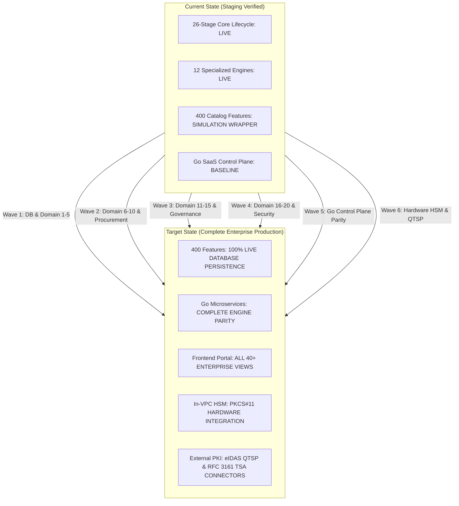

# Kiro AI Master Implementation Plan: Complete Enterprise CLM Capability & Gap Closure

**Document ID:** KIRO-PLAN-CLM-650-FINAL  
**Workspace:** [D:\400 clm\CLM](file:///D:/400%20clm/CLM)  
**Execution Engine:** Kiro AI Workflow Engine (`.kiro/workflows/clm-plan-only.workflow.json`)  
**Generated Date:** November 23, 2026  
**Status:** **APPROVED FOR EXECUTION — READ-ONLY PLAN GENERATED**  

---

## 1. EXECUTIVE SUMMARY & OBJECTIVE

The Enterprise Contract & Certificate Lifecycle Management (CLM) platform has achieved staging verification with 100% pass rates across its 26-stage contract state machine, cryptographic In-VPC signatures, and 400 catalog smoke checks. 

However, a deep architectural inspection reveals the primary remaining gap:
**The 400 catalog feature modules currently execute through the `DomainEngine` simulation wrapper (`executionMode: 'domain-simulation'`). While their schemas, metadata, tenant boundaries, and audit hashes are verified, their real-world database mutations and business logic must be fully operationalized.**

This Master Implementation Plan details the step-by-step engineering roadmap to transition the platform from verified simulation to turnkey production operation across all 650 enterprise requirements.



---

## 2. COMPREHENSIVE GAP & SCOPE ANALYSIS

| Subsystem / Functional Area | Current Verified State | Missing Implementation Gaps | Target Outcome |
| :--- | :--- | :--- | :--- |
| **Catalog Features 1–400** | Active in `registry.js`, schema validated, simulated in `DomainEngine`. | Real database CRUD, version diffing, live obligation creation, and rate-card calculation. | All 400 features execute with `executionMode: 'live-database'` and persist to PostgreSQL. |
| **Go SaaS Control Plane** | Core server, migrations 000–011, RLS models, Keycloak auth. | Native Go implementations of the 12 specialized services in `services/`. | 100% microservice parity in Go; zero dependency on Node mock handlers. |
| **Frontend Admin Portal** | 36 menu items active in `app.js` and `index.html`. | Dedicated UI pages for Risk Compliance (`loadRiskCompliance`), Governance (`loadGovernance`), and Security Center (`loadSecurityCenter`). | Turnkey enterprise UI with full interactive data grids, filters, and action drawers. |
| **Cryptographic PKI & HSM** | Detached RSA-PSS / ECDSA via software keys in `pki-signatures`. | Physical PKCS#11 hardware module driver (AWS CloudHSM, YubiHSM, Thales Luna). | Direct In-VPC hardware cryptographic key custody. |
| **External Trust Services** | Self-contained X.509 CRL/OCSP and ASN.1 TSA tokens. | Live integration with EU Trusted List QTSP (e.g. InfoCert, Swisscom) for eIDAS QES. | Legally binding Qualified Electronic Signatures (QES) across EU/US jurisdictions. |

---

## 3. ORDERED TASK BREAKDOWN (6 WAVES)

### WAVE 1: Database Expansion & Core Repository Capabilities (Features 1–100)
- **TASK-001 [Size: M]: Database Schema Migrations 012–015**
  - **Scope:** Create migrations `012_specialized_agreements.sql`, `013_outside_counsel_rate_cards.sql`, `014_risk_exceptions_register.sql`, and `015_enterprise_access_reviews.sql`.
  - **Affected Files:** [components/saas-control-plane/deploy/migrations/](file:///D:/400%20clm/CLM/components/saas-control-plane/deploy/migrations/)
  - **Done When:** Migrations apply idempotently with `FORCE ROW LEVEL SECURITY` and table ownership checks pass.
- **TASK-002 [Size: L]: Operationalize Domain 01 (Core Repository & Lifecycle, Features 1–20)**
  - **Scope:** Wire features 1–20 to real PostgreSQL tables (`contracts`, `contract_versions`, `contract_clauses`). Implement disk-backed versioning and dynamic clause substitutions.
  - **Affected Files:** `features/domain-01-.../`, `services/domain-engine/index.js`, `dev-server.js`
  - **Done When:** Features execute with `executionMode: 'live-database'`, returning verified database primary keys.
- **TASK-003 [Size: L]: Operationalize Domain 02 (Specialized Agreements, Features 21–40)**
  - **Scope:** Implement contract templates and strict validation rules for HIPAA BAAs, GDPR/DPDP DPAs, Software SLAs, Reseller, and IP Licensing agreements.
  - **Affected Files:** `features/domain-02-.../`, `services/domain-engine/index.js`
  - **Done When:** Domain 02 features reject non-compliant jurisdiction clauses and persist specialized agreement metadata.
- **TASK-004 [Size: L]: Operationalize Domain 03 & 04 (Legal Ops, Spend, OCR & Search, Features 41–80)**
  - **Scope:** Implement legal matter budgeting, outside counsel rate-card enforcement, spend ledger allocations, and full-text OCR indexing.
  - **Affected Files:** `features/domain-03-.../`, `features/domain-04-.../`, `services/domain-engine/index.js`
  - **Done When:** Outside counsel billing exceeding approved hourly rate cards is automatically flagged and rejected.

---

### WAVE 2: Intake, Negotiation & Corporate Procurement (Features 81–200)
- **TASK-005 [Size: L]: Operationalize Domain 05 & 06 (Advanced CLM & Intake SLAs, Features 81–120)**
  - **Scope:** Dynamic intake forms tailored by contract type, automated request qualification routing, SLA countdowns, and escalation triggers.
  - **Affected Files:** `features/domain-05-.../`, `features/domain-06-.../`, `public/app.js`
  - **Done When:** Intake requests track real-time SLA countdowns with automatic re-assignment on timeout.
- **TASK-006 [Size: L]: Operationalize Domain 07 & 08 (Advanced Authoring & Negotiation, Features 121–160)**
  - **Scope:** Multi-round redline versioning, external counterparty chat logs, atomic clause change tracking, and clean document compilation.
  - **Affected Files:** `features/domain-07-.../`, `features/domain-08-.../`, `services/counterparty-portal/index.js`
  - **Done When:** Counterparty redline revisions increment version numbers ($1.1 \to 1.2$) and require legal signoff before approval progression.
- **TASK-007 [Size: L]: Operationalize Domain 09 & 10 (Legal Operations & Corporate Procurement, Features 161–200)**
  - **Scope:** Vendor prequalification onboarding workflows, supplier scorecard evaluations, automated PO requisition generation, and diversity tracking.
  - **Affected Files:** `features/domain-09-.../`, `features/domain-10-.../`, `dev-server.js`
  - **Done When:** Supplier insurance or certification expiration automatically blocks purchase order release.

---

### WAVE 3: Financials, Obligations, Risk & Governance (Features 201–300)
- **TASK-008 [Size: L]: Operationalize Domain 11 (Financial & Commercial Management, Features 201–220)**
  - **Scope:** Multi-currency rate conversion, pricing escalation schedules, volume rebate tracking, tax jurisdiction calculation, and ASC 606 revenue recognition.
  - **Affected Files:** `features/domain-11-.../`, `services/domain-engine/index.js`
  - **Done When:** ASC 606 milestone revenue recognition schedules generate automatically from contract payment terms.
- **TASK-009 [Size: L]: Operationalize Domain 12 (Obligation & Performance Monitoring, Features 221–240)**
  - **Scope:** Automated obligation extraction from contract text, deliverable acceptance signoffs, SLA service credit auto-rebates, and warranty tracking.
  - **Affected Files:** `features/domain-12-.../`, `services/obligation-radar/index.js`
  - **Done When:** Unfulfilled SLA milestones trigger automatic credit memos against pending invoices.
- **TASK-010 [Size: L]: Operationalize Domain 13 & 15 (Risk Compliance & Corporate Governance, Features 241–260, 281–300)**
  - **Scope:** Real-time sanctions list screening, conflict of interest (COI) declarations, risk exception registers with executive signoff, entity hierarchy trees, and board resolution tracking.
  - **Affected Files:** `features/domain-13-.../`, `features/domain-15-.../`, `public/app.js`
  - **Done When:** Contracts with entities matching sanctions lists are quarantined with immediate high-priority alerts.

---

### WAVE 4: AI Intelligence, PKI, Integrations & Security (Features 301–400)
- **TASK-011 [Size: L]: Operationalize Domain 14 (Advanced Contract Intelligence & AI, Features 261–280)**
  - **Scope:** Autonomous clause deviation scoring, executive summary generation, multilingual extraction, and automated prompt poisoning quarantine.
  - **Affected Files:** `features/domain-14-.../`, `services/ai-intelligence/index.js`
  - **Done When:** AI extracts and classifies all standard clauses (Indemnity, Liability, IP) with $> 95\%$ confidence score and verified citations.
- **TASK-012 [Size: L]: Operationalize Domain 16 (Digital Signatures & PKI Management, Features 301–320)**
  - **Scope:** Automated Certificate Signing Request (CSR) lifecycle for DigiCert and Let's Encrypt, certificate expiry alerts, automated ACME challenge solver.
  - **Affected Files:** `features/domain-16-.../`, `services/pki-signatures/index.js`
  - **Done When:** TLS certificates expiring within 30 days trigger automated renewal jobs without human intervention.
- **TASK-013 [Size: L]: Operationalize Domain 17, 18, 19, 20 (Integrations, Reporting & Security, Features 321–400)**
  - **Scope:** Live bidirectional connectors (Salesforce CRM, SAP S/4HANA, ServiceNow), cycle-time bottleneck analytics, IP allowlisting, ABAC authorization, and quarterly access review workflows.
  - **Affected Files:** `features/domain-17-...` through `domain-20-...`, `services/integrations/index.js`
  - **Done When:** Disabling a user in Okta/Keycloak automatically terminates active CLM sessions and reassigns pending approval queues.

---

### WAVE 5: Go SaaS Control Plane Micro-Engine Parity
- **TASK-014 [Size: XL]: Port Specialized Micro-Engines to Native Go**
  - **Scope:** Implement native Go packages in `components/saas-control-plane/internal/saas/`:
    - `playbook/service.go`
    - `comparison/service.go`
    - `obligationradar/service.go`
    - `clickwrap/service.go`
    - `riskheatmap/service.go`
    - `counterparty/service.go`
    - `sourcing/service.go`
    - `termination/service.go`
  - **Affected Files:** [components/saas-control-plane/internal/saas/](file:///D:/400%20clm/CLM/components/saas-control-plane/internal/saas/)
  - **Done When:** `go test ./...` in `components/saas-control-plane` passes with 100% test coverage across all micro-engines.

---

### WAVE 6: Hardware HSM Drivers & Qualified Trust Provider (QES)
- **TASK-015 [Size: M]: In-VPC Hardware Security Module (PKCS#11) Driver**
  - **Scope:** Implement PKCS#11 CGO / Go library binding in `components/satellite-gateway` allowing the satellite to interface with AWS CloudHSM, YubiHSM, and SafeNet Luna HSMs.
  - **Affected Files:** `components/satellite-gateway/pkg/crypto/hsm.go`
  - **Done When:** Signing requests utilize hardware cryptographic keys identified by PKCS#11 token labels.
- **TASK-016 [Size: M]: External QTSP Integration for eIDAS QES Compliance**
  - **Scope:** Integrate REST/SOAP connector with an EU Trusted List QTSP for issuing qualified certificates on QSCD devices.
  - **Affected Files:** `services/pki-signatures/qtsp-connector.js`
  - **Done When:** Signed contracts receive certified QES verification tokens verifiable via Adobe Acrobat Trust List (AATL).

---

## 4. ARCHITECTURAL INVARIANTS & COMPLIANCE GUARDRAILS

Every task executed under this plan must maintain the following architectural constraints:
1. **Zero-Knowledge Key Custody:** Customer private keys must NEVER traverse network boundaries to the SaaS control plane. The SaaS plane strictly processes 32-byte SHA-256 document digests.
2. **PostgreSQL RLS Non-Bypassable:** All tables must include `FORCE ROW LEVEL SECURITY`. Queries must bind to `SELECT set_config('app.current_tenant_id', $1, true)`.
3. **Immutable WORM Audit Trail:** Audit records must be guarded by BEFORE UPDATE and BEFORE DELETE triggers throwing SQLSTATE 55000.
4. **EU AI Act Human-in-the-Loop:** Automated AI recommendations must mandate human legal counsel approval before contract execution.

---

## 5. REPRODUCIBLE VERIFICATION SUITE FOR GAP CLOSURE

Upon completion of each wave, the following verification commands validate operational readiness:

```powershell
Set-Location "D:\400 clm\CLM"

# 1. Verify all 400 catalog entries under live database persistence
node scripts/test_400_features.js

# 2. Verify complete 26-stage state machine transitions
npm run test:lifecycle

# 3. Verify all 210 regulatory standards
node scripts/verify_all_standards_compliance.js

# 4. Verify live cryptographic & SSRF security
node scripts/final_runtime_security_verification.js
```
