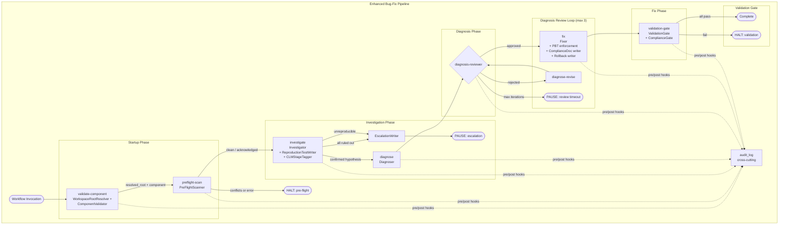
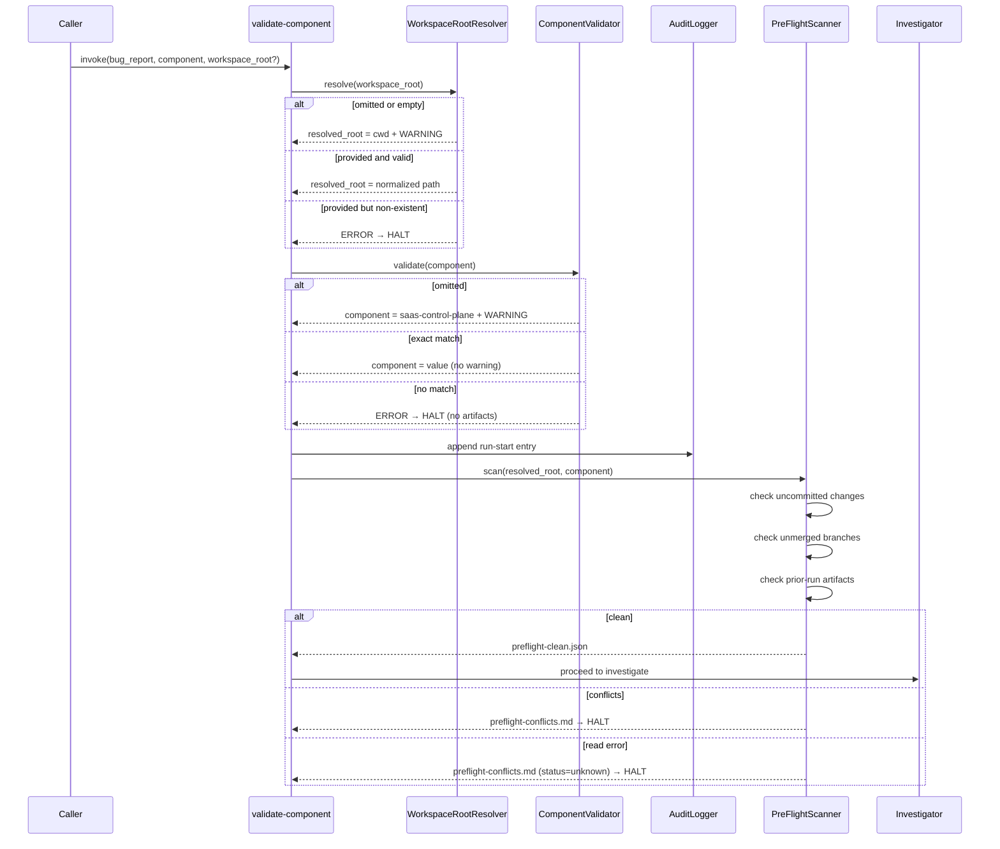
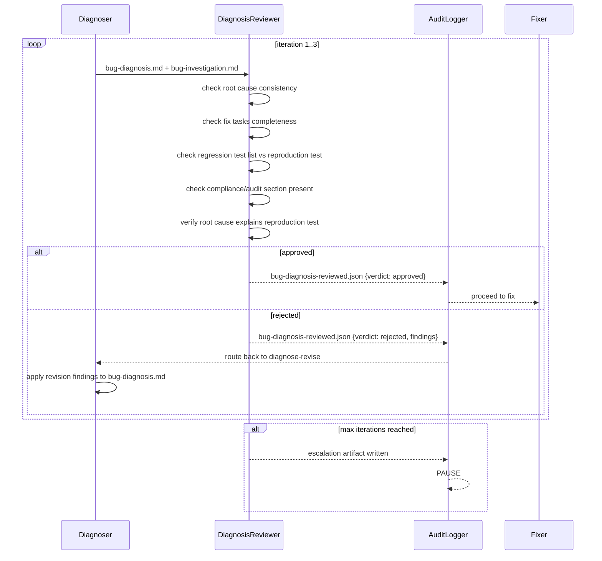

# Design Document: Structured Bug-Fix Workflow Improvement

## Overview

This document specifies the technical design for enhancing the CLM Structured Bug-Fix workflow (`clm-bugfix.workflow.json`). The current workflow is a three-step pipeline — investigate → diagnose → fix — with hardcoded absolute paths, no input validation, no pre-flight conflict detection, no failing reproduction test requirement, no diagnosis review gate, no property-based test enforcement, no compliance gating, no rollback documentation, and no audit logging.

The enhancement addresses all fifteen requirements across the bug-fix lifecycle by introducing eight new or upgraded pipeline components and restructuring the pipeline into a nine-step flow with a bounded review loop and a final validation gate. The design reuses the conventions already established by the sibling `clm-feature-dev.workflow.json` — the `{{resolved_root}}` template variable, the `validate-component` startup step, the `audit_log` cross-cutting concern, the `repeat` loop with `fileCheck` stop conditions, and the PBT enforcement annotation format — so that both workflows share a consistent operational model.

The enhanced pipeline:

```
validate-component → preflight-scan → investigate → diagnose → diagnosis-review-loop (max 3) → fix → validation-gate
```

All artifact paths are derived from a single `workspace_root` input, making the workflow portable across developer machines and CI environments. The workflow remains backward-compatible: existing invocations that omit the new optional `workspace_root` input continue to function with documented defaults and non-blocking warnings.

### Design Principles

1. **Convention reuse over invention** — Mirror the structure, audit schema, validation patterns, and PBT annotation format already proven in `clm-feature-dev.workflow.json` rather than introducing parallel mechanisms.
2. **Fail fast, fail loud** — Invalid inputs (bad component, unresolvable root, conflicting in-progress work) halt the pipeline before any investigation work begins.
3. **Reproducibility before diagnosis** — A failing reproduction test is required before the diagnose step proceeds, grounding root cause analysis in a concrete failure rather than hypothesis alone.
4. **Review before mutation** — A diagnosis review gate catches incorrect root cause identifications before code is changed.
5. **Tamper-evident by default** — Every run produces an append-only audit log entry with a SHA-256 integrity hash, regardless of outcome.
6. **Backward compatibility** — No existing input field is removed or renamed; no existing artifact filename changes; omissions produce warnings, not errors.

---

## Architecture

### High-Level Component Diagram



The `audit_log` concern is not a separate step — it runs as pre/post hooks around every step, recording step boundaries, outcomes, and artifact paths into the append-only `workflow-audit-log.json` file. This mirrors the pattern from `clm-feature-dev.workflow.json`.

### Startup Flow Sequence



### Diagnosis Review Loop Sequence



### Design Decisions and Rationale

| Decision | Rationale |
|----------|-----------|
| Merge `WorkspaceRootResolver` and `ComponentValidator` into a single `validate-component` step | Both checks must pass before any pipeline step; combining them into one step mirrors the feature-dev workflow and avoids a two-step startup with an intermediate artifact that adds no value. |
| Pre-flight scan as a separate step, not inline in investigate | The scan has a distinct contract (read-only, halt-on-conflict) and produces its own artifacts (`preflight-clean.json` / `preflight-conflicts.md`). Keeping it separate makes the boundary between "is it safe to start?" and "what is the bug?" explicit. |
| Reproduction test enforced as a gate condition, not a separate step | The reproduction test is written by the Investigator as part of the investigation — it is the investigation's deliverable. A separate step would require the Investigator's findings as input and would duplicate the agent's code-reading work. |
| Diagnosis review as a `repeat` loop, not a single gate | Incorrect root cause identifications are common; a bounded revision loop (max 3) gives the Diagnoser a chance to correct while preventing infinite cycling. This mirrors the `design-review-loop` and `implement-review-loop` patterns in the feature-dev workflow. |
| Validation gate as the final step, not inline in fix | The validation gate checks multiple independent conditions (reproduction test passes, regression tests exist, compliance addressed, make test/lint pass). Keeping it as a dedicated step with its own pass/fail artifacts makes the gate's outcome auditable and replayable. |
| Audit logging as a cross-cutting concern, not a step | The audit log must record every step's boundaries and outcomes. Modeling it as pre/post hooks around every step (as in the feature-dev workflow) is simpler and more reliable than a discrete step that would need to know what just happened. |
| SHA-256 hash over JSON with hash field empty | This deterministic computation enables independent re-verification: a reviewer recomputes the hash and compares it to the stored value to detect tampering. |

---

## Components and Interfaces

### 1. WorkspaceRootResolver

**Responsibility:** Accept the `workspace_root` input, normalize it, validate that it resolves to an existing directory, and expose the resolved absolute path as the `{{resolved_root}}` template variable available to all downstream steps.

**Interface:**

```
resolve(workspaceRoot: string | undefined) → 
  | { status: "ok", resolvedRoot: string }
  | { status: "warning", resolvedRoot: string, message: string }   // omitted → cwd
  | { status: "error", message: string }                           // non-existent path
```

**Inputs:** The `workspace_root` workflow input (optional string, 1–4096 chars when provided).

**Outputs:** `resolved_root` — the normalized absolute path, available as a template variable to all subsequent steps.

**Normalization rules:**
- Trim all trailing path separators (`\` and `/`) from the right until none remain.
- After trimming, verify the resulting path resolves to an existing directory.
- If omitted or empty: default to the current working directory and emit a WARNING.
- If provided but non-existent: HALT with an ERROR before any step executes.

### 2. ComponentValidator

**Responsibility:** Validate the `component` input against an explicit allowlist before any investigation work begins.

**Interface:**

```
validate(component: string | undefined) →
  | { status: "ok", component: string }                            // exact match
  | { status: "warning", component: "saas-control-plane", message: string }  // omitted
  | { status: "error", message: string }                           // no match
```

**Allowlist:** `["saas-control-plane", "satellite-gateway", "vsatellite", "shared"]`

**Matching:** Case-sensitive, no leading or trailing whitespace. No normalization or trimming is applied to the input before matching — an exact byte-for-byte comparison is required.

### 3. PreFlightScanner

**Responsibility:** Execute a read-only scan of the target component's directory and the workflow artifact output directory to detect conflicting in-progress work before the investigate step runs.

**Interface:**

```
scan(resolvedRoot: string, component: string) →
  | { status: "clean", conflicts: [] }                    // → write preflight-clean.json
  | { status: "conflict", conflicts: Conflict[] }         // → write preflight-conflicts.md, HALT
  | { status: "unknown", message: string }                 // → write preflight-conflicts.md (status=unknown), HALT
```

**Conflict types:**

| Type | Detection method | Severity |
|------|-----------------|----------|
| `uncommitted-change` | `git status --porcelain` in the component directory | per-file: low (untracked), medium (modified/staged) |
| `unmerged-branch` | `git branch --no-merged <default-branch>` | high |
| `prior-run-artifact` | glob match in artifact output dir for `bug-*.md`, `bug-*.json`, `feature-*.md`, `feature-*.json`, `plan-output.md`, `spec-*.md` | medium |

**Constraints:**
- MUST NOT modify any source files, branches, or artifacts.
- On read error (git command failure or file read failure): write `preflight-conflicts.md` with `{"status": "unknown"}` and HALT.
- If `preflight-acknowledged.json` with `{"acknowledged": true}` exists, skip the conflict-pause and proceed.

### 4. Investigator (Enhanced)

**Responsibility:** Investigate the reported bug in read-only mode, produce `bug-investigation.md`, write a failing Reproduction Test, and tag affected CLM lifecycle stages. The Investigator now has three sub-responsibilities that were absent from the original workflow:

**4a. ReproductionTestWriter**
- Write a test that reproduces the reported bug condition using the target component's existing test framework (the one invoked by `make test`).
- The test must assert the expected correct behavior and fail when run against the unfixed codebase.
- Record the test file path (relative to `workspace_root`) and the exact execution command in `bug-investigation.md` under a `## Reproduction Test` section.
- If the bug cannot be reproduced after at least two distinct strategies: record each attempt, flag as `unreproducible`, and HALT before the diagnose step.
- If all root cause hypotheses are ruled out: trigger the EscalationWriter before halting.

**4b. CLMStageTagger**
- Include a `## CLM Lifecycle Stage Impact` section in `bug-investigation.md` listing every affected CLM_Stage.
- A stage is affected if the bug's code path reads, writes, creates, modifies, or deletes that stage's data models, APIs, UI components, or business rules.
- Each entry lists the stage by numbered name (e.g., "Stage 11: Approval Workflow") with a ≤20-word impact description.
- If no stage is affected: include an explicit "No CLM Stage Impact" entry.
- Annotate Approval Workflow (stage 11) or Electronic Signature (stage 12) entries with `[COMPLIANCE-REQUIRED]`.
- Annotate cryptographic signature, certificate, or X.509 timestamping code entries with `[CRYPTO-IMPACT]`.
- Stage impact must be recorded before the diagnose step begins.

**4c. Investigation Gate Output**
- The workflow SHALL NOT proceed to the diagnose step unless `bug-investigation.md` contains either a `## Reproduction Test` section with a file path or an `unreproducible` flag. The absence of both halts the pipeline with an error.

### 5. Diagnoser

**Responsibility:** Read the investigation report, confirm the single root cause, and write a fix plan to `bug-diagnosis.md`. This is the existing diagnose step with no structural change — its output is consumed by the new DiagnosisReviewer.

**Interface:** Reads `bug-investigation.md`; writes `bug-diagnosis.md` containing: Confirmed Root Cause, Fix Approach, Fix Tasks, Regression Risk, Compliance/Audit Impact, Test Cases to Add.

### 6. DiagnosisReviewer (New)

**Responsibility:** Inspect `bug-diagnosis.md` for correctness before the fix step begins, catching incorrect root cause identifications.

**Interface:**

```
review(diagnosisPath: string, investigationPath: string) →
  | { reviewed: true, verdict: "approved", findings: [] }                // → bug-diagnosis-reviewed.json
  | { reviewed: true, verdict: "rejected", findings: Finding[] }        // → bug-diagnosis-reviewed.json, route to revise
```

**Checks performed:**
1. Internal consistency between confirmed root cause and fix tasks.
2. Completeness of the fix task list relative to the confirmed root cause.
3. Correctness of the regression test case list relative to the reproduction test.
4. Presence of the compliance/audit impact section.
5. Root cause consistency with the reproduction test — if the root cause does not explain the reproduction test failure, flag as blocking.

**Constraints:**
- SHALL NOT modify `bug-diagnosis.md` — the diagnose step is solely responsible for applying revisions.
- The review loop iterates up to 3 times. On the 3rd rejection, write an escalation artifact and transition to a paused state.

### 7. Fixer (Enhanced)

**Responsibility:** Read the reviewed diagnosis, apply the fix, add regression and property-based tests, write compliance documentation when required, and write the bug-fix summary including a rollback section. The Fixer has three new sub-responsibilities:

**7a. PBT Enforcer**
- For any function or method introduced or modified whose primary logic consists of sorting, filtering, parsing, serialization, cryptographic transformation, state-machine transition, or data aggregation over a collection: write at least one Property-Based Test.
- Annotate each PBT with a structured inline comment naming the property type (invariant, round-trip, idempotence, metamorphic, error condition).
- For parsers/serializers: write a round-trip property test asserting `parse(format(x)) == x` with ≥50 generated inputs.
- Use a PBT library that auto-generates inputs (Go: `pgregory.net/rapid` or `github.com/leanovate/gopter`).
- If a modified function interacts only with external services and contains none of the qualifying operations: substitute an integration test covering one success and one failure path.
- Any diagnosis-specified regression test case corresponding to an algorithmic operation SHALL be implemented as a PBT, not a fixed example test.

**7b. ComplianceDoc Writer**
- When `bug-investigation.md` contains one or more `[COMPLIANCE-REQUIRED]` markers: add a compliance documentation task to the fix task list before applying any code changes, referencing each affected stage.
- Write a `compliance/` directory file whose filename contains the bug report identifier.
- The Compliance_Doc must contain sections addressing GDPR, PCI-DSS, SOC 2, and HIPAA impact.
- When `[CRYPTO-IMPACT]` is present: `bug-diagnosis.md` must include a cryptographic integrity impact assessment (PKI signature integrity and X.509 timestamping correctness).

**7c. Rollback Writer**
- Write a `## Rollback` section in `bug-fix-summary.md` as a required top-level section.
- Enumerate every file created or modified (path relative to `workspace_root`, with created/modified indicator).
- For migrations: list each migration script and the exact rollback command or down-migration filename.
- For config/manifest changes: specify prior value and fix-introduced value for each changed key.
- Include a numbered, step-ordered procedure (1–20 steps, one discrete action per step).
- Annotate downtime steps with `[DOWNTIME]` and data-destroying steps with `[DATA-LOSS-RISK]`.
- If no files were modified, no migrations, no config changes: single step "No rollback actions required."

### 8. ValidationGate (Extended)

**Responsibility:** Run the final validation gate after the Fixer completes, verifying that all required conditions hold before the run is reported as successful.

**Checks performed (all must pass):**

| # | Check | On failure |
|---|-------|-----------|
| 1 | Reproduction test passes against fixed codebase (skip if `unreproducible`) | Fail gate, include test output |
| 2 | Every diagnosis-listed regression test case has a corresponding test file | Fail gate, list missing cases |
| 3 | Compliance/audit impact from diagnosis is addressed by the fix (if non-empty) | Fail gate, describe unaddressed impact |
| 4 | `make test` exits zero (always runs regardless of other check results) | Fail gate, include full output |
| 5 | `make lint` exits zero (always runs regardless of other check results) | Fail gate, include full output |
| 6 | Compliance_Doc exists with all four sections when `[COMPLIANCE-REQUIRED]` present | Fail gate, list missing sections |
| 7 | Crypto integrity assessment present in diagnosis when `[CRYPTO-IMPACT]` present | Fail gate |

**Outputs:**
- All pass → `bugfix-validation-passed.json` (timestamp, checks with "pass", bug report ID)
- Any fail → `bugfix-validation-failed.json` (timestamp, all checks with pass/fail, failure details, bug report ID)

**Unreproducible handling:** When `bug-investigation.md` flags the bug as `unreproducible`, skip check #1 and instead verify that at least two attempted reproduction strategies are documented.

### 9. AuditLogger

**Responsibility:** Maintain a tamper-evident, append-only audit log of every workflow run. Runs as a cross-cutting concern (pre/post hooks around every step), not as a discrete pipeline step.

**Log file:** `{{resolved_root}}/.agents/tasks/workflow-audit-log.json`

**Append-only semantics:** Each run is a new JSON object appended to the top-level array. Prior run records are never overwritten or truncated.

**SHA-256 integrity hash:** Computed over the JSON-serialized run entry with the `hash` field set to `""` (empty string). The resulting digest is written into the `hash` field as `"sha256:<hex>"`. This enables deterministic re-computation for integrity verification.

**Secret exclusion:** Any input whose name ends in `_secret`, `_token`, `_password`, or `_key`, or is marked `"secret": true` is omitted. Only `bug_report`, `workspace_root`, and `component` are recorded.

**Flush-on-halt:** Before any HALT or PAUSE, flush the partial audit log capturing all steps executed up to and including the failing or pausing step.

**Write-failure handling:** If the audit log file cannot be written due to a filesystem error, surface `ERROR: Audit logging failed: <reason>` and do NOT report the run as successfully completed.

---

## Data Models

### ReproductionTestRecord

Embedded in `bug-investigation.md` under the `## Reproduction Test` section. Records the reproduction test metadata for downstream consumption by the ValidationGate.

```json
{
  "reproduction_test": {
    "file_path": "components/saas-control-plane/internal/store/contract_repo_test.go",
    "test_function": "TestContractRepoInsertBlastRadius",
    "command": "make test",
    "pre_fix_status": "failed",
    "failure_output": "expected error 'tenant boundary violated', got nil",
    "strategies_attempted": [
      {
        "strategy": "direct API call reproduction",
        "result": "failed - assertion error: expected tenant isolation error"
      },
      {
        "strategy": "database state inspection",
        "result": "confirmed cross-tenant data leak"
      }
    ],
    "unreproducible": false,
    "confirmed_hypothesis": "ContractRepo.Insert skips tenant_id column in INSERT statement"
  }
}
```

| Field | Type | Description |
|-------|------|-------------|
| `file_path` | string | Path relative to `workspace_root` |
| `test_function` | string | Fully qualified test function name |
| `command` | string | Exact command to execute the test |
| `pre_fix_status` | enum: `failed` \| `not_attempted` | Status before fix was applied |
| `failure_output` | string \| null | Actual failure output recorded during investigation |
| `strategies_attempted` | array | Each attempted reproduction strategy and its result |
| `unreproducible` | boolean | True if bug could not be reproduced after ≥2 strategies |
| `confirmed_hypothesis` | string \| null | The confirmed root cause hypothesis, if any |

### DiagnosisReviewVerdict

Written to `bug-diagnosis-reviewed.json` by the DiagnosisReviewer.

```json
{
  "reviewed": true,
  "verdict": "approved",
  "findings": [],
  "iteration": 2,
  "reviewed_at": "2024-01-15T10:30:00Z"
}
```

Rejected variant:

```json
{
  "reviewed": true,
  "verdict": "rejected",
  "findings": [
    {
      "severity": "blocking",
      "description": "Root cause does not explain reproduction test failure: test expects tenant_id enforcement but root cause describes a timestamp formatting bug",
      "section": "Confirmed Root Cause",
      "line": 12
    },
    {
      "severity": "advisory",
      "description": "Fix task list missing test for the error path when tenant_id is empty",
      "section": "Fix Tasks",
      "line": 34
    }
  ],
  "iteration": 1,
  "reviewed_at": "2024-01-15T10:25:00Z"
}
```

| Field | Type | Description |
|-------|------|-------------|
| `reviewed` | boolean | Always `true` — the review was performed |
| `verdict` | enum: `approved` \| `rejected` | Whether the fix may proceed |
| `findings` | Finding[] | List of issues found; empty when approved |
| `iteration` | integer | Which review iteration (1–3) produced this verdict |
| `reviewed_at` | string (ISO-8601) | Timestamp of the review |

**Finding sub-model:**

| Field | Type | Description |
|-------|------|-------------|
| `severity` | enum: `blocking` \| `advisory` | Blocking findings prevent fix; advisory findings are warnings |
| `description` | string | What the issue is |
| `section` | string | Section heading in `bug-diagnosis.md` |
| `line` | integer | Line number in `bug-diagnosis.md` |

### EscalationArtifact

Written to `investigation-escalation-{ISO-8601-timestamp}.md` when the investigation cannot confirm a root cause.

```json
{
  "escalation": {
    "bug_report_summary": "Cross-tenant contract data leak in Approval Workflow stage",
    "hypotheses": [
      {
        "hypothesis": "Missing tenant_id in INSERT statement",
        "status": "ruled_out",
        "reason": "INSERT statement includes tenant_id; verified via code read"
      },
      {
        "hypothesis": "ORM mapping skips tenant_id column",
        "status": "ruled_out",
        "reason": "ORM struct tag confirmed present and correct"
      },
      {
        "hypothesis": "Query-time tenant filter bypass",
        "status": "ruled_out",
        "reason": "Filter present in all query paths traced"
      }
    ],
    "reproduction_test_status": "reproduced",
    "clm_stages_examined": ["Stage 11: Approval Workflow", "Stage 15: Repository"],
    "recommended_next_action": "escalate-to-domain-expert",
    "written_at": "2024-01-15T10:45:00Z"
  }
}
```

| Field | Type | Description |
|-------|------|-------------|
| `bug_report_summary` | string | Restated bug summary |
| `hypotheses` | array | Complete list with ruled-out status and reason for each |
| `reproduction_test_status` | enum: `reproduced` \| `unreproducible` \| `not_attempted` | |
| `clm_stages_examined` | string[] | Stages examined during investigation |
| `recommended_next_action` | enum: `manual-investigation` \| `gather-more-logs` \| `escalate-to-domain-expert` \| `abandon` | |
| `written_at` | string (ISO-8601) | Timestamp of escalation |

**Append behavior:** If a prior escalation file exists at the computed filename from a prior run, the new escalation content is appended below a `---` horizontal rule separator rather than overwriting.

### AuditLogEntry

The run entry appended to the top-level array in `workflow-audit-log.json`.

```json
{
  "run_id": "550e8400-e29b-41d4-a716-446655440000",
  "run_start": "2024-01-15T10:00:00Z",
  "run_end": "2024-01-15T10:35:00Z",
  "workspace_root": "/home/runner/work/CLM",
  "component": "saas-control-plane",
  "bug_report_id": "CLM-2024-001",
  "steps": [
    {
      "step_id": "validate-component",
      "step_start": "2024-01-15T10:00:00Z",
      "step_end": "2024-01-15T10:00:02Z",
      "outcome": "success"
    },
    {
      "step_id": "preflight-scan",
      "step_start": "2024-01-15T10:00:02Z",
      "step_end": "2024-01-15T10:00:10Z",
      "outcome": "success"
    },
    {
      "step_id": "investigate",
      "step_start": "2024-01-15T10:00:10Z",
      "step_end": "2024-01-15T10:15:00Z",
      "outcome": "success",
      "reproduction_test_outcome": "failed-before-fix"
    },
    {
      "step_id": "diagnose",
      "step_start": "2024-01-15T10:15:00Z",
      "step_end": "2024-01-15T10:20:00Z",
      "outcome": "success"
    },
    {
      "step_id": "diagnosis-reviewer",
      "step_start": "2024-01-15T10:20:00Z",
      "step_end": "2024-01-15T10:22:00Z",
      "outcome": "success",
      "review_verdict": "approved",
      "review_blocking_findings": 0
    },
    {
      "step_id": "fix",
      "step_start": "2024-01-15T10:22:00Z",
      "step_end": "2024-01-15T10:32:00Z",
      "outcome": "success"
    },
    {
      "step_id": "validation-gate",
      "step_start": "2024-01-15T10:32:00Z",
      "step_end": "2024-01-15T10:35:00Z",
      "outcome": "success"
    }
  ],
  "diagnosis_review_iterations": [
    {
      "iteration": 1,
      "verdict": "rejected",
      "blocking_findings": 1
    },
    {
      "iteration": 2,
      "verdict": "approved",
      "blocking_findings": 0
    }
  ],
  "compliance_gating": {
    "required": true,
    "result": "passed",
    "sections_verified": ["GDPR", "PCI-DSS", "SOC 2", "HIPAA"]
  },
  "artifacts_written": [
    "/home/runner/work/CLM/.agents/tasks/bug-investigation.md",
    "/home/runner/work/CLM/.agents/tasks/bug-diagnosis.md",
    "/home/runner/work/CLM/.agents/tasks/bug-diagnosis-reviewed.json",
    "/home/runner/work/CLM/.agents/tasks/bug-fix-summary.md",
    "/home/runner/work/CLM/.agents/tasks/bugfix-validation-passed.json",
    "/home/runner/work/CLM/compliance/CLM-2024-001-compliance.md"
  ],
  "hash": "sha256:a1b2c3d4e5f6..."
}
```

| Field | Type | Description |
|-------|------|-------------|
| `run_id` | string (UUID) | Unique identifier for this run |
| `run_start` | string (ISO-8601) | Run start timestamp |
| `run_end` | string (ISO-8601) | Run end timestamp (set on completion or halt) |
| `workspace_root` | string | Resolved absolute path used for this run |
| `component` | string | Validated component value |
| `bug_report_id` | string | Bug report identifier |
| `steps` | StepEntry[] | Ordered list of steps executed |
| `diagnosis_review_iterations` | ReviewIteration[] | Each diagnosis review iteration with verdict and finding count |
| `compliance_gating` | ComplianceGatingRecord | Compliance gating result and sections verified |
| `artifacts_written` | string[] | Resolved absolute paths of all artifact files written |
| `hash` | string | `"sha256:<hex>"` — SHA-256 of the entry with hash field empty |

**StepEntry sub-model:**

| Field | Type | Description |
|-------|------|-------------|
| `step_id` | string | Step identifier |
| `step_start` | string (ISO-8601) | Step start timestamp |
| `step_end` | string (ISO-8601) | Step end timestamp |
| `outcome` | enum: `success` \| `paused` \| `failed` | Step outcome |
| `reproduction_test_outcome` | enum: `failed-before-fix` \| `passed-before-fix` \| `not-attempted` | Investigate step only |
| `review_verdict` | enum: `approved` \| `rejected` | Diagnosis-reviewer step only |
| `review_blocking_findings` | integer | Diagnosis-reviewer step only |

### ValidationResult

Written to `bugfix-validation-passed.json` or `bugfix-validation-failed.json` by the ValidationGate.

**Passed:**

```json
{
  "timestamp": "2024-01-15T10:35:00Z",
  "bug_report_id": "CLM-2024-001",
  "checks": [
    { "name": "reproduction-test-passes", "result": "pass" },
    { "name": "regression-tests-present", "result": "pass" },
    { "name": "compliance-impact-addressed", "result": "pass" },
    { "name": "make-test", "result": "pass" },
    { "name": "make-lint", "result": "pass" }
  ]
}
```

**Failed:**

```json
{
  "timestamp": "2024-01-15T10:35:00Z",
  "bug_report_id": "CLM-2024-001",
  "checks": [
    { "name": "reproduction-test-passes", "result": "fail", "detail": "test still fails: expected error 'tenant boundary violated', got nil" },
    { "name": "regression-tests-present", "result": "pass" },
    { "name": "compliance-impact-addressed", "result": "fail", "detail": "GDPR impact assessment missing from compliance/CLM-2024-001-compliance.md" },
    { "name": "make-test", "result": "fail", "detail": "1 test failed in package internal/store" },
    { "name": "make-lint", "result": "pass" }
  ]
}
```

| Field | Type | Description |
|-------|------|-------------|
| `timestamp` | string (ISO-8601) | Run timestamp |
| `bug_report_id` | string | Bug report identifier |
| `checks` | CheckResult[] | List of all checks performed with name and result |
| `checks[].detail` | string | Present only when result is `fail` — failure detail |

### ComplianceDoc

Written by the Fixer to `compliance/<bug-report-id>-compliance.md` when `[COMPLIANCE-REQUIRED]` markers are present.

```markdown
# Compliance Impact Assessment — CLM-2024-001

## Bug Summary
Cross-tenant contract data leak in Approval Workflow stage.

## GDPR Impact
[Analysis of how the bug and fix affect GDPR data subject rights,
processing lawfulness, and data minimization principles...]

## PCI-DSS Impact
[Analysis of whether the bug affects cardholder data scope,
access controls, or audit trail requirements...]

## SOC 2 Impact
[Analysis of how the bug and fix affect SOC 2 trust service
criteria: security, availability, processing integrity,
confidentiality, and privacy...]

## HIPAA Impact
[Analysis of whether the bug affects PHI handling,
access controls, or audit controls under HIPAA Security Rule...]

## Cryptographic Integrity Assessment
[Required when CRYPTO-IMPACT marker present — assessment of
whether the fix preserves PKI digital signature integrity and
X.509 timestamping correctness...]
```

### PreflightResult

Written to `preflight-clean.json` (clean) or `preflight-conflicts.md` (conflict/unknown).

**Clean:**

```json
{
  "conflicts": [],
  "status": "clean"
}
```

**Conflict:**

```markdown
# Pre-Flight Conflicts Detected

| Type | Path | Severity |
|------|------|----------|
| uncommitted-change | components/saas-control-plane/internal/store/contract_repo.go | medium |
| unmerged-branch | feature/contract-tenant-isolation | high |
| prior-run-artifact | .agents/tasks/bug-investigation.md | medium |

The pipeline is halted. Acknowledge by creating `preflight-acknowledged.json`
with `{"acknowledged": true}` and re-run.
```

---

## Updated Workflow JSON Structure

The enhanced `clm-bugfix.workflow.json` restructures the pipeline into nine steps with a bounded review loop. The structure mirrors the conventions of `clm-feature-dev.workflow.json`:

```
inputs:
  bug_report: prompt
  component: string
  workspace_root: string           ← NEW optional input

audit_log:                          ← NEW cross-cutting concern
  path, format, append_only, schema, hash_computation, ...

steps:
  1. validate-component             ← NEW (reuses feature-dev pattern)
  2. preflight-scan                  ← NEW
  3. investigate                     ← ENHANCED (reproduction test + stage tagging)
  4. diagnose                        ← existing (unchanged structurally)
  5. repeat diagnosis-review-loop    ← NEW (max 3, stopCondition: fileCheck)
     ├─ diagnosis-reviewer           ← NEW
     └─ diagnose-revise              ← NEW (routes back to reviewer)
  6. fix                             ← ENHANCED (PBT + compliance + rollback)
  7. validation-gate                 ← NEW
```

### Workflow JSON Skeleton

```json
{
  "name": "CLM Structured Bug-Fix",
  "description": "Structured bug resolution for CLM: validate → preflight → investigate (with reproduction test) → diagnose → diagnosis review loop → fix (with PBT + compliance + rollback) → validation gate.",
  "inputs": {
    "bug_report": "prompt",
    "component": "string",
    "workspace_root": "string"
  },
  "audit_log": {
    "path": "{{resolved_root}}/.agents/tasks/workflow-audit-log.json",
    "description": "Cross-cutting audit logging concern...",
    "append_only": true,
    "flush_on_halt_or_pause": "Before any HALT or PAUSE, flush the partial audit log...",
    "schema": { "run_id": "...", "run_start": "...", "steps": [...], "hash": "..." },
    "secret_exclusion": "Any input whose name ends in '_secret', '_token', '_password', '_key'...",
    "hash_computation": "SHA-256 over JSON-serialized run entry with hash field set to empty string...",
    "write_failure_handling": "If the file cannot be written, surface ERROR and do NOT report success.",
    "record_artifact_paths": true,
    "record_diagnosis_review_iterations": true,
    "record_compliance_gating": true
  },
  "steps": [
    {
      "type": "step",
      "id": "validate-component",
      "timeout_ms": 5000,
      "on_timeout": "fail",
      "agent": "wf-component-validator",
      "prompt": "..."
    },
    {
      "type": "step",
      "id": "preflight-scan",
      "timeout_ms": 30000,
      "on_timeout": "fail",
      "agent": "wf-preflight-scanner",
      "prompt": "..."
    },
    {
      "type": "step",
      "id": "investigate",
      "agent": "wf-planner",
      "prompt": "... (enhanced with reproduction test + CLM stage tagging) ..."
    },
    {
      "type": "step",
      "id": "diagnose",
      "agent": "wf-planner",
      "prompt": "... (existing diagnose, unchanged) ..."
    },
    {
      "type": "repeat",
      "id": "diagnosis-review-loop",
      "maxIterations": 3,
      "onMaxIterations": "pause",
      "stopCondition": {
        "fileCheck": {
          "path": "{{resolved_root}}/.agents/tasks/bug-diagnosis-reviewed.json",
          "jsonPath": "verdict",
          "value": "approved"
        }
      },
      "steps": [
        {
          "type": "step",
          "id": "diagnosis-reviewer",
          "agent": "wf-diagnosis-reviewer",
          "prompt": "..."
        },
        {
          "type": "step",
          "id": "diagnose-revise",
          "agent": "wf-planner",
          "prompt": "... read bug-diagnosis-reviewed.json; if rejected, apply findings ..."
        }
      ]
    },
    {
      "type": "step",
      "id": "fix",
      "agent": "wf-coder",
      "prompt": "... (enhanced with PBT + compliance + rollback) ..."
    },
    {
      "type": "step",
      "id": "validation-gate",
      "agent": "wf-coder",
      "prompt": "... (extended validation gate) ..."
    }
  ]
}
```

### Key Structural Changes from the Current Workflow

| Aspect | Current | Enhanced |
|--------|---------|----------|
| Input fields | `bug_report`, `component` | `bug_report`, `component`, `workspace_root` (optional) |
| Step count | 3 | 9 (including 2 in the review loop) |
| Path references | Hardcoded `d:\cmd project\M2P-Git\CLM` | `{{resolved_root}}` template variable |
| Input validation | None | `validate-component` step with allowlist |
| Pre-flight scan | None | `preflight-scan` step |
| Reproduction test | Not required | Required before diagnose; gate-checked |
| CLM stage tagging | Not present | Required in investigation report |
| Diagnosis review | None | `diagnosis-review-loop` (max 3) |
| PBT enforcement | None | Required for algorithmic logic |
| Compliance gating | None | Required for approval/e-signature path bugs |
| Rollback section | None | Required in bug-fix-summary.md |
| Validation gate | `make test` + `make lint` inline | Dedicated step with 7 checks |
| Audit logging | None | Cross-cutting `audit_log` concern |
| Artifact filenames | `bug-investigation.md`, `bug-diagnosis.md`, `bug-fix-summary.md` | Same three + new files (no rename) |

---

## Pseudocode

### ComponentValidator

```pseudo
function validateComponent(component, workspaceRoot):
    # Step 1: Workspace Root Resolution
    if workspaceRoot is omitted or empty:
        logWarning("workspace_root not provided; using current working directory as workspace root")
        resolvedRoot = getCurrentWorkingDirectory()
    else:
        normalized = stripTrailingSeparators(workspaceRoot)  # remove trailing \ and /
        if not directoryExists(normalized):
            logError("workspace_root does not resolve to existing directory: " + normalized)
            flushPartialAuditLog(outcome="failed")
            HALT()
        resolvedRoot = normalized
    
    exposeTemplateVariable("resolved_root", resolvedRoot)
    
    # Step 2: Component Validation
    allowlist = ["saas-control-plane", "satellite-gateway", "vsatellite", "shared"]
    
    if component is omitted or empty:
        logWarning("component not specified; defaulting to saas-control-plane")
        component = "saas-control-plane"
    else if component in allowlist:  # exact, case-sensitive match
        # proceed without warning
        pass
    else:
        logError("Invalid component '" + component + "'. Valid values: " + join(allowlist, ", "))
        flushPartialAuditLog(outcome="failed")
        HALT()  # no artifacts produced
    
    exposeTemplateVariable("component", component)
    
    # Step 3: Initialize audit log
    initAuditLog(resolvedRoot, component, bugReport)
    
    return { resolvedRoot, component }
```

### PreFlightScanner

```pseudo
function preflightScan(resolvedRoot, component):
    componentDir = join(resolvedRoot, "components", component)
    artifactDir = join(resolvedRoot, ".agents", "tasks")
    
    # Check for prior acknowledgement
    ackPath = join(artifactDir, "preflight-acknowledged.json")
    if fileExists(ackPath) and readJson(ackPath).acknowledged == true:
        # Skip conflict-pause, proceed to investigate
        return { status: "acknowledged" }
    
    conflicts = []
    
    # (a) Uncommitted changes
    try:
        statusOutput = runGitCommand("git status --porcelain", componentDir)
        for line in statusOutput.split("\n"):
            if line is empty: continue
            filePath = line[3:]
            severity = "low" if line[0] == "?" else "medium"  # ? = untracked
            conflicts.append(Conflict("uncommitted-change", filePath, severity))
    catch GitError as e:
        writePreflightConflicts(artifactDir, status="unknown", message=e.message)
        HALT()
    
    # (b) Unmerged branches
    try:
        defaultBranch = runGitCommand("git symbolic-ref refs/remotes/origin/HEAD", componentDir)
        branches = runGitCommand("git branch --no-merged " + defaultBranch, componentDir)
        for branch in branches:
            conflicts.append(Conflict("unmerged-branch", branch, "high"))
    catch GitError as e:
        writePreflightConflicts(artifactDir, status="unknown", message=e.message)
        HALT()
    
    # (c) Prior-run artifacts
    patterns = ["bug-*.md", "bug-*.json", "feature-*.md", "feature-*.json", "plan-output.md", "spec-*.md"]
    for pattern in patterns:
        try:
            matchedFiles = glob(join(artifactDir, pattern))
            for file in matchedFiles:
                conflicts.append(Conflict("prior-run-artifact", file, "medium"))
        catch ReadError as e:
            writePreflightConflicts(artifactDir, status="unknown", message=e.message)
            HALT()
    
    # Result
    if len(conflicts) == 0:
        writeJson(join(artifactDir, "preflight-clean.json"), { conflicts: [], status: "clean" })
        return { status: "clean" }
    else:
        writePreflightConflicts(artifactDir, conflicts)
        flushPartialAuditLog(outcome="paused")
        HALT()  # requires explicit human acknowledgement
```

### ReproductionTestWriter

```pseudo
function writeReproductionTest(resolvedRoot, component, bugReport, investigationFindings):
    # Identify the target component's test framework
    # (the one invoked by `make test` — for Go components, this is the standard `testing` package)
    testFramework = detectTestFramework(resolvedRoot, component)
    
    # Attempt at least 2 distinct reproduction strategies
    strategies = []
    reproductionTest = null
    
    for strategy in [strategy1, strategy2, ...]:  # distinct approaches
        result = attemptReproduction(strategy, bugReport, investigationFindings)
        strategies.append({ strategy: strategy.name, result: result.summary })
        
        if result.reproduced:
            reproductionTest = result.testFile
            break
    
    if reproductionTest is null and len(strategies) >= 2:
        # Unreproducible after >= 2 strategies
        recordInInvestigation(strategies, unreproducible=true)
        HALT()  # do not proceed to diagnose
        return
    
    if reproductionTest is null:
        # Not enough strategies attempted yet
        recordInInvestigation(strategies, unreproducible=false)
        HALT()  # reproduction test required error
        return
    
    # Verify the test fails against the unfixed codebase
    testResult = runTest(reproductionTest.command, resolvedRoot, component)
    if testResult.passed:
        # Test passes — does not reproduce the bug
        recordFailure("Reproduction test passes; does not reproduce bug condition")
        HALT()
    
    # Record in bug-investigation.md
    appendToInvestigationReport("## Reproduction Test", {
        file_path: reproductionTest.relativePath,
        command: reproductionTest.command,
        pre_fix_status: "failed",
        failure_output: testResult.output,
        strategies_attempted: strategies,
        unreproducible: false,
        confirmed_hypothesis: investigationFindings.confirmedHypothesis
    })
```

### DiagnosisReviewer

```pseudo
function reviewDiagnosis(diagnosisPath, investigationPath):
    diagnosis = readMarkdown(diagnosisPath)
    investigation = readMarkdown(investigationPath)
    findings = []
    
    # Check (a): Internal consistency between root cause and fix tasks
    rootCause = extractSection(diagnosis, "## Confirmed Root Cause")
    fixTasks = extractSection(diagnosis, "## Fix Tasks")
    if not allTasksAddressRootCause(fixTasks, rootCause):
        findings.append(Finding("blocking",
            "Fix tasks do not fully address the confirmed root cause",
            "Fix Tasks", lineOf(fixTasks)))
    
    # Check (b): Completeness of fix task list
    if not fixTasksCoverAllAffectedFiles(rootCause):
        findings.append(Finding("blocking",
            "Fix task list is missing changes to affected files",
            "Fix Tasks", lineOf(fixTasks)))
    
    # Check (c): Regression test list correctness relative to reproduction test
    reproTest = extractReproductionTest(investigation)
    regressionTests = extractSection(diagnosis, "## Test Cases to Add")
    if not regressionTestsCoverReproduction(regressionTests, reproTest):
        findings.append(Finding("blocking",
            "Regression test list does not include a test for the reproduction condition",
            "Test Cases to Add", lineOf(regressionTests)))
    
    # Check (d): Presence of compliance/audit impact section
    if not hasSection(diagnosis, "## Compliance / Audit Impact"):
        findings.append(Finding("blocking",
            "Compliance / Audit Impact section is missing",
            "Document", 0))
    
    # Check (e): Root cause explains reproduction test failure
    if not rootCauseExplainsFailure(rootCause, reproTest.failure_output):
        findings.append(Finding("blocking",
            "Root cause does not explain reproduction test failure: " + reproTest.failure_output,
            "Confirmed Root Cause", lineOf(rootCause)))
    
    # Verdict
    blockingCount = count(findings, severity="blocking")
    if blockingCount == 0:
        writeJson("bug-diagnosis-reviewed.json",
            { reviewed: true, verdict: "approved", findings: [], iteration: currentIteration })
    else:
        writeJson("bug-diagnosis-reviewed.json",
            { reviewed: true, verdict: "rejected", findings: findings, iteration: currentIteration })
    
    # DO NOT modify bug-diagnosis.md — only the diagnose-revise step applies fixes
```

### EscalationWriter

```pseudo
function writeEscalation(resolvedRoot, investigationPath):
    investigation = readMarkdown(investigationPath)
    
    # Extract hypotheses and check if all are ruled out
    hypotheses = extractHypotheses(investigation)
    allRuledOut = all(h.status == "ruled_out" for h in hypotheses)
    
    if not allRuledOut:
        # At least one confirmed hypothesis → proceed to diagnose, no escalation
        return { escalate: false }
    
    # Build escalation artifact content
    escalation = {
        bug_report_summary: extractBugSummary(investigation),
        hypotheses: [{ hypothesis: h.name, status: h.status, reason: h.reason } for h in hypotheses],
        reproduction_test_status: extractReproductionStatus(investigation),
        clm_stages_examined: extractCLMStages(investigation),
        recommended_next_action: selectNextAction(hypotheses, reproduction_test_status),
        written_at: nowISO8601()
    }
    
    # Compute filename with ISO-8601 timestamp in seconds UTC
    timestamp = formatISO8601SecondsUTC(now())
    filename = "investigation-escalation-" + timestamp + ".md"
    filepath = join(resolvedRoot, ".agents", "tasks", filename)
    
    # Append behavior: if file already exists from prior run, append below ---
    if fileExists(filepath):
        existing = readFile(filepath)
        content = existing + "\n\n---\n\n" + renderEscalation(escalation)
    else:
        content = renderEscalation(escalation)
    
    writeFile(filepath, content)
    
    # Transition to paused state, do not proceed to diagnose
    flushPartialAuditLog(outcome="paused")
    PAUSE()
    
    return { escalate: true }
```

### ValidationGate

```pseudo
function runValidationGate(resolvedRoot, component, investigationPath, diagnosisPath):
    investigation = readMarkdown(investigationPath)
    diagnosis = readMarkdown(diagnosisPath)
    checks = []
    allPass = true
    
    # Check 1: Reproduction test passes (skip if unreproducible)
    unreproducible = investigation.flags.unreproducible
    if unreproducible:
        # Skip check 1; verify >= 2 strategies documented instead
        strategies = extractStrategiesAttempted(investigation)
        if len(strategies) < 2:
            checks.append({ name: "reproduction-strategies-documented", result: "fail",
                detail: "unreproducible flag set but fewer than 2 strategies documented" })
            allPass = false
        else:
            checks.append({ name: "reproduction-strategies-documented", result: "pass" })
    else:
        reproTest = extractReproductionTest(investigation)
        testResult = runTest(reproTest.command, resolvedRoot, component)
        if testResult.passed:
            checks.append({ name: "reproduction-test-passes", result: "pass" })
        else:
            checks.append({ name: "reproduction-test-passes", result: "fail",
                detail: testResult.output })
            allPass = false
    
    # Check 2: All diagnosis-listed regression tests have corresponding files
    regressionCases = extractRegressionTestCases(diagnosis)
    for case in regressionCases:
        if not testFileExists(resolvedRoot, case):
            checks.append({ name: "regression-tests-present", result: "fail",
                detail: "Missing test for: " + case.description })
            allPass = false
            break
    else:
        checks.append({ name: "regression-tests-present", result: "pass" })
    
    # Check 3: Compliance/audit impact addressed (if non-empty in diagnosis)
    complianceImpact = extractComplianceImpact(diagnosis)
    if complianceImpact is not empty:
        if not complianceImpactAddressed(resolvedRoot, complianceImpact):
            checks.append({ name: "compliance-impact-addressed", result: "fail",
                detail: "Unaddressed: " + complianceImpact })
            allPass = false
        else:
            checks.append({ name: "compliance-impact-addressed", result: "pass" })
    
    # Check 4 & 5: make test and make lint (always run both, regardless of failures)
    testResult = runCommand("make test", resolvedRoot)
    lintResult = runCommand("make lint", resolvedRoot)
    
    if testResult.exitCode == 0:
        checks.append({ name: "make-test", result: "pass" })
    else:
        checks.append({ name: "make-test", result: "fail", detail: testResult.output })
        allPass = false
    
    if lintResult.exitCode == 0:
        checks.append({ name: "make-lint", result: "pass" })
    else:
        checks.append({ name: "make-lint", result: "fail", detail: lintResult.output })
        allPass = false
    
    # Compliance gating (checks 6 & 7) — only if markers present
    complianceRequired = hasMarker(investigation, "[COMPLIANCE-REQUIRED]")
    cryptoImpact = hasMarker(investigation, "[CRYPTO-IMPACT]")
    
    if complianceRequired:
        complianceResult = checkComplianceDoc(resolvedRoot, bugReportId)
        if not complianceResult.allSectionsPresent:
            checks.append({ name: "compliance-doc-complete", result: "fail",
                detail: "Missing sections: " + complianceResult.missingSections })
            allPass = false
        else:
            checks.append({ name: "compliance-doc-complete", result: "pass" })
    
    if cryptoImpact:
        if not hasCryptoAssessment(diagnosis):
            checks.append({ name: "crypto-integrity-assessment", result: "fail",
                detail: "Cryptographic integrity assessment missing from diagnosis" })
            allPass = false
        else:
            checks.append({ name: "crypto-integrity-assessment", result: "pass" })
    
    # Write result
    if allPass:
        writeJson("bugfix-validation-passed.json",
            { timestamp: nowISO8601(), bug_report_id: bugReportId, checks: checks })
    else:
        writeJson("bugfix-validation-failed.json",
            { timestamp: nowISO8601(), bug_report_id: bugReportId, checks: checks })
        HALT()
```

### ComplianceGate

```pseudo
function checkComplianceDoc(resolvedRoot, bugReportId):
    complianceDir = join(resolvedRoot, "compliance")
    requiredSections = ["GDPR", "PCI-DSS", "SOC 2", "HIPAA"]
    
    # Find a compliance doc whose filename contains bugReportId (case-insensitive)
    pattern = "*" + toLowerCase(bugReportId) + "*"
    matchedFiles = glob(complianceDir, pattern, caseInsensitive=true)
    
    if len(matchedFiles) == 0:
        return { found: false, allSectionsPresent: false, missingSections: requiredSections }
    
    docContent = readFile(matchedFiles[0])
    missingSections = []
    
    for section in requiredSections:
        # Look for a heading or section marker containing the framework name
        if not containsSection(docContent, section):
            missingSections.append(section)
    
    return {
        found: true,
        allSectionsPresent: len(missingSections) == 0,
        missingSections: missingSections
    }
```

---

## Correctness Properties

*A property is a characteristic or behavior that should hold true across all valid executions of a system — essentially, a formal statement about what the system should do. Properties serve as the bridge between human-readable specifications and machine-verifiable correctness guarantees.*

### Properties Reflection Summary

The prework analysis identified acceptance criteria across 15 requirements. After reflection, redundant and overlapping criteria were consolidated: complementary branches (e.g., "valid input accepted" + "invalid input rejected") were merged into single bidirectional properties; criteria about the same section's format were grouped; and the audit log's append-only invariant (Req 12.3) and no-deletion mechanism (Req 15.3) were combined since they describe the same constraint. Criteria involving AI agent judgment (writing reproduction tests, diagnosing root causes, reviewing consistency) or external side effects (git operations, filesystem I/O) were classified as integration tests, not properties. Performance bounds (Req 14.1–14.3) were classified as integration tests. The following 23 properties represent the unique, non-redundant testable invariants of the workflow.

### Property 1: All Artifact Paths Derived from Workspace Root

*For any* `workspace_root` value resolved by the WorkspaceRootResolver, *every* artifact path, agent prompt path reference, and validation command working directory in the workflow definition SHALL be constructed by joining `resolved_root` with a relative sub-path. No step definition SHALL contain a hardcoded absolute path. The audit log path SHALL be derived from `workspace_root` in the same manner.

**Validates: Requirements 1.2, 1.5, 15.4**

### Property 2: Path Normalization Idempotence

*For any* `workspace_root` string containing one or more trailing path separator characters (`\` or `/`), applying the normalization function (strip all trailing separators) SHALL produce a path with no trailing separators, and applying normalization a second time to the result SHALL produce the same value: `normalize(normalize(x)) == normalize(x)`.

**Validates: Requirements 1.6**

### Property 3: Component and Workspace Root Input Validation

*For any* string exactly matching one of `["saas-control-plane", "satellite-gateway", "vsatellite", "shared"]` (case-sensitive, no leading/trailing whitespace), the ComponentValidator SHALL accept it without warning. *For any* string not matching the allowlist, the ComponentValidator SHALL halt with an error. *For any* `workspace_root` string of 1 to 4096 characters that resolves to an existing directory, the WorkspaceRootResolver SHALL accept it. *For any* `workspace_root` that does not resolve to an existing directory, the resolver SHALL halt.

**Validates: Requirements 1.1, 1.4, 2.2, 2.3**

### Property 4: Pre-Flight Scan Is Read-Only

*For any* workspace state, after the PreFlightScanner completes its scan (clean, conflict, or error), the set of tracked file checksums, the git branch state, and the set of existing workflow artifacts SHALL be unchanged from their pre-scan state. The scanner SHALL NOT create, modify, or delete any file, branch, or artifact.

**Validates: Requirements 3.5**

### Property 5: Pre-Flight Conflict Listing Completeness

*For any* set of detected conflicts (uncommitted changes, unmerged branches, prior-run artifacts), the `preflight-conflicts.md` artifact SHALL list every conflict with its type (`uncommitted-change`, `unmerged-branch`, or `prior-run-artifact`), file path, and severity (`low`, `medium`, or `high`). No detected conflict SHALL be omitted from the listing.

**Validates: Requirements 3.4**

### Property 6: Reproduction Test Gate

*For any* `bug-investigation.md` produced by the investigate step, the workflow SHALL NOT proceed to the diagnose step unless the report contains either a `## Reproduction Test` section with a file path or an `unreproducible` flag. *For any* investigation where the bug cannot be reproduced after at least two distinct strategies, the report SHALL contain the `unreproducible` flag and the pipeline SHALL halt before the diagnose step.

**Validates: Requirements 4.4, 4.5**

### Property 7: CLM Stage Impact Format and Compliance Markers

*For any* `bug-investigation.md` produced by the investigate step, a `## CLM Lifecycle Stage Impact` section SHALL be present. Each stage entry SHALL list the stage by numbered name with an impact description of no more than 20 words. *For any* entry referencing stage 11 (Approval Workflow) or stage 12 (Electronic Signature), the entry SHALL be annotated with a `[COMPLIANCE-REQUIRED]` marker. *For any* entry referencing cryptographic signature, certificate, or X.509 timestamping code, the entry SHALL be annotated with a `[CRYPTO-IMPACT]` marker.

**Validates: Requirements 5.1, 5.2, 5.4, 5.5**

### Property 8: Diagnosis Review Verdict Determined by Blocking Findings

*For any* diagnosis review, the verdict SHALL be `approved` if and only if the set of blocking findings is empty. *For any* diagnosis where the confirmed root cause does not explain the reproduction test failure recorded in `bug-investigation.md`, the reviewer SHALL produce a blocking finding. Advisory findings SHALL NOT change the verdict from approved to rejected.

**Validates: Requirements 6.3, 6.4, 6.6**

### Property 9: Diagnosis Review Loop Bounded at Three Iterations

*For any* diagnosis that is rejected on three consecutive review iterations without an approved verdict, the workflow SHALL write an escalation artifact and transition to a paused state. The review loop SHALL NOT iterate more than three times.

**Validates: Requirements 6.5**

### Property 10: Diagnosis Reviewer Does Not Modify Diagnosis

*For any* diagnosis review operation, the content of `bug-diagnosis.md` SHALL be identical before and after the review. The DiagnosisReviewer SHALL NOT write to or modify `bug-diagnosis.md`; only the diagnose-revise step applies corrections.

**Validates: Requirements 6.7**

### Property 11: Escalation Written If and Only If All Hypotheses Ruled Out

*For any* investigation where all Root_Cause_Hypotheses in `bug-investigation.md` are marked as "ruled out," the Investigator SHALL write an `investigation-escalation-{timestamp}.md` artifact and the pipeline SHALL transition to a paused state. *For any* investigation with at least one hypothesis marked as "confirmed," the workflow SHALL proceed to the diagnose step without writing an escalation artifact.

**Validates: Requirements 7.1, 7.6**

### Property 12: Escalation Content, Filename, and Append Behavior

*For any* escalation artifact written, the content SHALL include the bug report summary, all hypotheses with their ruled-out reasons, the reproduction test status, the CLM stages examined, and a recommended next action. The filename SHALL match the format `investigation-escalation-{ISO-8601-timestamp-seconds-UTC}.md`. *For any* escalation file that already exists at the computed filename from a prior run, the new content SHALL be appended below a `---` separator, preserving the existing content.

**Validates: Requirements 7.2, 7.3, 7.4, 7.5**

### Property 13: Property-Based Tests Required for Algorithmic Functions with Valid Annotations

*For any* function or method introduced or modified by the fix step whose primary logic consists of sorting, filtering, parsing, serialization, cryptographic transformation, state-machine transition, or data aggregation over a collection, at least one property-based test SHALL exist using a library that auto-generates inputs. Each property-based test SHALL have an inline comment immediately preceding it naming the property type as exactly one of: `invariant`, `round-trip`, `idempotence`, `metamorphic`, or `error condition`. *For any* diagnosis-specified regression test case corresponding to an algorithmic operation, the implemented test SHALL be a property-based test, not a fixed example test.

**Validates: Requirements 8.1, 8.2, 8.5, 8.6**

### Property 14: Round-Trip Property for Parsers and Serializers

*For any* parser or serializer introduced or modified by the fix step, a round-trip property test SHALL exist asserting that `parse(format(x)) == x` for a minimum of 50 automatically generated inputs per test run.

**Validates: Requirements 8.3**

### Property 15: Rollback Section Completeness and Well-Formedness

*For any* `bug-fix-summary.md` produced by the fix step, a `## Rollback` section SHALL be present as a top-level section. The section SHALL enumerate every file created or modified by the fix (path relative to `workspace_root`, with created/modified indicator). *For any* migration script introduced, the section SHALL list it with a rollback command or down-migration filename. *For any* configuration key changed, the section SHALL specify both the prior value and the fix-introduced value. The section SHALL include a numbered procedure of 1 to 20 steps, each containing exactly one discrete action.

**Validates: Requirements 9.1, 9.2, 9.3, 9.4, 9.5**

### Property 16: Validation Gate Check Comprehensiveness

*For any* validation gate run, the gate SHALL execute the reproduction test (unless `unreproducible`), verify all diagnosis-listed regression test cases have corresponding test files, verify compliance/audit impact is addressed (if non-empty), and execute both `make test` and `make lint` regardless of other check results. *For any* `unreproducible` investigation, the gate SHALL skip the reproduction test check and verify that at least two reproduction strategies are documented. If any check fails, the gate SHALL fail.

**Validates: Requirements 10.1, 10.2, 10.3, 10.4, 10.7**

### Property 17: Validation Result File Mutual Exclusion

*For any* validation gate run, if all checks pass, `bugfix-validation-passed.json` SHALL be written and `bugfix-validation-failed.json` SHALL NOT be written. If any check fails, `bugfix-validation-failed.json` SHALL be written (containing all checks with pass/fail results and failure details) and `bugfix-validation-passed.json` SHALL NOT be written. The two files are mutually exclusive.

**Validates: Requirements 10.5, 10.6**

### Property 18: Compliance Gating Active If and Only If Markers Present

*For any* investigation containing a `[COMPLIANCE-REQUIRED]` marker, the validation gate SHALL verify a Compliance_Doc file exists in the `compliance/` directory with the bug report identifier in its filename, and SHALL verify the doc contains GDPR, PCI-DSS, SOC 2, and HIPAA impact sections. *For any* investigation containing a `[CRYPTO-IMPACT]` marker, the gate SHALL verify `bug-diagnosis.md` includes a cryptographic integrity impact assessment. *For any* investigation containing no `[COMPLIANCE-REQUIRED]` or `[CRYPTO-IMPACT]` markers, the gate SHALL skip all compliance checks and SHALL NOT fail for missing compliance documentation.

**Validates: Requirements 11.1, 11.2, 11.3, 11.4**

### Property 19: Audit Log Append-Only Invariant

*For any* new run appended to `workflow-audit-log.json`, all prior run records in the top-level array SHALL be preserved without modification. The array length SHALL increase by exactly one. No mechanism in the workflow SHALL delete or modify an existing record; any operation that attempts to overwrite or remove an existing record SHALL fail.

**Validates: Requirements 12.3, 15.3**

### Property 20: Audit Log Hash Tamper-Evidence via Canonical Computation

*For any* audit log entry, the SHA-256 integrity hash SHALL be computed over the canonical JSON serialization of the entry's content (all fields except the hash field itself) with keys sorted alphabetically and no insignificant whitespace. *For any* stored audit log record, when a verifier recomputes the hash over the same content and compares it to the stored hash field, the two values SHALL be identical. If they differ, the record SHALL be reported as tampered.

**Validates: Requirements 12.1, 15.1, 15.2**

### Property 21: Audit Log Run Metadata Completeness

*For any* audit log entry, the entry SHALL record: run_id, run_start, run_end, workspace_root, component, bug_report_id, the ordered list of steps executed (each with step_id, step_start, step_end, outcome), resolved absolute paths of all artifacts written, diagnosis review iterations (each with verdict and blocking finding count), compliance gating result and sections verified, reproduction test outcome (as part of the investigate step entry), and the workflow definition version. *For any* run that fails or pauses, the audit log SHALL be finalized with all steps executed up to and including the failing or pausing step before the pipeline halts.

**Validates: Requirements 12.2, 12.4, 12.5, 12.6, 12.8, 15.6**

### Property 22: Backward Compatibility Invariant

*For any* workflow invocation that was valid before this enhancement (providing only `bug_report` and `component`), the workflow SHALL execute without producing a non-zero exit code due to missing new inputs. The `workspace_root` input SHALL be optional with a default of the current working directory. The three existing artifact filenames (`bug-investigation.md`, `bug-diagnosis.md`, `bug-fix-summary.md`) SHALL be unchanged, and no new artifact SHALL use a filename identical to any of these three.

**Validates: Requirements 13.1, 13.3, 13.4**

### Property 23: Pre-Flight Scan Scoping for Large Workspaces

*For any* workspace with 10,001 or more tracked files, the PreFlightScanner SHALL limit its scan to files within the target component's directory subtree. The scoping SHALL be verifiable independently of elapsed scan time — the set of files inspected SHALL be a subset of the component directory subtree, regardless of whether a full-workspace scan would have completed within the time bound.

**Validates: Requirements 14.4**

---

## Error Handling

### Error Handling Matrix

| # | Failure Mode | Component | Behavior | Artifact | Pipeline Effect | Reversible? |
|---|-------------|-----------|----------|----------|----------------|-------------|
| 1 | `workspace_root` omitted | WorkspaceRootResolver | Default to cwd, emit WARNING | Audit log entry | Proceeds | Yes (provide input next time) |
| 2 | `workspace_root` non-existent path | WorkspaceRootResolver | HALT with ERROR before any step | Partial audit log (failed) | Halts | Yes (fix path, re-run) |
| 3 | `workspace_root` has trailing separators | WorkspaceRootResolver | Normalize (strip separators), proceed | Audit log entry | Proceeds | N/A |
| 4 | `component` omitted | ComponentValidator | Default to `saas-control-plane`, emit WARNING | Audit log entry | Proceeds | Yes |
| 5 | `component` invalid (no allowlist match) | ComponentValidator | HALT with ERROR before any step, no artifacts | Partial audit log (failed) | Halts | Yes (fix component, re-run) |
| 6 | Pre-flight: clean | PreFlightScanner | Write `preflight-clean.json`, proceed | `preflight-clean.json` | Proceeds | N/A |
| 7 | Pre-flight: conflicts detected | PreFlightScanner | Write `preflight-conflicts.md`, HALT (requires acknowledgement) | `preflight-conflicts.md` | Pauses | Yes (acknowledge, re-run) |
| 8 | Pre-flight: read/git error | PreFlightScanner | Write `preflight-conflicts.md` (status=unknown), HALT | `preflight-conflicts.md` | Halts | Yes (fix git state, re-run) |
| 9 | Pre-flight: prior `preflight-acknowledged.json` exists | PreFlightScanner | Skip conflict-pause, proceed | None | Proceeds | N/A |
| 10 | Investigation: bug reproduced | Investigator | Write reproduction test (fails pre-fix), proceed to diagnose | `bug-investigation.md` | Proceeds | N/A |
| 11 | Investigation: bug unreproducible after ≥2 strategies | Investigator | Flag `unreproducible`, HALT before diagnose | `bug-investigation.md` | Halts | Yes (gather more info, re-run) |
| 12 | Investigation: no reproduction test and no `unreproducible` flag | Investigator | HALT with error (reproduction test required) | `bug-investigation.md` | Halts | Yes (write test, re-run) |
| 13 | Investigation: all hypotheses ruled out | EscalationWriter | Write escalation artifact, PAUSE | `investigation-escalation-{timestamp}.md` | Pauses | Yes (manual investigation, re-run) |
| 14 | Diagnosis review: approved | DiagnosisReviewer | Write `bug-diagnosis-reviewed.json` (approved), proceed to fix | `bug-diagnosis-reviewed.json` | Proceeds | N/A |
| 15 | Diagnosis review: rejected | DiagnosisReviewer | Write `bug-diagnosis-reviewed.json` (rejected, findings), route to revise | `bug-diagnosis-reviewed.json` | Loops back | Yes (revise, re-review) |
| 16 | Diagnosis review: max 3 iterations without approval | DiagnosisReviewer | Write escalation artifact, PAUSE | Escalation artifact | Pauses | Yes (manual review, re-run) |
| 17 | Fix: PBT required but not written | Fixer | Fixer must write PBT; if missing, validation gate catches it | Code changes | Caught at gate | Yes (add PBT, re-run gate) |
| 18 | Fix: compliance doc required but missing | Fixer | Fixer must write compliance doc; if missing, validation gate catches it | `compliance/*.md` | Caught at gate | Yes (write doc, re-run gate) |
| 19 | Fix: rollback section missing | Fixer | Fixer must write rollback; validation gate does not check this (it's a structural requirement) | `bug-fix-summary.md` | Caught at review | Yes (add section) |
| 20 | Validation gate: reproduction test still fails | ValidationGate | Fail gate, write `bugfix-validation-failed.json` | `bugfix-validation-failed.json` | Halts | Yes (fix code, re-run gate) |
| 21 | Validation gate: regression test missing | ValidationGate | Fail gate, list missing cases | `bugfix-validation-failed.json` | Halts | Yes (add test, re-run gate) |
| 22 | Validation gate: compliance impact unaddressed | ValidationGate | Fail gate, describe unaddressed impact | `bugfix-validation-failed.json` | Halts | Yes (address impact, re-run gate) |
| 23 | Validation gate: `make test` fails | ValidationGate | Fail gate, include full output | `bugfix-validation-failed.json` | Halts | Yes (fix tests, re-run gate) |
| 24 | Validation gate: `make lint` fails | ValidationGate | Fail gate, include full output | `bugfix-validation-failed.json` | Halts | Yes (fix lint, re-run gate) |
| 25 | Validation gate: compliance doc missing sections | ValidationGate | Fail gate, list missing sections | `bugfix-validation-failed.json` | Halts | Yes (add sections, re-run gate) |
| 26 | Validation gate: crypto assessment missing | ValidationGate | Fail gate | `bugfix-validation-failed.json` | Halts | Yes (add assessment, re-run gate) |
| 27 | Audit log: filesystem write error | AuditLogger | Surface ERROR, do NOT report run as successful | None (write failed) | Halts | Yes (fix filesystem, re-run) |
| 28 | Audit log: partial run (step failed/paused) | AuditLogger | Flush partial audit log before HALT/PAUSE | `workflow-audit-log.json` | Records partial run | N/A |
| 29 | `validate-component` timeout (>5s) | validate-component | HALT with timeout error | Partial audit log (failed) | Halts | Yes (re-run) |
| 30 | `preflight-scan` timeout (>30s) | preflight-scan | HALT with timeout error | Partial audit log (failed) | Halts | Yes (re-run) |

### Error Handling Principles

1. **No silent failures** — Every error produces a log entry (WARNING or ERROR) and, where applicable, a structured artifact (`*.json` or `*.md`) that records the failure context.
2. **Fail-fast on startup** — Invalid inputs (bad component, unresolvable root) halt before any investigation work begins, wasting no agent compute.
3. **Graceful degradation with warnings** — Omitted optional inputs (`workspace_root`, `component`) produce WARNING-level entries and proceed with documented defaults, preserving backward compatibility.
4. **Partial audit logging** — On any HALT or PAUSE, the audit logger flushes the partial run record capturing all steps executed so far, ensuring the pipeline's behavior is always auditable even on failure.
5. **Gated errors over inline errors** — The validation gate runs all checks independently and collects all failures before reporting, so the operator sees all issues at once rather than fixing them one at a time across multiple runs.

---

## Testing Strategy

This feature uses a dual testing approach: property-based tests for universal invariants of the workflow's supporting logic, and example-based/integration tests for specific scenarios, agent behaviors, and external service interactions.

### PBT Applicability Assessment

The enhanced bugfix workflow is primarily a declarative JSON pipeline definition with agent prompts. However, the supporting logic components — path normalization, component validation, SHA-256 hash computation, compliance section detection, validation gate check logic, and rollback section validation — are pure functions with clear input/output behavior and universal properties that hold across a wide input space. These are suitable for property-based testing.

AI agent behaviors (writing reproduction tests, diagnosing root causes, reviewing diagnoses for consistency) are inherently judgment-driven and cannot be expressed as universal properties. These are tested with integration tests using representative examples. Performance bounds (Req 14.1–14.3) are tested with timing assertions. Git/filesystem operations (pre-flight scan execution) are tested with integration tests against a real or mock repository.

### Property-Based Testing

**Library:** `pgregory.net/rapid` for Go (the project's language). This library auto-generates pseudo-random inputs from defined generators and is the recommended choice in the existing `clm-feature-dev.workflow.json` PBT enforcement section.

**Configuration:**
- Minimum 100 iterations per property test (due to randomization)
- For round-trip parser/serializer properties: minimum 50 generated inputs per test run
- Each test tagged with a comment referencing the design property:
  `// Feature: structured-bugfix-improvement, Property N: <property_text>`

**Property Test Mapping:**

| Property | Test Function | Input Generator | What Varies |
|----------|---------------|-----------------|-------------|
| P1 (paths from workspace_root) | `TestAllPathsDerivedFromRoot` | Random workspace_root values, random relative sub-paths | Root path, sub-path, OS separator |
| P2 (normalization idempotence) | `TestPathNormalizationIdempotent` | Random paths with 0–10 trailing separators of mixed `\` and `/` | Number and type of trailing separators |
| P3 (input validation) | `TestComponentValidationExactMatch` | Random strings (allowlisted and non-allowlisted), random workspace_root lengths | Input string, length, path existence |
| P4 (pre-flight read-only) | `TestPreflightScanReadOnly` | Random workspace states with varying git states | Tracked files, branches, artifacts |
| P5 (conflict listing) | `TestConflictListingComplete` | Random sets of conflicts with varying types/severities | Conflict type, count, severity |
| P6 (reproduction test gate) | `TestReproductionTestGate` | Random investigation reports with/without reproduction sections | Report content, flag presence |
| P7 (stage impact format) | `TestStageImpactFormat` | Random stage sets with varying descriptions and markers | Stage numbers, description length, marker presence |
| P8 (review verdict by findings) | `TestReviewVerdictByBlockingFindings` | Random finding sets with varying severities | Finding count, severity, root cause consistency |
| P9 (review loop bound) | `TestReviewLoopBoundedAtThree` | Random rejection counts (0–5) | Number of rejections |
| P10 (reviewer no modification) | `TestReviewerDoesNotModifyDiagnosis` | Random diagnosis contents | Diagnosis content, review findings |
| P11 (escalation iff all ruled out) | `TestEscalationIffAllRuledOut` | Random hypothesis sets with varying confirmed/ruled-out states | Hypothesis count, status |
| P12 (escalation content) | `TestEscalationContentComplete` | Random timestamps, hypothesis sets, stage sets | Timestamp, hypotheses, stages |
| P13 (PBT for algorithmic) | `TestPBTRequiredForAlgorithmic` | Random function signatures with varying operation types | Operation type, function characteristics |
| P14 (round-trip for parsers) | `TestRoundTripForParsers` | Random data structures of varying complexity | Data structure, nesting, content |
| P15 (rollback completeness) | `TestRollbackSectionComplete` | Random file change sets with varying types | File count, type (created/modified), migrations, configs |
| P16 (validation gate) | `TestValidationGateComprehensive` | Random check result combinations | Pass/fail per check, unreproducible flag |
| P17 (result file mutual exclusion) | `TestValidationResultMutualExclusion` | Random check result sets (all-pass vs any-fail) | Number of passing/failing checks |
| P18 (compliance gating) | `TestComplianceGatingActiveIffMarkers` | Random marker combinations, random doc contents | Marker presence, doc section presence |
| P19 (audit log append-only) | `TestAuditLogAppendOnly` | Random run sequences with varying outcomes | Run count, run outcome, prior entries |
| P20 (hash tamper-evidence) | `TestAuditLogHashTamperEvident` | Random audit entries, random tampered entries | Entry content, tampered fields |
| P21 (audit metadata complete) | `TestAuditLogMetadataComplete` | Random run scenarios with varying steps/outcomes | Steps executed, review iterations, compliance |
| P22 (backward compatibility) | `TestBackwardCompatibility` | Random invocations with/without new inputs | Input set, field presence |
| P23 (scan scoping) | `TestPreflightScopingLargeWorkspace` | Random workspaces with >10K files | File count, component directory |

### Example-Based Unit Tests

Unit tests verify specific scenarios that are not universal properties:

| Test | Scenario | Requirement |
|------|----------|-------------|
| `TestWorkspaceRootOmittedDefaultsToCwd` | Omit workspace_root, verify cwd used + warning emitted | 1.3, 13.2 |
| `TestWorkspaceRootNonExistentHalts` | Provide non-existent path, verify HALT before any step | 1.4 |
| `TestComponentOmittedDefaultsToControlPlane` | Omit component, verify default + warning | 2.4 |
| `TestPreflightCleanWritesCleanJson` | Clean workspace, verify preflight-clean.json schema | 3.3 |
| `TestPreflightAcknowledgedSkipsPause` | Pre-existing preflight-acknowledged.json, verify skip | 3.7 |
| `TestPreflightReadErrorHalts` | Simulate git read error, verify status=unknown + HALT | 3.6 |
| `TestNoStageImpactExplicitEntry` | Bug with no stage impact, verify "No CLM Stage Impact" entry | 5.3 |
| `TestRollbackNoChangesSingleStep` | Fix with no changes, verify "No rollback actions required." | 9.8 |
| `TestValidationAllPassWritesPassedJson` | All checks pass, verify bugfix-validation-passed.json | 10.5 |
| `TestDowntimeMarkerOnRollbackStep` | Rollback step requires downtime, verify [DOWNTIME] marker | 9.6 |
| `TestDataLossRiskMarker` | Rollback step destroys data, verify [DATA-LOSS-RISK] marker | 9.7 |
| `TestAuditLogWriteFailureSurfacesError` | Simulate filesystem error, verify error surfaced | 12.7, 15.7 |
| `TestAuditLogRotationAtTenThousand` | Audit log with 10K records, verify rotation | 15.5 |
| `TestTimeoutHaltsWithError` | Simulate timeout, verify HALT identifies timed-out operation | 14.5 |

### Integration Tests

Integration tests verify external service interactions, agent behaviors, and end-to-end pipeline execution:

| Test | Scope | Requirement | Examples |
|------|-------|-------------|----------|
| `TestPreflightScanDetectsConflicts` | Git operations + filesystem | 3.2 | Test repo with uncommitted changes, unmerged branch, prior artifacts |
| `TestReproductionTestWrittenAndFails` | Investigate agent behavior | 4.1, 4.3 | Known bug, verify test written that fails on unfixed code |
| `TestReproductionTestUsesExistingFramework` | Investigate agent behavior | 4.6 | Known bug in Go component, verify test uses `testing` package |
| `TestDiagnosisReviewConsistency` | Reviewer agent behavior | 6.2 | Consistent diagnosis (approved), inconsistent diagnosis (rejected) |
| `TestComplianceDocWrittenByFixer` | Fix agent behavior | 11.5, 11.6 | Bug touching stage 11, verify Fixer writes compliance doc before code changes |
| `TestEscalationOnAllRuledOut` | Investigate + escalation | 7.1, 7.3 | Bug where all hypotheses ruled out, verify escalation written and pipeline paused |
| `TestPipelineEndToEnd` | Full pipeline | All | Known bug, run full pipeline, verify all artifacts produced and validation passes |
| `TestStartupPerformance` | Performance | 14.1, 14.2, 14.3 | Clean workspace with <10K files, verify combined startup ≤30s |
| `TestBackwardCompatExistingInvocation` | Backward compatibility | 13.5 | Invoke with only bug_report + component, verify full pipeline runs with defaults |

### Smoke Tests

Smoke tests verify one-time setup and configuration:

| Test | Scope | Requirement |
|------|-------|-------------|
| `TestWorkflowJsonValidStructure` | Workflow definition | All |
| `TestAllowlistDefined` | Component validation | 2.1 |
| `TestStepOrderingCorrect` | Pipeline structure | 3.1, 5.6, 6.1 |
| `TestAuditLogInitialized` | Audit logging | 12.1 |

### Test File Organization

Tests for the workflow's supporting logic will be placed in a dedicated test package. The workflow JSON structural validation tests will verify the JSON schema and step ordering. Integration tests will use a test git repository fixture.

```
.kiro/workflows/
  clm-bugfix.workflow.json          ← enhanced workflow definition
  clm-bugfix.workflow_test.go       ← structural + property tests for workflow logic
  clm-bugfix.integration_test.go     ← integration tests (build tag: integration)
```

### CI Integration

The existing CI pipeline (`ci.yml`) runs `go test ./... -count=1` and `go vet ./...`. The new tests will be discovered automatically by the Go test runner. Integration tests requiring a git fixture will use build tags to separate them from the default test run:

```bash
# Default test run (property + unit + structural tests)
go test ./... -count=1

# Integration tests (with git fixtures)
go test ./... -count=1 -tags=integration
```
