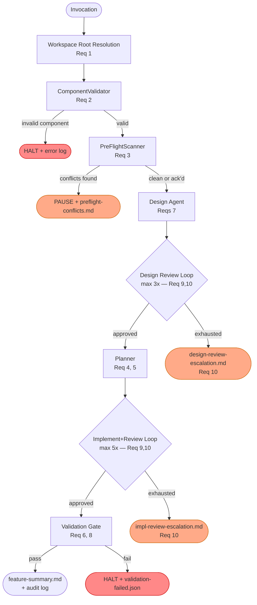

# Design Document: Structured Feature Dev Improvement

## Overview

This document describes the technical design for enhancing the CLM Structured Feature Development workflow (`clm-feature-dev.workflow.json`). The enhancement closes ten reliability gaps across six functional areas — path portability, input validation, pre-flight safety, planning quality, artifact completeness, and loop resilience — while adding two NFRs for startup performance and compliance auditability.

The current workflow is a five-stage JSON pipeline: design → design-review loop → plan → implement+review loop → validate. After this enhancement, the pipeline gains three new preflight steps (workspace-root resolution, component validation, codebase scan), enriches the plan with CLM lifecycle stage grouping and property-based test requirements, extends the validation gate with three new checks, and adds three new continuous artifact-quality mechanisms (design changelog, rollback section, versioned approval files). A new audit log provides tamper-evident traceability across every run.

All changes are fully backward-compatible: callers that omit the new inputs continue to work with non-breaking defaults and warning-level log messages.

---

## Architecture

### Enhanced Pipeline Overview

The pipeline gains three sequential steps at startup (before design), plus cross-cutting enhancements applied to existing steps.



### Component Diagram

```mermaid
graph LR
    subgraph Inputs
        FRQ[feature_request]
        COMP[component]
        WR[workspace_root]
    end

    subgraph Startup["Startup Gate (new)"]
        WRR[WorkspaceRootResolver]
        CV[ComponentValidator]
        PFS[PreFlightScanner]
    end

    subgraph Pipeline["Existing Pipeline (enhanced)"]
        DA[Design Agent\n+ Changelog]
        DRW[Design Reviewer\n+ Versioned Approval]
        PL[Planner\n+ Stage Grouping\n+ PBT Enforcement]
        CD[Coder\n+ PBT Requirement]
        CR[Code Reviewer\n+ PBT Blocking Check]
        VG[Validation Gate\n+ 3 new checks\n+ Rollback Section]
    end

    subgraph Artifacts
        PDJ[preflight-clean.json\nor preflight-conflicts.md]
        FD[feature-design.md\n+ ## Changelog]
        FP[feature-plan.md\n+ stage groups]
        FS[feature-summary.md\n+ ## Rollback]
        AF[*-approved.json\nwith version counter]
        ESC[*-escalation-*.md]
        AL[workflow-audit-log.json]
        VR[feature-validation-\npassed/failed.json]
    end

    Inputs --> Startup
    Startup --> Pipeline
    Pipeline --> Artifacts
```



### Startup Sequence

```mermaid
sequenceDiagram
    participant Caller
    participant WRR as WorkspaceRootResolver
    participant CV as ComponentValidator
    participant PFS as PreFlightScanner
    participant DA as DesignAgent
    participant AL as AuditLogger

    Caller->>WRR: invoke(workspace_root?, feature_request, component?)
    WRR->>AL: start run entry
    alt workspace_root omitted
        WRR-->>Caller: WARN "workspace_root not provided; using CWD"
        WRR->>WRR: resolve = CWD
    else workspace_root provided
        WRR->>WRR: strip trailing separators
        WRR->>WRR: verify directory exists
        alt does not exist
            WRR-->>Caller: ERROR "workspace_root does not resolve to existing directory: <path>"
            WRR->>AL: finalize partial run (failed)
            WRR-->>Caller: HALT
        end
    end
    WRR->>CV: validated_root

    alt component omitted
        CV-->>Caller: WARN "component not specified; defaulting to saas-control-plane"
        CV->>CV: component = "saas-control-plane"
    else component provided but invalid
        CV-->>Caller: ERROR "Invalid component '<value>'. Valid values: saas-control-plane, satellite-gateway, vsatellite, shared"
        CV->>AL: finalize partial run (failed)
        CV-->>Caller: HALT
    end
    CV->>PFS: validated_component, validated_root

    PFS->>PFS: check git status (uncommitted changes)
    PFS->>PFS: check branch divergence
    PFS->>PFS: glob stale artifact files

    alt preflight-acknowledged.json present
        PFS->>DA: proceed (skip conflict pause)
    else no conflicts
        PFS->>PFS: write preflight-clean.json
        PFS->>DA: proceed
    else conflicts found
        PFS->>PFS: write preflight-conflicts.md
        PFS->>AL: finalize partial run (paused)
        PFS-->>Caller: PAUSE (await preflight-acknowledged.json)
    end

    DA->>DA: read/write feature-design.md + ## Changelog
    DA->>AL: record step outcome
```

---

## Components and Interfaces

### WorkspaceRootResolver

Runs as the implicit first action of every pipeline step. Not a standalone agent step — implemented as shared initialization logic invoked before any agent prompt is rendered.

**Responsibilities:**
- Accept `workspace_root` input (optional, string, 1–4096 chars)
- Normalize trailing path separators
- Validate directory existence
- Emit `WARNING`-level log if omitted
- Expose resolved root as `{{resolved_root}}` template variable for all downstream prompt and stop-condition path interpolations

**Interface:**
```
resolve(workspace_root?: string) -> Result<string, WorkspaceRootError>
```

### ComponentValidator

A new named step `"id": "validate-component"` inserted immediately after workflow start and before `"id": "design"`.

**Responsibilities:**
- Validate `component` against the allowlist
- Emit warning if omitted (default to `saas-control-plane`)
- Halt with structured error if invalid
- Must complete within 5 seconds (Req 12.1)

**Allowlist:** `["saas-control-plane", "satellite-gateway", "vsatellite", "shared"]`

**Log message formats (exact):**
- Omitted: `component not specified; defaulting to saas-control-plane`
- Invalid: `Invalid component '<value>'. Valid values: saas-control-plane, satellite-gateway, vsatellite, shared`

**Interface:**
```
validate(component?: string) -> Result<ValidComponent, ComponentValidationError>
```

### PreFlightScanner

A new named step `"id": "preflight-scan"` inserted after `validate-component` and before `design`.

**Responsibilities:**
- Detect uncommitted changes (modified, staged, untracked relative to HEAD)
- Detect local branches diverged from default branch and not merged
- Detect stale artifact files matching glob: `feature-*.md`, `feature-*.json`, `bug-*.md`, `bug-*.json`, `plan-output.md`, `spec-*.md` in the workflow artifact output directory
- Write `preflight-clean.json` or `preflight-conflicts.md`
- Honor existing `preflight-acknowledged.json` to skip conflict pause
- Must complete within 30 seconds for workspaces < 10,000 tracked files (Req 12.2)
- Scope to component subtree for workspaces > 10,000 tracked files (Req 12.4)
- Read-only: never modifies source files or workflow artifacts

**Severity Classification:**

| Conflict Type | Severity |
|---|---|
| Stale artifact (prior-run-artifact) | low |
| Uncommitted change in unrelated path | low |
| Uncommitted change in target component | medium |
| Staged change in target component | medium |
| Unmerged local branch with overlapping path | high |

**Output artifact paths (relative to `{{resolved_root}}/.agents/tasks/`):**
- Clean: `preflight-clean.json`
- Conflicts: `preflight-conflicts.md`
- Acknowledgement (human-written): `preflight-acknowledged.json`

**Interface:**
```
scan(root: string, component: string) -> ScanResult
write_result(result: ScanResult, output_dir: string) -> void
```

### Planner (enhanced)

The existing `"id": "plan"` step receives an enriched prompt requiring stage grouping.

**New Responsibilities:**
- Read 26 CLM stage names from `clm-project-context.md` at `{{resolved_root}}/.kiro/steering/clm-project-context.md`
- Tag each plan task to one or more CLM stages
- Produce blast-radius summary table at top of `feature-plan.md`
- Emit `Cross-Stage` section for multi-stage tasks
- Inject `[COMPLIANCE-REQUIRED]` annotation and a preceding compliance task for any task touching stage 11 (Approval Workflow) or stage 12 (Electronic Signature)
- Guard: halt if `feature-design-approved.json` with `"approved": true` is absent

### Coder (enhanced)

The existing `"id": "implement"` step receives an enriched prompt requiring PBT enforcement.

**Qualifying function criteria** (any one of): sorting, filtering, parsing, serialization, cryptographic transformation, state-machine transition, data aggregation over a collection.

**PBT annotation format** (inline comment immediately before test function):
```
// Property: <type> — <description>
// Validates: <requirement ref>
// Type: invariant | round-trip | idempotence | metamorphic | error condition
```

**PBT library selection** (by project language):
- Go: `pgregory.net/rapid` or `github.com/leanovate/gopter`
- TypeScript/JS: `fast-check`
- Python: `hypothesis`

**Round-trip minimum:** 50 automatically generated inputs per test run (parsers/serializers).
**General PBT minimum:** 100 iterations per test run.

### ValidationGate (extended)

The existing `"id": "validate"` step receives an extended prompt. Three new checks added before the existing `make test` / `make lint` pair:

1. **Open-question scan** — scan `feature-design.md` for lines containing `TODO`, `TBD`, `OPEN:`, `??`, or items in an open-questions section that lack `[RESOLVED]` or `[ANSWERED]`
2. **Migration script check** — if any plan task has `[MIGRATION-REQUIRED]`, verify a file exists in `{{resolved_root}}/deploy/migrations/` whose filename contains the feature name slug (case-insensitive)
3. **Compliance doc check** — if any plan task has `[COMPLIANCE-REQUIRED]`, verify a file exists in `{{resolved_root}}/compliance/` whose filename contains the feature name slug (case-insensitive)

**Feature name slug:** The workflow input `feature_request` lowercased, spaces replaced with hyphens, special characters stripped.

### DesignAgent (changelog-enhanced)

On every write to `feature-design.md`, the agent appends one changelog entry to the `## Changelog` section. One entry per execution, regardless of how many sections changed.

### AuditLogger

A cross-cutting concern — not a separate agent step. Runs as pre/post hooks around each step.

**Responsibilities:**
- Maintain `workflow-audit-log.json` as an append-only array
- Capture each run as one JSON object with the schema defined in Data Models
- Compute SHA-256 hash over the run entry (excluding the `hash` field itself)
- Flush partial record to disk before any halt or pause
- Record each approval file write with version number
- Fail loudly if the log file cannot be written

---

## Data Models

### ApprovalFile

```json
{
  "approved": false,
  "version": 3,
  "last_written_by": "agent:design-reviewer",
  "last_written_at": "2024-01-15T10:23:45Z"
}
```

| Field | Type | Description |
|---|---|---|
| `approved` | boolean | Stop-condition flag |
| `version` | integer ≥ 1 | Monotonically incrementing counter, starts at 1 |
| `last_written_by` | string | Agent identity that performed this write |
| `last_written_at` | ISO-8601 string | Timestamp of last write, accurate to the second |

**Stop condition evaluation:** `approved === true`, regardless of `version` value.

### PreflightResult

**Clean output (`preflight-clean.json`):**
```json
{
  "conflicts": [],
  "status": "clean",
  "scanned_at": "2024-01-15T10:00:00Z",
  "workspace_root": "/path/to/project",
  "component": "satellite-gateway"
}
```

**Conflict output (`preflight-conflicts.md` — Markdown table):**
```markdown
# Pre-Flight Conflict Report

Scanned at: 2024-01-15T10:00:00Z
Component: satellite-gateway

## Conflicts Found

| # | Type | File Path | Severity |
|---|------|-----------|----------|
| 1 | uncommitted-change | components/satellite-gateway/internal/api/handler.go | medium |
| 2 | prior-run-artifact | .agents/tasks/feature-design.md | low |

## Required Action

Resolve or acknowledge conflicts before proceeding. To acknowledge and bypass:
create `.agents/tasks/preflight-acknowledged.json` with `{"acknowledged": true}`.
```

**Unknown status (error during scan):**
```json
{
  "status": "unknown",
  "error": "git command failed: <message>",
  "scanned_at": "2024-01-15T10:00:00Z"
}
```

### EscalationArtifact

Filename format: `{loop-id}-escalation-{YYYY-MM-DDTHH-MM-SSZ}.md`

Example: `design-review-loop-escalation-2024-01-15T10-23-45Z.md`

Note: colons in ISO-8601 timestamps are replaced with hyphens in filenames for cross-platform compatibility. The content of the artifact preserves standard ISO-8601 format.

```markdown
# Escalation: design-review-loop

**Generated at:** 2024-01-15T10:23:45Z
**Loop ID:** design-review-loop
**Max Iterations Configured:** 3
**Iterations Executed:** 3
**Final Reviewer Verdict:** rejected

## Unresolved Findings (Final Iteration)

1. Multi-tenant isolation not addressed for the new API endpoint
2. Missing migration script reference for schema change in section 3.2
3. Compliance impact analysis for stage 12 (Electronic Signature) incomplete

## Recommended Next Action

`revise-and-retry` — Address the three unresolved findings above, then manually reset
`feature-design-approved.json` to `{"approved": false, "version": <next>}` and re-invoke the pipeline.

---
Valid `recommended_next_action` vocabulary: manual-approve | revise-and-retry | escalate-to-team | abandon
```

**Append behavior:** When the file already exists, append below a `---` separator. Do not overwrite.

### AuditLogEntry

`workflow-audit-log.json` is a top-level JSON array. Each element is one run entry:

```json
{
  "run_id": "a3f2c1d4-...",
  "run_start": "2024-01-15T10:00:00Z",
  "run_end": "2024-01-15T11:30:00Z",
  "workspace_root": "/path/to/project",
  "component": "satellite-gateway",
  "feature_request": "Add webhook retry logic",
  "steps": [
    {
      "step_id": "validate-component",
      "step_start": "2024-01-15T10:00:01Z",
      "step_end": "2024-01-15T10:00:02Z",
      "outcome": "success"
    },
    {
      "step_id": "preflight-scan",
      "step_start": "2024-01-15T10:00:02Z",
      "step_end": "2024-01-15T10:00:18Z",
      "outcome": "success"
    },
    {
      "step_id": "design",
      "step_start": "2024-01-15T10:00:18Z",
      "step_end": "2024-01-15T10:12:00Z",
      "outcome": "success"
    }
  ],
  "approval_file_events": [
    {
      "file": ".agents/tasks/feature-design-approved.json",
      "written_at": "2024-01-15T10:15:00Z",
      "version_written": 2
    }
  ],
  "artifacts_written": [
    "/path/to/project/.agents/tasks/feature-design.md",
    "/path/to/project/.agents/tasks/feature-plan.md"
  ],
  "hash": "sha256:e3b0c44298fc1c149afbf4c8996fb92427ae41e4..."
}
```

**Step `outcome` values:** `success` | `paused` | `failed`

**Secret exclusion:** Any input whose name ends in `_secret`, `_token`, `_password`, `_key`, or that is sourced from a secrets store (annotated with `"secret": true` in the workflow input definition) is omitted from the log. Only `feature_request`, `workspace_root`, and `component` are recorded.

**SHA-256 computation:** Hash is computed over the JSON-serialized run entry with the `"hash"` field set to `""` (empty string), then the result is written into the `"hash"` field. This enables deterministic re-computation for integrity verification.

### ValidationResult

**Success (`feature-validation-passed.json`):**
```json
{
  "feature_name": "webhook-retry-logic",
  "run_timestamp": "2024-01-15T11:30:00Z",
  "checks": [
    { "name": "open-question-scan", "result": "pass" },
    { "name": "migration-script-check", "result": "pass" },
    { "name": "compliance-doc-check", "result": "pass" },
    { "name": "make-test", "result": "pass" },
    { "name": "make-lint", "result": "pass" },
    { "name": "plan-tasks-complete", "result": "pass" }
  ]
}
```

**Failure (`feature-validation-failed.json`):**
```json
{
  "feature_name": "webhook-retry-logic",
  "run_timestamp": "2024-01-15T11:30:00Z",
  "checks": [
    { "name": "open-question-scan", "result": "fail",
      "detail": "Line 47: TODO: decide on retry backoff strategy\nLine 89: OPEN: confirm GDPR retention period" },
    { "name": "migration-script-check", "result": "pass" },
    { "name": "compliance-doc-check", "result": "fail",
      "detail": "No file in compliance/ matching 'webhook-retry-logic'" },
    { "name": "make-test", "result": "pass" },
    { "name": "make-lint", "result": "pass" },
    { "name": "plan-tasks-complete", "result": "pass" }
  ]
}
```

Both files are mutually exclusive: only one is written per validation run.

### ChangelogEntry (embedded in `feature-design.md`)

```markdown
## Changelog

### Iteration 1 — 2024-01-15T10:12:00Z — agent:design

Initial design created.

### Iteration 2 — 2024-01-15T10:45:00Z — agent:design-revise

Sections modified:
- **Modified:** Architecture — Added multi-tenant isolation detail for new endpoint
- **Added:** ## Open Questions — Added Q1 re: migration timing
- **Removed:** ## Alternative Approaches — Removed per reviewer feedback
```

---

## Updated Workflow JSON Structure

The enhanced workflow adds three steps at the front and enriches prompts in existing steps. Below is the structural diff showing where new steps slot in:

```json
{
  "name": "CLM Structured Feature Development",
  "description": "...",
  "inputs": {
    "feature_request": "prompt",
    "component": "string",
    "workspace_root": "string"
  },
  "steps": [
    {
      "type": "step",
      "id": "validate-component",
      "agent": "wf-component-validator",
      "prompt": "..."
    },
    {
      "type": "step",
      "id": "preflight-scan",
      "agent": "wf-preflight-scanner",
      "prompt": "..."
    },
    {
      "type": "step",
      "id": "design",
      "agent": "wf-design",
      "prompt": "... (enhanced with workspace_root + changelog instruction)"
    },
    {
      "type": "repeat",
      "id": "design-review-loop",
      "maxIterations": 3,
      "onMaxIterations": "pause",
      "onExhaustion": {
        "writeEscalation": true,
        "escalationFile": "{{resolved_root}}/.agents/tasks/design-review-loop-escalation-{{timestamp_utc}}.md"
      },
      "stopCondition": {
        "fileCheck": {
          "path": "{{resolved_root}}/.agents/tasks/feature-design-approved.json",
          "jsonPath": "approved",
          "value": true
        }
      },
      "steps": ["design-reviewer", "design-revise"]
    },
    {
      "type": "step",
      "id": "plan",
      "agent": "wf-planner",
      "prompt": "... (enhanced with stage grouping + compliance annotation)"
    },
    {
      "type": "repeat",
      "id": "implement-review-loop",
      "maxIterations": 5,
      "onMaxIterations": "pause",
      "onExhaustion": {
        "writeEscalation": true,
        "escalationFile": "{{resolved_root}}/.agents/tasks/implement-review-loop-escalation-{{timestamp_utc}}.md"
      },
      "stopCondition": {
        "fileCheck": {
          "path": "{{resolved_root}}/.agents/tasks/feature-impl-approved.json",
          "jsonPath": "approved",
          "value": true
        }
      },
      "steps": ["implement", "code-reviewer"]
    },
    {
      "type": "step",
      "id": "validate",
      "agent": "wf-validator",
      "prompt": "... (enhanced with 3 new checks + rollback section instruction)"
    }
  ]
}
```

**Key changes from current JSON:**
1. `workspace_root` added to `inputs`
2. `validate-component` step inserted at index 0
3. `preflight-scan` step inserted at index 1
4. All hardcoded absolute paths replaced with `{{resolved_root}}/...`
5. `onExhaustion.writeEscalation` added to both repeat steps
6. `escalationFile` uses `{{timestamp_utc}}` template variable (colons replaced with hyphens by the runtime)

---

## Pseudocode

### ComponentValidator

```pseudocode
ALLOWLIST = ["saas-control-plane", "satellite-gateway", "vsatellite", "shared"]

function validate_component(component: string | undefined) -> Result:
    start_time = now()

    if component is undefined or component is empty:
        LOG WARNING "component not specified; defaulting to saas-control-plane"
        component = "saas-control-plane"
    else if component not in ALLOWLIST:
        LOG ERROR "Invalid component '${component}'. Valid values: ${ALLOWLIST.join(', ')}"
        return Err(ComponentValidationError(component, ALLOWLIST))

    elapsed = now() - start_time
    if elapsed > 5_000ms:
        LOG ERROR "ComponentValidator timed out after ${elapsed}ms (limit: 5000ms)"
        return Err(TimeoutError("validate-component", elapsed))

    return Ok(component)
```

### PreFlightScanner

```pseudocode
MAX_FILES_BEFORE_SCOPE = 10_000
SCAN_TIMEOUT_MS = 30_000
STALE_ARTIFACT_GLOBS = [
    "feature-*.md", "feature-*.json",
    "bug-*.md", "bug-*.json",
    "plan-output.md", "spec-*.md"
]

function scan(root: string, component: string, output_dir: string) -> ScanResult:
    start_time = now()
    conflicts = []

    # Check for prior acknowledgement
    ack_path = join(output_dir, "preflight-acknowledged.json")
    if file_exists(ack_path):
        ack = read_json(ack_path)
        if ack.acknowledged == true:
            return ScanResult(status="acknowledged", conflicts=[])

    # Determine scan scope
    tracked_count = count_tracked_files(root)  # git ls-files | wc -l
    if tracked_count > MAX_FILES_BEFORE_SCOPE:
        scan_path = join(root, "components", component)
    else:
        scan_path = root

    # 1. Uncommitted changes
    try:
        git_status = run("git status --porcelain", cwd=scan_path, timeout=10_000ms)
        for line in git_status.lines:
            status_code = line[0:2].trim()
            file_path = line[3:]
            severity = "medium" if file_path starts with "components/" + component else "low"
            if status_code != "":
                conflicts.append(Conflict("uncommitted-change", file_path, severity))
    except GitCommandError as e:
        write_json(join(output_dir, "preflight-conflicts.md"),
                   {"status": "unknown", "error": e.message})
        HALT with non-zero exit

    # 2. Diverged branches
    try:
        branches = run("git branch -vv", cwd=root, timeout=10_000ms)
        for branch in branches:
            if branch is diverged from default and not merged:
                conflicts.append(Conflict("unmerged-branch", branch.name, "high"))
    except GitCommandError as e:
        # same error handling as above

    # 3. Stale artifacts
    for glob in STALE_ARTIFACT_GLOBS:
        matches = find_files(output_dir, glob)
        for match in matches:
            conflicts.append(Conflict("prior-run-artifact", match, "low"))

    # Check timeout
    if now() - start_time > SCAN_TIMEOUT_MS:
        LOG ERROR "PreFlightScanner timed out after ${now()-start_time}ms"
        HALT with error

    # Write result
    if conflicts is empty:
        write_json(join(output_dir, "preflight-clean.json"), {
            "conflicts": [],
            "status": "clean",
            "scanned_at": iso8601_now(),
            "workspace_root": root,
            "component": component
        })
        return ScanResult(status="clean", conflicts=[])
    else:
        write_markdown(join(output_dir, "preflight-conflicts.md"),
                       render_conflict_table(conflicts))
        HALT and await human acknowledgement
```

### VersionedApprovalWrite

```pseudocode
MAX_RETRIES = 3
DURABLE_STATE_KEY = "last_approval_version.{file_path}"

function write_approval(file_path: string, approved: bool, agent_id: string) -> Result:
    last_known_version = load_durable_state(DURABLE_STATE_KEY)

    for attempt in 1..MAX_RETRIES:
        # Read current file
        try:
            current = read_json(file_path)
        except ReadError as e:
            LOG ERROR "Cannot read approval file before write: ${e}. Aborting."
            return Err(ReadFailureError(file_path))

        # Conflict detection
        expected_next = (last_known_version or 0) + 1
        if last_known_version is not None and current.version != last_known_version:
            LOG WARN "Approval file version conflict on '${file_path}': " +
                     "expected version ${last_known_version}, found ${current.version}. " +
                     "Not modifying file. Pipeline paused."
            PAUSE pipeline and await human resolution
            return Err(VersionConflictError(expected=last_known_version, actual=current.version))

        new_version = current.version + 1
        new_content = {
            "approved": approved,
            "version": new_version,
            "last_written_by": agent_id,
            "last_written_at": iso8601_now()
        }

        # Atomic write + state persist
        try:
            write_json_atomic(file_path, new_content)       # write to temp, rename
            save_durable_state(DURABLE_STATE_KEY, new_version)  # same atomic op
            AUDIT_LOG.record_approval_write(file_path, new_version)
            return Ok(new_version)
        except AtomicWriteError:
            LOG WARN "Atomic write failed on attempt ${attempt}/${MAX_RETRIES}"
            if attempt == MAX_RETRIES:
                PAUSE pipeline
                return Err(AtomicWriteExhaustedError(file_path))
            continue
```

### EscalationWriter

```pseudocode
RECOMMENDED_ACTIONS = ["manual-approve", "revise-and-retry", "escalate-to-team", "abandon"]

function write_escalation(
    loop_id: string,
    max_iterations: int,
    executed_iterations: int,
    final_verdict: string | null,
    unresolved_findings: list[string],
    output_dir: string
) -> void:

    timestamp_utc = iso8601_now().replace(":", "-")  # for filename safety
    filename = "${loop_id}-escalation-${timestamp_utc}.md"
    file_path = join(output_dir, filename)

    recommended = determine_recommended_action(final_verdict, unresolved_findings)
    content = render_escalation_markdown(
        loop_id, max_iterations, executed_iterations,
        final_verdict, unresolved_findings, recommended
    )

    if file_exists(file_path):
        # Append below separator
        existing = read_file(file_path)
        write_file(file_path, existing + "\n---\n" + content)
    else:
        write_file(file_path, content)

function determine_recommended_action(verdict, findings) -> string:
    if verdict == "approved":
        return "manual-approve"   # shouldn't happen but safe fallback
    if len(findings) > 5:
        return "escalate-to-team"
    if verdict == "rejected" and len(findings) <= 5:
        return "revise-and-retry"
    return "escalate-to-team"
```

### ValidationGate

```pseudocode
function run_validation_gate(
    design_path: string,
    plan_path: string,
    workspace_root: string,
    feature_slug: string
) -> ValidationResult:

    checks = []

    # Check 1: Open questions
    design_content = read_file(design_path)
    unresolved = []
    for (line_num, line) in enumerate(design_content.lines):
        if contains_any(line, ["TODO", "TBD", "OPEN:", "??"]):
            unresolved.append((line_num, line.trim()))
        if in_open_questions_section(line) and not contains_any(line, ["[RESOLVED]", "[ANSWERED]"]):
            unresolved.append((line_num, line.trim()))
    checks.append(Check("open-question-scan",
                        "pass" if unresolved is empty else "fail",
                        detail=format_unresolved(unresolved)))

    # Check 2: Migration scripts
    plan_content = read_file(plan_path)
    if "[MIGRATION-REQUIRED]" in plan_content:
        migrations_dir = join(workspace_root, "deploy", "migrations")
        script_exists = any(
            feature_slug.lower() in f.lower()
            for f in list_files(migrations_dir)
        )
        checks.append(Check("migration-script-check",
                            "pass" if script_exists else "fail",
                            detail="" if script_exists else
                                   "No migration script found in deploy/migrations/ matching '${feature_slug}'"))
    else:
        checks.append(Check("migration-script-check", "pass"))

    # Check 3: Compliance docs
    if "[COMPLIANCE-REQUIRED]" in plan_content:
        compliance_dir = join(workspace_root, "compliance")
        doc_exists = any(
            feature_slug.lower() in f.lower()
            for f in list_files(compliance_dir)
        )
        checks.append(Check("compliance-doc-check",
                            "pass" if doc_exists else "fail",
                            detail="" if doc_exists else
                                   "No compliance doc found in compliance/ matching '${feature_slug}'"))
    else:
        checks.append(Check("compliance-doc-check", "pass"))

    # Check 4: make test
    test_result = run("make test", cwd=workspace_root, capture_output=true)
    checks.append(Check("make-test",
                        "pass" if test_result.exit_code == 0 else "fail",
                        detail=test_result.output if test_result.exit_code != 0 else ""))

    # Check 5: make lint
    lint_result = run("make lint", cwd=workspace_root, capture_output=true)
    checks.append(Check("make-lint",
                        "pass" if lint_result.exit_code == 0 else "fail",
                        detail=lint_result.output if lint_result.exit_code != 0 else ""))

    # Check 6: plan completeness
    incomplete_tasks = count_incomplete_tasks(plan_content)
    checks.append(Check("plan-tasks-complete",
                        "pass" if incomplete_tasks == 0 else "fail",
                        detail="" if incomplete_tasks == 0 else
                               "${incomplete_tasks} tasks not marked [x]"))

    all_passed = all(c.result == "pass" for c in checks)
    timestamp = iso8601_now()

    if all_passed:
        write_json(join(output_dir, "feature-validation-passed.json"), {
            "feature_name": feature_slug,
            "run_timestamp": timestamp,
            "checks": checks
        })
    else:
        write_json(join(output_dir, "feature-validation-failed.json"), {
            "feature_name": feature_slug,
            "run_timestamp": timestamp,
            "checks": checks
        })
        HALT with non-zero exit

    return ValidationResult(all_passed, checks)
```

---

## Correctness Properties

*A property is a characteristic or behavior that should hold true across all valid executions of a system — essentially, a formal statement about what the system should do. Properties serve as the bridge between human-readable specifications and machine-verifiable correctness guarantees.*

### Property 1: Path Join Correctness

*For any* valid `workspace_root` string and relative sub-path string, the path constructed by the WorkspaceRootResolver must equal the result of the host OS's canonical path join function, and must begin with the resolved (normalized) root.

**Validates: Requirements 1.2, 1.5**

---

### Property 2: Trailing Separator Normalization

*For any* `workspace_root` string with zero or more trailing path separator characters appended, the normalized result must contain zero trailing path separators and be otherwise identical to the string with no trailing separators.

**Validates: Requirements 1.6**

---

### Property 3: Component Allowlist Acceptance

*For any* string that is an exact member of `["saas-control-plane", "satellite-gateway", "vsatellite", "shared"]`, the ComponentValidator must return a success result with no warning message emitted.

**Validates: Requirements 2.2**

---

### Property 4: Component Allowlist Rejection

*For any* string that is not an exact member of the allowlist, the ComponentValidator must return a halt error whose message contains both the invalid input value and all four valid values.

**Validates: Requirements 2.3**

---

### Property 5: PreFlightScanner Read-Only Invariant

*For any* workspace state, the set of files present before the PreFlightScanner executes must equal the set of files present after it completes — the scanner must not create, modify, or delete source files or existing workflow artifacts.

**Validates: Requirements 3.5**

---

### Property 6: Preflight Conflict Report Completeness

*For any* non-empty set of detected conflicts, every conflict in the set must appear in `preflight-conflicts.md` with all three required fields: `type` (one of `uncommitted-change`, `unmerged-branch`, `prior-run-artifact`), `file path`, and `severity` (one of `low`, `medium`, `high`).

**Validates: Requirements 3.4**

---

### Property 7: Stage Grouping Accuracy

*For any* feature plan task list and CLM stage assignments, the blast-radius summary table's per-stage task count must equal the actual count of tasks assigned to that stage in the plan body.

**Validates: Requirements 4.2, 4.4**

---

### Property 8: Compliance Annotation Completeness

*For any* plan task that is assigned to CLM stage 11 (Approval Workflow) or stage 12 (Electronic Signature), that task must carry the `[COMPLIANCE-REQUIRED]` annotation and must be immediately preceded by a compliance documentation task in the plan.

**Validates: Requirements 4.5**

---

### Property 9: PBT Annotation Presence

*For any* property-based test written by the Coder step, the test function must be immediately preceded by an inline comment that names the correctness property type as exactly one of: `invariant`, `round-trip`, `idempotence`, `metamorphic`, or `error condition`.

**Validates: Requirements 5.2**

---

### Property 10: Round-Trip Test Coverage

*For any* parser or serializer function introduced by the Coder step, there must exist a property-based test asserting `parse(format(x)) == x` (or equivalent inverse), configured to run at least 50 automatically generated inputs.

**Validates: Requirements 5.3**

---

### Property 11: Changelog Append-Only Invariant

*For any* sequence of N executions of the design-revise step, all prior changelog entries must remain unchanged after each subsequent write — no existing entry may be modified or removed.

**Validates: Requirements 7.3**

---

### Property 12: One Changelog Entry Per Step Execution

*For any* single execution of the design-revise step, exactly one new entry must be appended to the `## Changelog` section, regardless of how many sections of `feature-design.md` were modified during that execution.

**Validates: Requirements 7.6**

---

### Property 13: Rollback File Enumeration Completeness

*For any* set of files created or modified during a feature, every file in that set must appear in the `## Rollback` section of `feature-summary.md` with its path expressed relative to `workspace_root` and its status labeled as either `created` or `modified`.

**Validates: Requirements 8.2**

---

### Property 14: Config Key Prior-Value Preservation

*For any* configuration key modified by a feature, the `## Rollback` section must record both the prior value (before the feature) and the new value (introduced by the feature) for that key.

**Validates: Requirements 8.4**

---

### Property 15: Rollback Step Count Bounds

*For any* feature, the numbered rollback procedure in `feature-summary.md` must contain between 1 and 20 steps (inclusive).

**Validates: Requirements 8.5**

---

### Property 16: Approval Version Monotonicity

*For any* sequence of N agent writes to an approval file, the `version` field after write N must equal N (starting from 1), and each write must produce a version exactly 1 greater than the version it read.

**Validates: Requirements 9.1, 9.2**

---

### Property 17: Approval Write Conflict Immutability

*For any* approval file where the current `version` differs from the agent's last recorded version, the agent's attempted write must leave the file byte-for-byte unchanged.

**Validates: Requirements 9.4**

---

### Property 18: Escalation Artifact Schema Completeness

*For any* loop exhaustion event, the escalation artifact written must contain all required fields: loop identifier, maximum iteration count, executed iteration count, final reviewer verdict, the complete list of unresolved findings from the final iteration, and a `recommended_next_action` value drawn from the vocabulary `{manual-approve, revise-and-retry, escalate-to-team, abandon}`.

**Validates: Requirements 10.3**

---

### Property 19: Escalation Artifact Append Preservation

*For any* escalation file that already exists at the computed path, a subsequent escalation write must preserve the entire prior file content above a `---` separator, with new content appearing only below that separator.

**Validates: Requirements 10.5**

---

### Property 20: Backward-Compatible Invocation

*For any* workflow invocation that was valid before this enhancement (providing `feature_request` and optionally `component`, but not `workspace_root`), the invocation must produce a non-error outcome after the enhancement is applied.

**Validates: Requirements 11.3**

---

### Property 21: New Artifact Non-Collision

*For any* artifact filename introduced by this enhancement, its filename must not equal any of `feature-design.md`, `feature-plan.md`, or `feature-summary.md`.

**Validates: Requirements 11.4**

---

### Property 22: Audit Log Entry Completeness

*For any* workflow run, the audit log entry for that run must contain: run start timestamp, run end timestamp, `workspace_root` value, `component` value, the ordered list of steps with outcomes, all non-secret input values, resolved absolute paths of all artifacts written, and a SHA-256 integrity hash.

**Validates: Requirements 13.1**

---

### Property 23: Audit Log Append-Only

*For any* sequence of N workflow runs sharing the same output directory, after run N the audit log array must contain exactly N entries, and entries 1 through N-1 must be byte-for-byte identical to their values after each respective run.

**Validates: Requirements 13.3**

---

### Property 24: Audit Log Partial-Run Capture

*For any* workflow run where a step fails or the pipeline pauses, the audit log must be written to disk containing all steps executed up to and including the failing or pausing step before the pipeline halts.

**Validates: Requirements 13.2**

---

### Property 25: Open-Question Scan Completeness

*For any* design document, the set of unresolved items identified by the validation gate's open-question scanner must equal exactly the set of lines containing `TODO`, `TBD`, `OPEN:`, or `??`, plus all items in open-questions sections that lack `[RESOLVED]` or `[ANSWERED]` markers — no more, no fewer.

**Validates: Requirements 6.1**

---

### Property 26: Validation Result Mutual Exclusion

*For any* validation gate run, exactly one of `feature-validation-passed.json` and `feature-validation-failed.json` is written — never both, never neither.

**Validates: Requirements 6.5, 6.6**

---

## Error Handling

### Error Handling Matrix

| Failure Mode | Detection Point | Response | Recovery Path | Artifacts Written |
|---|---|---|---|---|
| `workspace_root` does not exist | WorkspaceRootResolver | HALT immediately before any step | Fix path and re-invoke | `workflow-audit-log.json` (partial) |
| Invalid `component` value | ComponentValidator | HALT with structured error log | Fix component name and re-invoke | `workflow-audit-log.json` (partial) |
| Git command failure during pre-flight | PreFlightScanner | Write `preflight-conflicts.md` with `status: unknown`, HALT | Fix git state, re-invoke | `preflight-conflicts.md`, `workflow-audit-log.json` |
| Pre-flight conflicts detected | PreFlightScanner | PAUSE awaiting `preflight-acknowledged.json` | Human: resolve conflicts or write ack file | `preflight-conflicts.md`, `workflow-audit-log.json` |
| Approval file version conflict | VersionedApprovalWrite | Emit WARN, do NOT write, PAUSE pipeline | Human: inspect both files, manually set `version` to expected, resume | `workflow-audit-log.json` |
| Review loop exhausted | Repeat step post-exhaustion | Write escalation artifact, PAUSE | Human: consult escalation artifact, choose recommended action | `*-escalation-*.md`, `workflow-audit-log.json` |
| Validation gate check failure | ValidationGate | Write `feature-validation-failed.json`, HALT | Fix flagged issues, re-run validate step | `feature-validation-failed.json`, `workflow-audit-log.json` |
| `make test` / `make lint` non-zero exit | ValidationGate | Include full output in failed JSON, HALT | Fix failing tests/lint errors | `feature-validation-failed.json` |
| Audit log write failure | AuditLogger | Surface error, do NOT report run as success | Fix filesystem permissions, retry | None (the log itself could not be written) |
| Validator timeout exceeded | ValidationGate | HALT with timeout error, preserve partial artifacts | Investigate timeout cause | `workflow-audit-log.json` (partial) |

### Retry Behavior Summary

| Operation | Max Retries | On Exhaustion |
|---|---|---|
| Atomic approval file write | 3 | PAUSE pipeline, await human resolution |
| `make test` / `make lint` | 0 (no retry) | Immediate failure report |
| Pre-flight git command | 0 (no retry) | Write unknown-status artifact, HALT |

### Timeout Enforcement

Both startup components enforce hard timeouts via the workflow runtime's step timeout configuration:

```json
{
  "id": "validate-component",
  "timeout_ms": 5000,
  "on_timeout": "fail"
},
{
  "id": "preflight-scan",
  "timeout_ms": 30000,
  "on_timeout": "fail"
}
```

On timeout, the runtime writes a timeout error to the audit log and halts. The agent prompt for each step includes instructions to self-report elapsed time in the error message.

---

## Testing Strategy

### Overview

This feature enhances workflow orchestration logic. Most of the new logic lives in agent prompts and a thin coordination layer. The testing strategy therefore targets:

1. **Pure functions** — path resolution, normalization, allowlist validation, open-question scanner, version counter arithmetic → **property-based tests**
2. **Structured data output** — artifact schemas, changelog format, audit log entries → **property-based tests**
3. **External integrations** — git commands, `make test`/`make lint`, filesystem reads → **integration tests with mocks**
4. **Workflow configuration** — step ordering, stop conditions, input definitions → **snapshot/schema tests**

### Property-Based Testing

The PBT library used for testing this feature's own logic:
- **Go** (primary runtime language of CLM components): `pgregory.net/rapid`
- **Workflow config tests** (JSON schema validation): `fast-check` (Node.js)

Minimum iterations per test: **100** (general properties), **50** (round-trip serialization tests).

Each property test carries an annotation comment referencing the design property it validates:

```go
// Property: round-trip — ApprovalFile serialization preserves all fields
// Feature: structured-feature-dev-improvement, Property 16: Approval Version Monotonicity
// Type: round-trip
func TestApprovalVersionMonotonicity(t *testing.T) {
    rapid.Check(t, func(rt *rapid.T) {
        // ...
    })
}
```

### Property Tests

| Design Property | Test Function | Property Type | Notes |
|---|---|---|---|
| P1: Path Join Correctness | `TestPathJoinMatchesOS` | invariant | Generate random root + subpath combos |
| P2: Trailing Separator Normalization | `TestNormalizeTrailingSeparators` | round-trip | Generate strings with 0–10 trailing seps |
| P3: Component Allowlist Acceptance | `TestAllowlistedComponentAccepted` | invariant | Exhaustive (only 4 values) |
| P4: Component Allowlist Rejection | `TestNonAllowlistedComponentRejected` | error condition | Generate arbitrary strings, filter out 4 valid values |
| P5: PreFlight Read-Only Invariant | `TestPreflightNoSideEffects` | invariant | Compare file tree hash before/after scan |
| P6: Conflict Report Completeness | `TestConflictReportFields` | invariant | Generate random conflict sets |
| P7: Stage Grouping Accuracy | `TestBlastRadiusSummaryCount` | metamorphic | Generate random task-to-stage assignments |
| P8: Compliance Annotation | `TestComplianceAnnotationForStages11And12` | invariant | Generate tasks with stage 11/12 assignments |
| P9: PBT Annotation Presence | `TestPBTAnnotationComment` | invariant | Parse test source, check comment structure |
| P10: Round-Trip Test Coverage | `TestParserSerializerRoundTrip` | round-trip | Generate valid CLM data objects |
| P11: Changelog Append-Only | `TestChangelogImmutability` | invariant | Run N revisions, check all prior entries intact |
| P12: One Entry Per Execution | `TestChangelogOneEntryPerStep` | invariant | Multiple section changes in one step → 1 entry |
| P13: Rollback File Enumeration | `TestRollbackCoversAllChangedFiles` | invariant | Generate file change sets |
| P14: Config Key Prior-Value | `TestRollbackConfigKeyValues` | invariant | Generate config change diffs |
| P15: Rollback Step Count Bounds | `TestRollbackStepCount` | invariant | Generate features of varying complexity |
| P16: Approval Version Monotonicity | `TestApprovalVersionMonotonicity` | invariant | Sequence of N writes → version = N |
| P17: Approval Write Conflict Immutability | `TestConflictingWriteNoModification` | invariant | Inject version mismatch, verify file unchanged |
| P18: Escalation Schema Completeness | `TestEscalationArtifactFields` | invariant | Generate random loop exhaustion events |
| P19: Escalation Append Preservation | `TestEscalationAppendBelowSeparator` | invariant | Pre-populate file, append, verify structure |
| P20: Backward-Compatible Invocation | `TestLegacyInvocationSucceeds` | invariant | All prior-valid invocation forms tested |
| P21: New Artifact Non-Collision | `TestNewArtifactFilenameUniqueness` | invariant | Exhaustive (small finite set) |
| P22: Audit Log Entry Completeness | `TestAuditLogEntrySchema` | invariant | Generate runs, check all fields present |
| P23: Audit Log Append-Only | `TestAuditLogAppendOnly` | invariant | N runs, check entries 1..N-1 unchanged |
| P24: Audit Log Partial-Run Capture | `TestAuditLogOnStepFailure` | error condition | Inject step failure, check log written |
| P25: Open-Question Scan Completeness | `TestOpenQuestionScannerPrecisionRecall` | invariant | Generate docs with known marker distributions |
| P26: Validation Result Mutual Exclusion | `TestValidationResultMutualExclusion` | invariant | All pass/fail combinations |

### Integration Tests

Integration tests use mocks for external commands (`git`, `make`) and filesystem operations to avoid environment dependencies.

| Test | What It Exercises | Mock Strategy |
|---|---|---|
| `TestComponentValidatorTimeout` | 5-second timeout enforcement | Inject artificial delay |
| `TestPreflightScannerTimeout` | 30-second timeout enforcement | Inject artificial delay |
| `TestLargeWorkspaceScopedScan` | Component-subtree scoping for >10k files | Mock `git ls-files` to return >10,000 filenames |
| `TestMakeTestFailurePropagated` | Validation gate on `make test` non-zero exit | Mock `make` returning exit code 1 |
| `TestMakeLintFailurePropagated` | Validation gate on `make lint` non-zero exit | Mock `make` returning exit code 1 |
| `TestGitCommandFailureInPreflight` | Preflight error handling | Mock `git status` throwing error |
| `TestAuditLogWriteFailure` | Audit log filesystem error handling | Make log path unwritable |
| `TestMigrationScriptPresenceCheck` | Validation gate migration check | Parameterize with present/absent file |
| `TestComplianceDocPresenceCheck` | Validation gate compliance check | Parameterize with present/absent file |

### Snapshot / Schema Tests

The updated `clm-feature-dev.workflow.json` is validated against a JSON Schema that enforces:
- `workspace_root` present in `inputs` definition
- `validate-component` appears at index 0 in `steps`
- `preflight-scan` appears at index 1 in `steps`
- No hardcoded absolute paths (regex: no strings matching `[A-Z]:\\` or `^/home/` or `^/Users/`)
- Both repeat steps have `onExhaustion.writeEscalation: true`
- Both repeat steps reference `{{resolved_root}}` in their stop condition `fileCheck.path`

### Unit Tests (Example-Based)

Specific scenarios that complement the property tests:

- `TestOmittedWorkspaceRootDefaultsToCWD` — verify CWD used and warning logged
- `TestOmittedComponentDefaultsToSaasControlPlane` — verify default and warning
- `TestPreflightAcknowledgementSkipsConflictPause` — verify ack file bypasses pause
- `TestDesignDocWithoutChangelogGetsSection` — recovery path for missing `## Changelog`
- `TestDesignDocWhitespaceOnlyChangeGetsNoSubstantiveEntry` — edge case
- `TestValidationGateWithComplexOpenQuestions` — open-questions section with mixed resolved/unresolved
- `TestEscalationAppendWithExistingFile` — append-not-overwrite

---

## Changelog

### Iteration 1 — 2024-01-15T00:00:00Z — agent:design

Initial design created.
