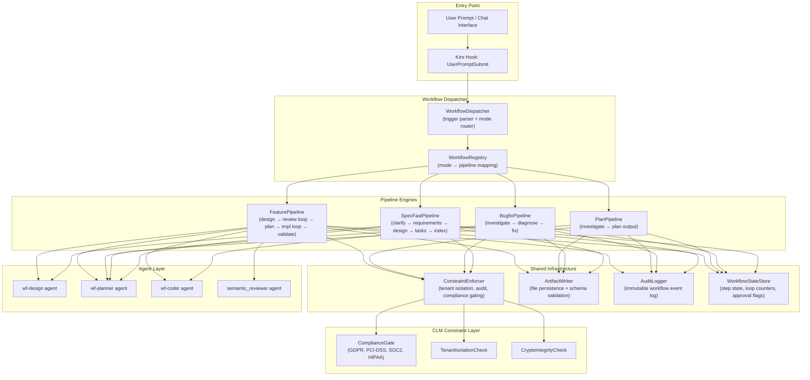
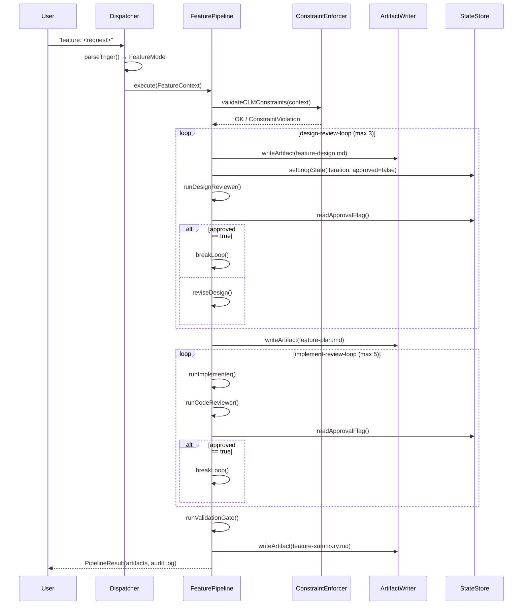
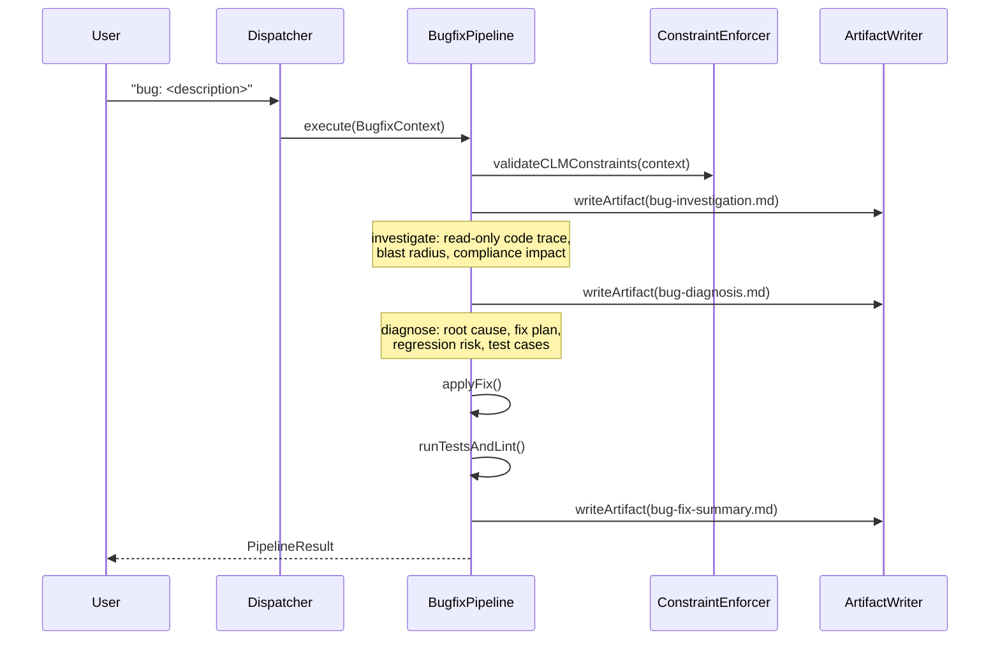
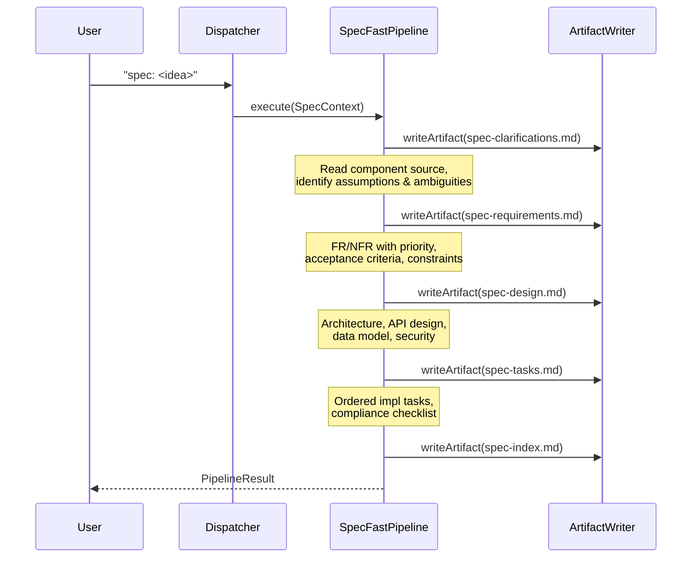

# Design Document: Structured Workflow System

## Overview

The Structured Workflow System provides four specialized development modes for the CLM platform — **Feature Development**, **Plan-Only**, **Bug-Fix**, and **SpecFast** — each enforcing a deterministic, multi-step pipeline through trigger-phrase activation. The system wraps agent orchestration behind a shared execution runtime, a uniform artifact contract, and CLM-specific constraint enforcement (multi-tenant isolation, immutable audit trail, cryptographic integrity, compliance gating), so every mode produces verifiable, traceable outputs without relying on ad-hoc agent behavior.

The design covers the dispatcher, per-mode pipeline engines, artifact writer, constraint validator, and the shared data model that links trigger input through to final deliverable, with formal specifications for each core algorithm and interface.

---

## Architecture



---

## Sequence Diagrams

### Feature Development Pipeline



### Bug-Fix Pipeline



### SpecFast Pipeline



---

## Components and Interfaces

### Component 1: WorkflowDispatcher

**Purpose**: Parse the user's trigger phrase, identify the correct workflow mode, and route execution to the appropriate pipeline engine.

**Interface**:
```pascal
INTERFACE WorkflowDispatcher
  dispatch(rawPrompt: String, agentContext: AgentContext): PipelineResult
  parseMode(rawPrompt: String): WorkflowMode | ParseError
  buildContext(mode: WorkflowMode, rawPrompt: String): WorkflowContext
END INTERFACE
```

**Responsibilities**:
- Match trigger prefixes: `feature:`, `/feature`, `bug:`, `/bug`, `plan:`, `/plan`, `spec:`, `/spec`
- Extract the payload (everything after the trigger prefix) as the feature/idea description
- Infer the target component from the payload or default to `saas-control-plane`
- Return a `ParseError` if no recognized trigger is found — no silent default routing

**Trigger Matching Rules**:
- Case-insensitive prefix match at start of prompt
- Normalize leading/trailing whitespace in the payload
- Multi-word component hints: `component: satellite-gateway` inline in the payload

---

### Component 2: WorkflowRegistry

**Purpose**: Maintain the mapping from `WorkflowMode` enum values to their concrete pipeline implementations and associated artifact schemas.

**Interface**:
```pascal
INTERFACE WorkflowRegistry
  getPipeline(mode: WorkflowMode): Pipeline
  getArtifactSchema(mode: WorkflowMode): ArtifactSchema[]
  registerPipeline(mode: WorkflowMode, pipeline: Pipeline): Void
END INTERFACE
```

**Responsibilities**:
- Act as the single source of truth for mode-to-pipeline bindings
- Provide artifact schema definitions used by the `ArtifactWriter` for validation
- Support runtime registration to allow new workflow modes without modifying core dispatch logic

---

### Component 3: Pipeline Engines

Each of the four mode engines implements the `Pipeline` interface:

```pascal
INTERFACE Pipeline
  execute(ctx: WorkflowContext): PipelineResult
  getSteps(): Step[]
  getCurrentStep(): Step | None
  canResume(): Boolean
END INTERFACE

INTERFACE Step
  id: String
  agentRole: AgentRole
  execute(ctx: StepContext): StepResult
  onMaxIterations: LoopExhaustedPolicy
END INTERFACE
```

**FeaturePipeline steps**: `design → design-review-loop(max=3) → plan → implement-review-loop(max=5) → validate`

**PlanPipeline steps**: `investigate`

**BugfixPipeline steps**: `investigate → diagnose → fix`

**SpecFastPipeline steps**: `clarify → requirements → design → tasks → index`

---

### Component 4: ConstraintEnforcer

**Purpose**: Validate that the workflow context and produced artifacts comply with CLM's non-negotiable architectural invariants before and after each step.

**Interface**:
```pascal
INTERFACE ConstraintEnforcer
  validatePreStep(ctx: StepContext): ConstraintResult
  validatePostStep(ctx: StepContext, artifact: Artifact): ConstraintResult
  checkTenantIsolation(artifact: Artifact): IsolationResult
  checkComplianceGating(ctx: WorkflowContext): ComplianceResult
  checkCryptoIntegrity(artifact: Artifact): CryptoResult
END INTERFACE
```

**Responsibilities**:
- Pre-step: confirm context carries a valid tenant scope
- Pre-step: flag if the feature touches approval workflow or e-signature path → require compliance documentation
- Post-step: scan produced artifacts for hardcoded credentials or private keys
- Post-step: confirm state transition artifacts include audit log event declarations
- Post-step: confirm any new DB schema artifacts include `tenant_id` column and RLS declarations

---

### Component 5: ArtifactWriter

**Purpose**: Persist workflow artifact files to the designated output path, validate their structure against the expected schema, and track artifact lineage.

**Interface**:
```pascal
INTERFACE ArtifactWriter
  write(artifact: Artifact): WriteResult
  read(path: ArtifactPath): Artifact | NotFound
  validateSchema(artifact: Artifact, schema: ArtifactSchema): ValidationResult
  listArtifacts(mode: WorkflowMode, runId: RunId): ArtifactPath[]
END INTERFACE
```

**Responsibilities**:
- Write artifacts atomically (write to temp path, then rename)
- Enforce schema: required sections must be present before marking an artifact complete
- Maintain a run manifest (`run-manifest.json`) alongside the artifacts for traceability

---

### Component 6: WorkflowStateStore

**Purpose**: Track per-run execution state — which step is active, loop iteration counters, approval flag values — so pipelines can be safely resumed and loops can self-terminate.

**Interface**:
```pascal
INTERFACE WorkflowStateStore
  initRun(runId: RunId, mode: WorkflowMode): RunState
  getRunState(runId: RunId): RunState
  setStepStatus(runId: RunId, stepId: StepId, status: StepStatus): Void
  setApprovalFlag(runId: RunId, stepId: StepId, approved: Boolean): Void
  getApprovalFlag(runId: RunId, stepId: StepId): Boolean
  incrementLoopCounter(runId: RunId, loopId: LoopId): Integer
  getLoopCounter(runId: RunId, loopId: LoopId): Integer
END INTERFACE
```

---

## Data Models

### WorkflowContext

```pascal
STRUCTURE WorkflowContext
  runId:       UUID
  mode:        WorkflowMode   -- FEATURE | PLAN | BUGFIX | SPECFAST
  tenantId:    TenantId        -- Required; all artifacts are tenant-scoped
  component:   ComponentName   -- saas-control-plane | satellite-gateway | vsatellite | shared
  rawPrompt:   String          -- Original user input
  payload:     String          -- Stripped trigger prefix
  artifactDir: Path            -- e.g., .agents/tasks/
  triggeredAt: Timestamp
  agentSession: AgentSession
END STRUCTURE
```

**Validation Rules**:
- `runId` must be a valid UUID v4
- `tenantId` must be non-empty; no anonymous pipeline runs
- `component` must be one of the four recognized CLM components
- `artifactDir` must exist and be writable before pipeline execution begins

---

### Artifact

```pascal
STRUCTURE Artifact
  artifactId:  UUID
  runId:       UUID
  mode:        WorkflowMode
  stepId:      StepId
  path:        ArtifactPath
  content:     String
  schema:      ArtifactSchema
  createdAt:   Timestamp
  checksum:    SHA256Hash      -- Content integrity; stored in run manifest
END STRUCTURE
```

**Validation Rules**:
- `content` must not be empty when written
- `checksum` is computed on write and verified on read
- Schema required sections must all be present (validated with `ArtifactWriter.validateSchema`)

---

### ArtifactSchema

```pascal
STRUCTURE ArtifactSchema
  mode:             WorkflowMode
  stepId:           StepId
  requiredSections: String[]   -- Markdown H2 headings that must appear
  forbiddenPatterns: Regex[]   -- Patterns that must NOT appear (e.g., private keys)
END STRUCTURE
```

**Schema definitions per mode**:

| Mode | Step | Required Sections |
|------|------|-------------------|
| FEATURE | design | Bug Summary, Code Path, API Changes, Tenant Isolation, Compliance Impact |
| FEATURE | plan | Dependency Order, Tasks |
| FEATURE | summary | Root Cause, Fix Applied, Verification |
| BUGFIX | investigate | Bug Summary, Code Path, Suspect Root Causes, Blast Radius |
| BUGFIX | diagnose | Confirmed Root Cause, Fix Approach, Fix Tasks, Regression Risk |
| BUGFIX | fix | Root Cause, Fix Applied, Tests Added, Verification |
| PLAN | investigate | Summary, CLM Lifecycle Stages Affected, Implementation Tasks, Open Questions, Estimated Complexity |
| SPECFAST | clarify | Idea Restated, Assumptions Made, CLM Context |
| SPECFAST | requirements | Overview, Functional Requirements, Non-Functional Requirements, Constraints |
| SPECFAST | design | Architecture Overview, Component Changes, API Design, Data Model, Security Design |
| SPECFAST | tasks | Dependency Order, Tasks, Compliance Checklist, Total Estimate |

---

### RunState

```pascal
STRUCTURE RunState
  runId:        UUID
  mode:         WorkflowMode
  status:       RunStatus     -- RUNNING | PAUSED | COMPLETED | FAILED
  currentStep:  StepId
  loopCounters: Map<LoopId, Integer>
  approvalFlags: Map<StepId, Boolean>
  artifacts:    ArtifactPath[]
  startedAt:    Timestamp
  updatedAt:    Timestamp
END STRUCTURE
```

---

### WorkflowMode (Enum)

```pascal
ENUM WorkflowMode
  FEATURE   -- Structured feature development
  PLAN      -- Plan-only, read-only investigation
  BUGFIX    -- Three-phase bug resolution
  SPECFAST  -- Rapid spec generation
END ENUM
```

---

### StepStatus (Enum)

```pascal
ENUM StepStatus
  PENDING | RUNNING | COMPLETED | FAILED | SKIPPED
END ENUM
```

---

### LoopExhaustedPolicy (Enum)

```pascal
ENUM LoopExhaustedPolicy
  PAUSE     -- Suspend pipeline and surface to user
  FAIL      -- Mark run as FAILED
  CONTINUE  -- Proceed to next step anyway (use sparingly)
END ENUM
```

---

## Algorithmic Pseudocode

### Main Dispatch Algorithm

```pascal
ALGORITHM dispatch(rawPrompt, agentContext)
INPUT:  rawPrompt: String, agentContext: AgentContext
OUTPUT: PipelineResult

PRECONDITIONS:
  rawPrompt ≠ ""
  agentContext.tenantId ≠ null

POSTCONDITIONS:
  result.runId is a valid UUID
  result.artifacts contains all expected mode artifacts
  result.auditEvents ≠ empty

BEGIN
  -- Step 1: Parse trigger
  parseResult ← parseMode(rawPrompt)
  IF parseResult IS ParseError THEN
    RETURN PipelineResult.noMatch("No recognized trigger prefix found")
  END IF

  mode ← parseResult.mode
  payload ← parseResult.payload

  -- Step 2: Build context
  ctx ← WorkflowContext {
    runId:       generateUUID(),
    mode:        mode,
    tenantId:    agentContext.tenantId,
    component:   extractComponent(payload) OR "saas-control-plane",
    rawPrompt:   rawPrompt,
    payload:     payload,
    artifactDir: agentContext.artifactDir,
    triggeredAt: now()
  }

  -- Step 3: Validate CLM constraints
  constraintResult ← constraintEnforcer.validatePreStep(ctx)
  IF constraintResult IS ConstraintViolation THEN
    auditLogger.log(CONSTRAINT_VIOLATION, ctx, constraintResult)
    RETURN PipelineResult.failed(constraintResult.reason)
  END IF

  -- Step 4: Route to pipeline
  pipeline ← registry.getPipeline(mode)
  stateStore.initRun(ctx.runId, mode)
  auditLogger.log(PIPELINE_STARTED, ctx)

  -- Step 5: Execute
  result ← pipeline.execute(ctx)

  auditLogger.log(PIPELINE_COMPLETED, ctx, result)
  RETURN result
END
```

**Loop Invariant**: After each pipeline step, `stateStore.getRunState(runId).artifacts` contains exactly the artifacts produced so far, and no artifact has a null checksum.

---

### FeaturePipeline Execution Algorithm

```pascal
ALGORITHM FeaturePipeline.execute(ctx)
INPUT:  ctx: WorkflowContext
OUTPUT: PipelineResult

PRECONDITIONS:
  ctx.mode = FEATURE
  ctx.tenantId ≠ null

POSTCONDITIONS:
  All five step IDs (design, design-review-loop, plan, implement-review-loop, validate)
    appear in stateStore with status COMPLETED
  feature-design.md, feature-plan.md, feature-summary.md exist at ctx.artifactDir

BEGIN
  -- Phase 1: Design
  designResult ← runStep("design", wfDesignAgent, ctx)
  artifactWriter.write(designResult.artifact)

  -- Phase 2: Design review loop
  designApproved ← false
  designIteration ← 0

  WHILE NOT designApproved DO
    ASSERT designIteration ≤ 3
    --   Loop invariant: feature-design.md exists and has required sections

    IF designIteration = 3 THEN
      stateStore.setRunStatus(ctx.runId, PAUSED)
      RETURN PipelineResult.paused("Design review loop exhausted after 3 iterations")
    END IF

    reviewResult ← runStep("design-reviewer", wfDesignReviewerAgent, ctx)
    designApproved ← reviewResult.approved

    IF NOT designApproved THEN
      reviseResult ← runStep("design-revise", wfDesignAgent, ctx)
      artifactWriter.write(reviseResult.artifact)
    END IF

    designIteration ← designIteration + 1
  END WHILE

  -- Phase 3: Plan
  planResult ← runStep("plan", wfPlannerAgent, ctx)
  artifactWriter.write(planResult.artifact)

  -- Phase 4: Implement + review loop
  implApproved ← false
  implIteration ← 0

  WHILE NOT implApproved DO
    ASSERT implIteration ≤ 5
    --   Loop invariant: All previously completed tasks in plan are marked [x]

    IF implIteration = 5 THEN
      stateStore.setRunStatus(ctx.runId, PAUSED)
      RETURN PipelineResult.paused("Implementation review loop exhausted after 5 iterations")
    END IF

    implResult ← runStep("implement", wfCoderAgent, ctx)
    reviewResult ← runStep("code-reviewer", semanticReviewerAgent, ctx)
    implApproved ← reviewResult.approved
    implIteration ← implIteration + 1
  END WHILE

  -- Phase 5: Validate
  validateResult ← runStep("validate", wfCoderAgent, ctx)
  artifactWriter.write(validateResult.artifact)

  RETURN PipelineResult.completed(ctx.runId, collectArtifacts(ctx))
END
```

**Loop Invariants**:
- Design review loop: `feature-design.md` has all required sections at each iteration start
- Implement loop: the task count of checked `[x]` tasks is non-decreasing across iterations

---

### BugfixPipeline Execution Algorithm

```pascal
ALGORITHM BugfixPipeline.execute(ctx)
INPUT:  ctx: WorkflowContext
OUTPUT: PipelineResult

PRECONDITIONS:
  ctx.mode = BUGFIX
  ctx.payload describes a bug symptom or failing behavior

POSTCONDITIONS:
  bug-investigation.md, bug-diagnosis.md, bug-fix-summary.md exist
  make test AND make lint exit with code 0

BEGIN
  -- Phase 1: Investigate (read-only)
  ctx.readOnly ← true
  investigateResult ← runStep("investigate", wfPlannerAgent, ctx)
  artifactWriter.write(investigateResult.artifact)

  -- Validate blast radius for compliance/audit/crypto impact
  blastRadiusCheck ← constraintEnforcer.validatePostStep(ctx, investigateResult.artifact)
  IF blastRadiusCheck.hasComplianceImpact THEN
    investigateResult.artifact.addNote("COMPLIANCE_DOC_REQUIRED: " + blastRadiusCheck.reason)
  END IF

  -- Phase 2: Diagnose
  ctx.readOnly ← false
  diagnoseResult ← runStep("diagnose", wfPlannerAgent, ctx)
  artifactWriter.write(diagnoseResult.artifact)

  -- Phase 3: Fix
  fixResult ← runStep("fix", wfCoderAgent, ctx)
  testResult ← runTestsAndLint(ctx)

  IF testResult.exitCode ≠ 0 THEN
    RETURN PipelineResult.failed("Tests or lint failed after fix: " + testResult.output)
  END IF

  artifactWriter.write(fixResult.artifact)
  RETURN PipelineResult.completed(ctx.runId, collectArtifacts(ctx))
END
```

---

### SpecFastPipeline Execution Algorithm

```pascal
ALGORITHM SpecFastPipeline.execute(ctx)
INPUT:  ctx: WorkflowContext
OUTPUT: PipelineResult

PRECONDITIONS:
  ctx.mode = SPECFAST
  ctx.payload is a non-empty idea description

POSTCONDITIONS:
  spec-clarifications.md, spec-requirements.md, spec-design.md, spec-tasks.md, spec-index.md exist
  spec-tasks.md contains a Compliance Checklist section

BEGIN
  -- Phase 1: Clarify
  clarifyResult ← runStep("clarify", wfDesignAgent, ctx)
  artifactWriter.write(clarifyResult.artifact)

  -- Compliance gate: does the idea touch approval workflow or e-signature?
  complianceCheck ← constraintEnforcer.checkComplianceGating(ctx)
  IF complianceCheck.requiresComplianceDoc THEN
    ctx.flags.add(COMPLIANCE_DOC_REQUIRED)
  END IF

  -- Phase 2: Requirements
  reqResult ← runStep("requirements", wfDesignAgent, ctx)
  artifactWriter.write(reqResult.artifact)

  -- Phase 3: Technical Design
  designResult ← runStep("design", wfDesignAgent, ctx)
  artifactWriter.write(designResult.artifact)

  -- Phase 4: Tasks
  tasksResult ← runStep("tasks", wfPlannerAgent, ctx)
  artifactWriter.write(tasksResult.artifact)

  -- Phase 5: Index
  index ← buildSpecIndex(ctx, [clarifyResult, reqResult, designResult, tasksResult])
  artifactWriter.write(index)

  RETURN PipelineResult.completed(ctx.runId, collectArtifacts(ctx))
END
```

---

### PlanPipeline Execution Algorithm

```pascal
ALGORITHM PlanPipeline.execute(ctx)
INPUT:  ctx: WorkflowContext
OUTPUT: PipelineResult

PRECONDITIONS:
  ctx.mode = PLAN
  ctx.payload is a non-empty idea or task description

POSTCONDITIONS:
  plan-output.md exists
  NO files in ctx.component directory were created or modified (read-only guarantee)

BEGIN
  -- Enforce read-only mode — coder agent is NOT invoked
  ctx.readOnly ← true
  ctx.forbiddenOperations ← [WRITE_FILE, DELETE_FILE, RUN_COMMAND]

  investigateResult ← runStep("investigate", wfPlannerAgent, ctx)

  -- Verify no code was changed (read-only invariant)
  diffCheck ← verifyNoDiff(ctx.component)
  IF diffCheck.hasChanges THEN
    auditLogger.log(PLAN_MODE_VIOLATION, ctx, diffCheck)
    RETURN PipelineResult.failed("Plan-only mode violation: code changes detected")
  END IF

  artifactWriter.write(investigateResult.artifact)
  RETURN PipelineResult.completed(ctx.runId, collectArtifacts(ctx))
END
```

**Critical Invariant**: `verifyNoDiff` runs after the planner agent finishes. If any tracked file in the component directory was modified, the run is marked FAILED and the mutation is logged as a `PLAN_MODE_VIOLATION` audit event.

---

### Trigger Parsing Algorithm

```pascal
ALGORITHM parseMode(rawPrompt)
INPUT:  rawPrompt: String
OUTPUT: ParseResult (mode: WorkflowMode, payload: String) | ParseError

PRECONDITIONS:
  rawPrompt is defined (may be empty string)

POSTCONDITIONS:
  IF result IS ParseResult THEN result.payload = rawPrompt with trigger prefix stripped and trimmed
  IF result IS ParseError THEN no side effects

TRIGGERS = [
  ("feature:", FEATURE),  ("/feature", FEATURE),
  ("bug:",     BUGFIX),   ("/bug",     BUGFIX),
  ("plan:",    PLAN),     ("/plan",    PLAN),
  ("spec:",    SPECFAST), ("/spec",    SPECFAST)
]

BEGIN
  normalized ← toLowerCase(trim(rawPrompt))

  FOR each (prefix, mode) IN TRIGGERS DO
    IF normalized startsWith prefix THEN
      payload ← trim(rawPrompt[length(prefix) ..])
      RETURN ParseResult { mode: mode, payload: payload }
    END IF
  END FOR

  RETURN ParseError { reason: "No recognized trigger prefix found in: " + rawPrompt }
END
```

---

## Key Functions with Formal Specifications

### Function: runStep

```pascal
FUNCTION runStep(stepId: StepId, agent: Agent, ctx: WorkflowContext): StepResult
```

**Preconditions**:
- `stepId` is a valid, non-empty string registered in the pipeline's step list
- `agent` is non-null and initialized
- `ctx.runId` is a valid UUID with an active entry in `WorkflowStateStore`
- `ctx.readOnly = true` IMPLIES agent is NOT `wf-coder` or `semantic_reviewer` (those agents may mutate files)

**Postconditions**:
- `stateStore.getStepStatus(ctx.runId, stepId) = COMPLETED` on success
- `stateStore.getStepStatus(ctx.runId, stepId) = FAILED` on agent error
- `StepResult.artifact.checksum` is computed and non-null
- `auditLogger` has a `STEP_COMPLETED` or `STEP_FAILED` event for this step

**Loop Invariants**: Not applicable (not a loop function)

---

### Function: validatePreStep

```pascal
FUNCTION validatePreStep(ctx: StepContext): ConstraintResult
```

**Preconditions**:
- `ctx.tenantId` is non-null
- `ctx.mode` is a recognized `WorkflowMode`

**Postconditions**:
- Returns `ConstraintResult.OK` if all invariants hold
- Returns `ConstraintResult.Violation` with a non-empty `reason` if any invariant fails
- Does NOT modify any files or state

**Invariants checked**:
1. `ctx.tenantId ≠ null` — no anonymous runs
2. If `ctx.mode = PLAN`: context must carry `readOnly = true`
3. If `ctx.payload` contains keywords `[approval, e-sign, signature, esign]`: flag `COMPLIANCE_DOC_REQUIRED`
4. `ctx.component ∈ {saas-control-plane, satellite-gateway, vsatellite, shared}`

---

### Function: validatePostStep

```pascal
FUNCTION validatePostStep(ctx: StepContext, artifact: Artifact): ConstraintResult
```

**Preconditions**:
- `artifact.content` is non-empty
- `artifact.stepId` matches the step that just completed

**Postconditions**:
- Returns `ConstraintResult.OK` if artifact passes all post-step checks
- Returns `ConstraintResult.Violation` if:
  - Artifact content matches any `forbiddenPattern` (private key, hardcoded secret)
  - Required sections for this step's schema are absent
  - A schema change artifact lacks `tenant_id` and RLS references

---

### Function: verifyNoDiff

```pascal
FUNCTION verifyNoDiff(componentPath: Path): DiffResult
```

**Preconditions**:
- `componentPath` is a valid, tracked directory

**Postconditions**:
- Returns `DiffResult.clean` if no working-tree changes exist
- Returns `DiffResult.hasChanges(files: Path[])` listing modified paths

---

## Error Handling

### Error Scenario 1: No Recognized Trigger

**Condition**: User prompt does not start with any of the 8 recognized trigger patterns.

**Response**: `WorkflowDispatcher.dispatch` returns `PipelineResult.noMatch` with a help message listing the four modes and their trigger phrases.

**Recovery**: No pipeline state is initialized; no audit event is written. The user is prompted to retry with a valid trigger.

---

### Error Scenario 2: Design Review Loop Exhausted

**Condition**: The design reviewer rejects the design 3 consecutive times without approving it.

**Response**: Pipeline status is set to `PAUSED`. The last design artifact is retained. The user receives the most recent review feedback.

**Recovery**: User can override by editing `feature-design-approved.json` manually or by resuming with an improved design. The pipeline resumes from the `plan` step once approved.

---

### Error Scenario 3: Plan-Mode Violation (Code Changed)

**Condition**: `wf-planner` agent writes to a file in the component directory during a `plan:` workflow.

**Response**: `verifyNoDiff` detects the change. Run is marked `FAILED`. A `PLAN_MODE_VIOLATION` audit event is logged with the affected file paths.

**Recovery**: Changes are reverted via `git checkout`. The user is informed of which files were incorrectly modified. The plan pipeline can be re-triggered.

---

### Error Scenario 4: Constraint Violation (Compliance Gate)

**Condition**: Feature or spec request involves the approval workflow or e-signature path but the `COMPLIANCE_DOC_REQUIRED` flag was not acknowledged.

**Response**: `ConstraintEnforcer` blocks progression to the `tasks` step. The run is `PAUSED` with an explanatory message.

**Recovery**: User acknowledges the compliance requirement, a compliance documentation task is injected into the task list, and the pipeline resumes.

---

### Error Scenario 5: Artifact Schema Validation Failure

**Condition**: An agent produces a markdown artifact that is missing a required section (e.g., `bug-investigation.md` lacks the `## Blast Radius` section).

**Response**: `ArtifactWriter.write` returns a `ValidationResult.invalid` with the list of missing sections. The step is marked `FAILED`.

**Recovery**: The step is retried with the validation error injected into the agent prompt so the agent knows what to add.

---

### Error Scenario 6: Test/Lint Failure After Bug Fix

**Condition**: `make test` or `make lint` exits non-zero after the bug-fix step.

**Response**: `BugfixPipeline` marks the run `FAILED` and surfaces the test output. The `bug-fix-summary.md` is NOT written until tests pass.

**Recovery**: The `fix` step is retried. The test output is appended to the `wf-coder` prompt as additional context.

---

## Testing Strategy

### Unit Testing Approach

Each component is independently unit-tested with mocked dependencies:

- `WorkflowDispatcher.parseMode`: property-based test — for every valid trigger prefix (in any case, with any whitespace), the correct mode and stripped payload are returned. For inputs without a valid prefix, `ParseError` is always returned.
- `ConstraintEnforcer.validatePreStep`: table-driven tests covering all constraint rule combinations (missing tenant, read-only mode violations, compliance-gating keywords).
- `ArtifactWriter.validateSchema`: parameterized tests for each mode/step schema — verify that a complete artifact passes and that removing any single required section produces a `ValidationResult.invalid`.
- `WorkflowStateStore`: concurrent read/write tests confirming loop counters are monotonically increasing and approval flags are consistent under concurrent step updates.

### Property-Based Testing Approach

**Property Test Library**: `fast-check` (TypeScript) / `QuickCheck` (Go)

Key properties:

1. **Dispatch idempotency**: For any valid trigger prompt `P`, `dispatch(P)` produces the same `WorkflowMode` on repeated calls.
2. **Trigger exhaustiveness**: Any string that starts with a trigger prefix is never mis-routed to a different mode.
3. **Artifact checksum consistency**: For any artifact `A`, `write(A)` followed by `read(A.path)` returns an artifact with `checksum` equal to `sha256(A.content)`.
4. **Loop termination guarantee**: For any pipeline run with `maxIterations = N`, the loop counter never exceeds `N` and the pipeline either terminates or enters `PAUSED` state.
5. **Plan-mode purity**: For any `PlanPipeline` run, `verifyNoDiff` always returns `clean` (agent mock constrained to only call read operations).

### Integration Testing Approach

End-to-end pipeline tests using real workflow JSON files and mocked agents:

- **Feature pipeline**: Inject a mock `wf-design-reviewer` that approves on iteration 2. Verify all 3 artifacts appear at `artifactDir` and the run state reaches `COMPLETED`.
- **Bug-fix pipeline**: Inject a mock `wf-coder` that produces a syntactically valid fix. Verify `make test` mock returns exit 0.
- **Plan pipeline**: Inject a mock `wf-planner` that attempts to write a file. Verify `PLAN_MODE_VIOLATION` audit event appears and run state is `FAILED`.
- **SpecFast with compliance gate**: Use a payload containing "e-signature". Verify `COMPLIANCE_DOC_REQUIRED` flag appears in `spec-tasks.md` compliance checklist.

---

## Performance Considerations

- **Step execution is synchronous within a pipeline run** but multiple pipeline runs for different tenants are concurrent. State store reads/writes must be atomic to prevent loop counter races.
- **Artifact writes are atomic** (write-then-rename). This ensures no partial artifact is ever read by a reviewer step.
- **Agent prompt size**: Each step's prompt is bounded by injecting only the relevant previous artifact content rather than the full history. For the `design-review-loop`, inject only the current `feature-design.md` and the last review comment.
- **Loop counter checks** happen before agent invocation to avoid wasting an agent call on an already-exhausted loop.
- **Audit log writes** are fire-and-forget (non-blocking) from the pipeline's perspective; they are written to a durable queue rather than inline.

---

## Security Considerations

- **Tenant isolation**: `WorkflowContext.tenantId` is set at dispatch time from the authenticated session. Every artifact path is prefixed with the tenant scope. Pipelines MUST NOT access artifact directories belonging to a different tenant.
- **Read-only enforcement for Plan mode**: The `PLAN` context carries `forbiddenOperations = [WRITE_FILE, DELETE_FILE, RUN_COMMAND]`. The dispatcher must not route plan-mode prompts to `wf-coder`. Post-step `verifyNoDiff` provides a defense-in-depth check.
- **Artifact content scanning**: `ConstraintEnforcer.validatePostStep` applies regex patterns to detect potential hardcoded secrets (AWS key patterns, PEM-encoded private keys, connection strings with embedded passwords) in every produced artifact before it is persisted.
- **Approval flag integrity**: The approval flag file (`feature-design-approved.json`) is written by the review agent and read by the loop condition check. To prevent a bypass, the dispatcher verifies the file's content matches the expected schema and was written during the current run (by comparing `runId` in the file to `ctx.runId`).
- **Compliance gating**: Features touching the approval workflow or e-signature path are gated by `ConstraintEnforcer.checkComplianceGating`. The gate injects a mandatory compliance documentation task before the `tasks` step can complete.
- **Audit trail**: Every `PIPELINE_STARTED`, `STEP_COMPLETED`, `STEP_FAILED`, `PIPELINE_COMPLETED`, `CONSTRAINT_VIOLATION`, and `PLAN_MODE_VIOLATION` event is written to the CLM immutable audit log with `tenantId`, `runId`, `userId`, and `timestamp`.

---

## Dependencies

| Dependency | Purpose | Component |
|---|---|---|
| Existing `.kiro/workflows/*.workflow.json` | Workflow definitions consumed and extended by the pipeline engines | All pipelines |
| Kiro Hook system (`UserPromptSubmit` hook) | Intercepts user prompts to perform trigger-phrase dispatch | Dispatcher |
| `wf-design`, `wf-planner`, `wf-coder`, `semantic_reviewer` | Agent roles invoked per step | All pipelines |
| CLM `make test` + `make lint` | Validation gate for bug-fix and feature pipelines | BugfixPipeline, FeaturePipeline |
| CLM immutable audit log (`contract_audit_logs`) | Audit event persistence | AuditLogger |
| Git working tree (`git status` / `git diff`) | Plan-mode purity enforcement | PlanPipeline |
| SHA-256 hashing | Artifact content integrity | ArtifactWriter |
| CLM multi-tenant RLS (PostgreSQL row-level security) | Tenant scoping of any state store backed by the CLM database | WorkflowStateStore |
