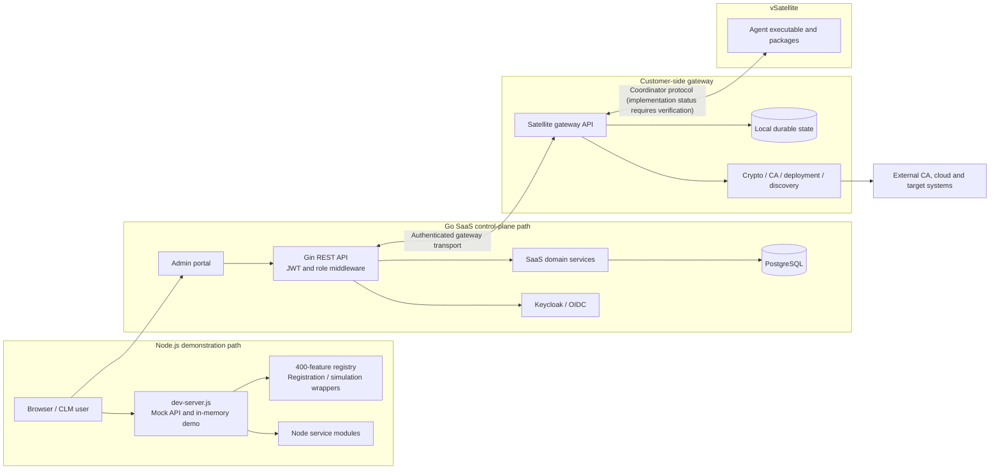

# CLM Architecture Audit

**Audit date:** 2026-11-10  
**Scope:** Tracked repository at `D:\400 clm\CLM`  
**Purpose:** Initial architecture and implementation audit with a Phase 3 follow-up; this is not a production-readiness certification or a complete security review.

## Scope and evidence

The Git root is `D:\400 clm\CLM`. A pre-existing untracked `CLM\` subtree and the sibling `D:\400 clm\CLM-Enterprise-400` directory were not treated as part of the tracked application. The worktree already contained modified and untracked files before this audit; those files were left untouched.

Evidence was collected from the source tree, service READMEs, database migrations, deployment configuration, root README, test scripts, and test execution. Documentation statements are treated as intended behavior unless corroborated by code or tests.

## Architecture diagram

The Node.js mock/demo and Go services are separate execution paths. Passing a demo scenario does not establish that the equivalent Go endpoint, database workflow, provider integration, or production deployment is active. The 400-entry registry is also not a map of 400 independently verified Go services.

## Observed component inventory

| Area | Observed implementation | Evidence and limits |
|---|---|---|
| Demo/API | Root `dev-server.js`, root `package.json`, Node service modules under `services/` | Root Node tests invoke the mock API directly; they are not integration tests of the Go services. |
| Feature catalog | `features/` contains 20 domain directories and 400 `index.js` plus 400 `test.js` files | `npm run test:400` passes registry/wrapper assertions while explicitly reporting capabilities as unverified. |
| SaaS backend | Go module `components/saas-control-plane/`, Gin router, REST handlers/middleware, domain services, PostgreSQL repositories | Routes are registered in `internal/api/rest/router.go`; tenant-scoped DB helpers and tests exist. The Go suite was not run successfully in this Windows environment. |
| Customer gateway | Go module `components/satellite-gateway/`, API, connector, local state, certificate discovery/issuance/deployment, audit and policy packages | Source exists; this audit did not exercise a live CA, cloud provider, customer VPC or HSM. |
| vSatellite | Go module `components/vsatellite/`, agent/scanner/deployer source, and staged build workflow | Source and package files exist, contrary to the component README's “Not Implemented” / “EMPTY” statements. Runtime behavior remains unverified here. |
| Database | PostgreSQL schemas and SQL migrations under both `internal/store/postgres/migrations/` and `deploy/migrations/` | The two migration locations and default bootstrap paths are inconsistent; see finding `CLM-ARCH-001`. |
| Identity | Keycloak configuration and Go authentication/identity/SSO services | Source presence is confirmed; live identity-provider behavior was not tested. |
| Infrastructure | Compose, Dockerfiles, Kubernetes, Terraform, observability and CI configuration | Configuration presence is not deployment evidence; no live cluster deployment was tested in this audit. |
| Tests | Node scenario, registry, lifecycle, corporate and global suites; Go tests in service modules | Node results are recorded below. The staged Go test wrapper could not run because `bash` invoked a WSL installation whose configured disk was missing. |

## Findings

### CLM-ARCH-001 — Default database setup omits contract and security migrations

- **Affected area:** SaaS schema bootstrap and migrations
- **Severity:** High
- **Exact paths:** `components/saas-control-plane/deploy/docker-compose.yml`; `components/saas-control-plane/Makefile`; `components/saas-control-plane/deploy/migrations/005_contract_lifecycle_management.sql` through `008_comprehensive_rls_hardening.sql`
- **Problem:** The Compose database initialization mounts migrations 001–004 from `internal/store/postgres/migrations/` and 009–010 from `deploy/migrations/`. The `make migrate` target applies only 001–004 from `deploy/migrations/`. Neither standard path applies migrations 005–008. Those omitted files create contract lifecycle tables, add contract/procurement tenant policies, add the chained audit protections, and apply broader RLS policies.
- **Root cause:** There are two migration directories and no single ordered migration runner wired into the documented local bootstrap or `make migrate` target.
- **Business impact:** A database initialized through these paths may lack schema and protections required by documented contract workflows. This invalidates claims that those tables' RLS and WORM controls are active in that deployment path and can cause runtime contract operations to fail.
- **Remediation status:** An ordered runner now embeds and applies migrations 001–011 with transactional version/checksum history and advisory locking. Compose, the installer, `make migrate`, and the database integration-test script are wired to it. Migration 011 adds forced RLS for the current tenant-owned table inventory, restricted-role grants, and tenant ownership for contract risks.
- **Remaining validation:** The migration inventory unit test passes. Migration 011 was not executed in this run because no scratch-database DSN was configured, so fresh-install, legacy-baseline, upgrade, RLS, and audit-trigger behavior remain unverified.
- **Validation procedure:** Initialize a clean database using the supported path; assert all expected tables exist, tenant policies are enabled and forced where required, and audit-chain triggers are installed. Then run negative cross-tenant access and audit-mutation tests against the resulting database.
- **Confidence:** High; the configured mount and Makefile command lists were inspected, and the omitted SQL files contain the described DDL/policies/triggers.

### CLM-ARCH-004 — Architecture document made unsupported production and security claims

- **Affected area:** Architecture and assurance statements
- **Severity:** High
- **Exact path:** `ENTERPRISE-CLM-ARCHITECTURE.md`
- **Problem:** The document labeled the product production-certified, described framework mandates as achieved conformance, claimed RLS withstands complete application compromise, asserted zero contract-text egress despite `contracts.content_body` in PostgreSQL, and presented unsubstantiated availability, latency, throughput, and isolation benchmarks.
- **Remediation status:** The document now labels these as design targets, states the database-context trust boundary and contract-text storage discrepancy, and removes unsupported benchmarks and approval claims.
- **Remaining validation:** Resolve plaintext document storage and obtain reproducible evidence for each target before asserting production conformance.
- **Confidence:** High; claims were checked against the architecture text, current migration/source inventory, and available test evidence.

### CLM-ARCH-002 — Registry checks do not verify 400 business capabilities

- **Affected area:** Feature catalog, test evidence and implementation status
- **Severity:** Medium
- **Exact paths:** `features/`; `scripts/test_400_features.js`; `CLM-400-IMPLEMENTATION-STATUS.md`
- **Problem:** The repository contains 400 registered feature modules in 20 domains, but the passing 400-check suite validates registration metadata, wrapper validation, smoke execution, and audit-hash shape. It asserts `businessCapabilityVerified === false`, `functionalStatus === "NOT_VERIFIED"`, and `productionReady === false`.
- **Root cause:** The current suite is a registry smoke test rather than per-capability acceptance/integration testing.
- **Business impact:** Registry counts and green smoke results cannot be used as evidence that the 400 named capabilities are implemented or production-ready.
- **Recommended solution:** Maintain per-capability implementation states and add behavior-level tests tied to explicit acceptance criteria before marking a capability verified.
- **Validation procedure:** For each claimed capability, trace requirement to implementation, API or UI surface, persistence/integration behavior, and passing acceptance tests. Keep unverified entries explicitly marked as such.
- **Confidence:** High; the test's assertions and its final output state the limitation explicitly.

### CLM-ARCH-003 — vSatellite implementation status documentation is stale

- **Affected area:** vSatellite architecture and release documentation
- **Severity:** Low
- **Exact paths:** `components/vsatellite/README.md`; `components/vsatellite/cmd/clm-vsatellite/main.go`; `components/vsatellite/internal/agent/agent.go`; `components/vsatellite/internal/scanner/scanner.go`; `components/vsatellite/internal/deployer/deployer.go`
- **Problem:** The README labels vSatellite “Not Implemented” and describes its packages as empty, while the tracked tree contains agent, scanner, and deployer Go sources and the executable contains heartbeat and command-loop code.
- **Root cause:** The README has not been reconciled with later source changes.
- **Business impact:** Operators and engineers may make incorrect deployment, testing, or release decisions based on the stated component status.
- **Recommended solution:** Reconcile the README with current source and test evidence; distinguish code present, verified behavior, and live deployment status.
- **Validation procedure:** Run the canonical staged vSatellite tests/build in CI, exercise registration/heartbeat/command/result flows against a test gateway, and update the status table to match measured results.
- **Confidence:** High for the source/document mismatch; runtime completeness was not assessed.

## Verification run

| Command | Result | Interpretation |
|---|---|---|
| `npm test` | Passed, 40/40 | Mock/demo scenarios only. |
| `npm run test:400` | Passed, 400/400 | Registry wrapper checks; business capabilities remain unverified. |
| `npm run test:lifecycle` | Passed, 26/26 | Node lifecycle simulation, not proof of the Go production workflow. |
| `npm run test:corporate` | Passed, 10/10 | Node demo corporate scenarios. |
| `npm run test:global` | Passed, 15/15 | Node global capability scenarios. |
| Direct `go test ./...` from modules | Not a valid canonical test path | Module imports/layout require the repository's staging wrapper. |
| `bash ../shared/scripts/go-staged.sh ... test` | Blocked before execution | The available `bash` launcher failed to attach its configured WSL disk. |
| Temporary staged Go test, vet, and builds | Passed | A PowerShell staging copy applied the module-path rewrite; all Go packages passed, vet passed, and server/CLI builds completed. PostgreSQL integration tests were skipped because `CLM_TEST_DB_DSN` was unset. |
| Six root Node suites | Passed | Scenario 40/40, registry 400/400 wrappers, corporate 10/10, lifecycle 26/26, workflow 3/3, and global 15/15. These are demo/simulation evidence, not Go backend or provider integration evidence. |

## Audit limits and next gates

- This is a source-and-configuration architecture audit, not a complete file-by-file audit, penetration test, or production readiness sign-off.
- No PostgreSQL migration/bootstrap test, live API test, live Keycloak test, CA/provider test, HSM test, cloud deployment, or customer VPC test was run.
- No claim is made that every documented lifecycle stage or feature is implemented.
- The architecture specification is a target design, not proof of certification, deployment, benchmark results, complete zero-egress behavior, or isolation under full application compromise.
- Before applying the new runner to existing environments, validate the baseline procedure and migrations 001–011 against representative database copies; do not treat passing unit tests as database integration evidence.
