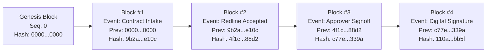
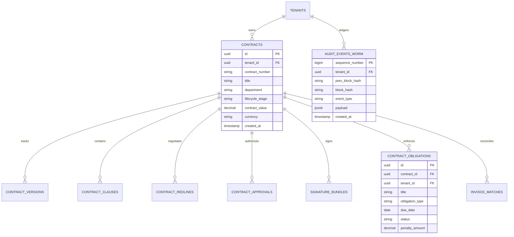

# ENTERPRISE CLM PLATFORM — RELATIONAL DATABASE & WORM AUDIT ARCHITECTURE

**Database Engine:** PostgreSQL 15.6+ with Kernel Row-Level Security  
**Audit Storage:** Cryptographically Chained WORM Ledger (Migration 007)  
**Security Classification:** Strict Enterprise Multi-Tenant Isolation  
**Document Version:** 4.0.0-ENTERPRISE  

---

### 1. KERNEL ROW-LEVEL SECURITY (FORCE RLS)

Multi-tenancy in the Enterprise CLM platform is guaranteed directly by the PostgreSQL engine kernel rather than relying on application code `WHERE` clauses.

```sql
-- Core RLS Configuration on Multi-Tenant Tables
ALTER TABLE contracts ENABLE ROW LEVEL SECURITY;
ALTER TABLE contracts FORCE ROW LEVEL SECURITY;

ALTER TABLE contract_versions ENABLE ROW LEVEL SECURITY;
ALTER TABLE contract_versions FORCE ROW LEVEL SECURITY;

ALTER TABLE contract_clauses ENABLE ROW LEVEL SECURITY;
ALTER TABLE contract_clauses FORCE ROW LEVEL SECURITY;

ALTER TABLE contract_redlines ENABLE ROW LEVEL SECURITY;
ALTER TABLE contract_redlines FORCE ROW LEVEL SECURITY;

ALTER TABLE contract_approvals ENABLE ROW LEVEL SECURITY;
ALTER TABLE contract_approvals FORCE ROW LEVEL SECURITY;

ALTER TABLE contract_obligations ENABLE ROW LEVEL SECURITY;
ALTER TABLE contract_obligations FORCE ROW LEVEL SECURITY;

-- Dynamic Tenant Isolation Policy
CREATE POLICY clm_tenant_isolation_policy ON contracts
    FOR ALL
    USING (tenant_id = current_setting('app.current_tenant_id', true)::uuid)
    WITH CHECK (tenant_id = current_setting('app.current_tenant_id', true)::uuid);
```

Whenever an API request enters the system, the Go Gateway opens a pooled connection and executes:
```sql
SET LOCAL app.current_tenant_id = 'c7e8e520-21a4-4a57-9d7a-cfb3d4f8e001';
```
If an unauthorized query attempts to scan records belonging to another tenant, PostgreSQL returns an empty set (`0 records returned`) with zero information disclosure.

---

### 2. 4-TIER DATABASE ACCESS ROLES

To strictly enforce segregation of duties at the database layer:

```mermaid
graph TD
    subgraph "PostgreSQL 15+ Security Contexts"
        Migrator["clm_migrator_role"] -->|DDL Only (CREATE/ALTER)| Schema[("Catalog Schemas")]
        App["clm_app_role"] -->|DML (SELECT/INSERT/UPDATE)| Tables[("RLS Enforced Tables")]
        ReadOnly["clm_read_role"] -->|SELECT Only| Replicas[("Read Replicas")]
        WORMRole["clm_audit_worm_role"] -->|INSERT Only| WORMTable[("Chained WORM Ledger")]
    end
```

| Role Name | Permitted Commands | Prohibited Commands | Context of Use |
|:---|:---|:---|:---|
| `clm_migrator_role` | `CREATE`, `ALTER`, `DROP`, `GRANT` | Direct business DML in runtime | Executed only during CI/CD migration deployments. |
| `clm_app_role` | `SELECT`, `INSERT`, `UPDATE` (scoped by RLS) | `DELETE` on audit tables, `DROP`, `ALTER` | Standard application runtime connection pool. |
| `clm_read_role` | `SELECT` | `INSERT`, `UPDATE`, `DELETE`, DDL | Reporting dashboards and data warehouse extraction. |
| `clm_audit_worm_role` | `INSERT`, `SELECT` | `UPDATE`, `DELETE`, `TRUNCATE`, DDL | WORM audit service logging immutable events. |

---

### 3. CRYPTOGRAPHICALLY CHAINED WORM AUDIT LEDGER (MIGRATION 007)

Audit trail immutability is implemented through a SHA-256 cryptographic chain where each audit entry incorporates the hash of the preceding block:



#### Monotonic Concurrency Control
To prevent race conditions during high-concurrency writes, the engine serializes writes per tenant using row-level locking on `tenant_audit_chain_heads`:

```sql
-- Step 1: Lock the chain head for the tenant
SELECT last_block_id, last_block_hash, sequence_number 
FROM tenant_audit_chain_heads 
WHERE tenant_id = p_tenant_id 
FOR UPDATE;

-- Step 2: Compute cryptographic block digest
v_new_hash := encode(sha256(
    (v_prev_hash || p_event_payload::text || clock_timestamp()::text)::bytea
), 'hex');

-- Step 3: Insert new WORM block
INSERT INTO audit_events_worm (
    tenant_id, sequence_number, prev_block_hash, block_hash, event_type, payload, created_at
) VALUES (
    p_tenant_id, v_seq + 1, v_prev_hash, v_new_hash, p_event_type, p_event_payload, clock_timestamp()
);

-- Step 4: Advance chain head
UPDATE tenant_audit_chain_heads 
SET last_block_hash = v_new_hash, sequence_number = v_seq + 1, updated_at = clock_timestamp()
WHERE tenant_id = p_tenant_id;
```

#### Tamper Defense Trigger
```sql
CREATE OR REPLACE FUNCTION fn_prevent_audit_tampering()
RETURNS TRIGGER AS $$
BEGIN
    RAISE EXCEPTION 'FATAL: Audit records are Write-Once-Read-Many (WORM). Modifications and deletions are cryptographically prohibited.'
    USING ERRCODE = '55000';
END;
$$ LANGUAGE plpgsql;

CREATE TRIGGER trg_audit_worm_no_update
BEFORE UPDATE ON audit_events_worm
FOR EACH ROW EXECUTE FUNCTION fn_prevent_audit_tampering();

CREATE TRIGGER trg_audit_worm_no_delete
BEFORE DELETE ON audit_events_worm
FOR EACH ROW EXECUTE FUNCTION fn_prevent_audit_tampering();

CREATE TRIGGER trg_audit_worm_no_truncate
BEFORE TRUNCATE ON audit_events_worm
EXECUTE FUNCTION fn_prevent_audit_tampering();
```

---

### 4. CORE RELATIONAL ENTITY RELATIONSHIPS



---

### 5. PARTITIONING & HIGH-AVAILABILITY STRATEGY

1. **Table Partitioning**: `audit_events_worm` and `contract_obligations` are partitioned by fiscal year using PostgreSQL declarative range partitioning (`RANGE (created_at)`), ensuring sub-millisecond query performance on historical data.
2. **Replication Topology**: Synchronous multi-AZ standby nodes with zero data loss (`synchronous_commit = on`). Read queries offloaded to asynchronous read replicas.
3. **Backup & Point-In-Time Recovery (PITR)**: Continuous WAL (Write-Ahead Logging) archiving to immutable S3 buckets configured with Object Lock (Legal Hold). RPO = 0 seconds, RTO < 15 minutes.

