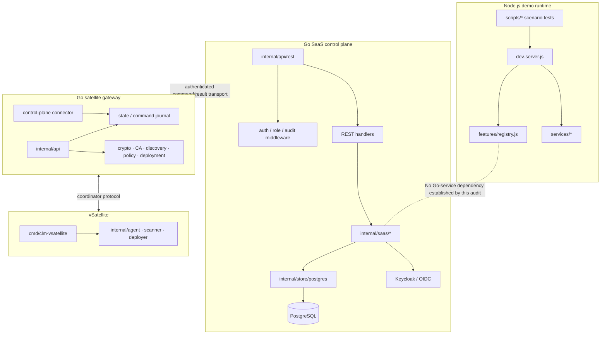

# CLM Dependency Analysis — Initial Baseline

**Audit date:** 2026-11-10  
**Scope:** Tracked repository at `D:\400 clm\CLM`

## Runtime and package dependency map

## Observed dependency boundaries

| Boundary | Observed dependency | Assessment |
|---|---|---|
| Demo tests to app | Root Node test scripts import `dev-server.js`; the feature smoke runner also imports the Node registry. | These are mock/demo tests, not Go API integration tests. |
| Node feature catalog | `dev-server.js` uses the 400-feature registry and Node service modules. | No direct dependency from the Go REST router to the JavaScript feature registry was established. |
| Go REST to domain | `internal/api/rest/router.go` wires handlers and `internal/saas/*` services. | Modular Go service layout; route-to-requirement completeness was not traced in this initial pass. |
| SaaS persistence | Go repositories use PostgreSQL and transaction-local tenant context helpers. | SQL policy definitions exist, but migration application is incomplete in the standard setup paths. |
| Identity | SaaS identity/SSO services connect to Keycloak and validate configured token flows. | Live identity behavior was not tested. |
| SaaS to gateway | Control plane and satellite source include separate command/connector paths. | Transport security and operational behavior were not independently exercised in this audit. |
| Gateway to vSatellite | Gateway coordinator routes and vSatellite agent source are present. | Source documentation conflicts; end-to-end protocol behavior remains unverified. |
| Build layout | Component Go modules use a shared staging script to produce the canonical `github.com/m2p/clm` import layout. | Direct `go test ./...` from each module is not a valid substitute for the staged workflow. |

## Dependency and cycle assessment

- The repository has separately identifiable Node demo, Go SaaS, gateway, and vSatellite execution surfaces.
- The 400-feature catalog is not demonstrated to be a dependency of the Go SaaS service graph.
- The staged Go workflow bundles packages to satisfy cross-component import paths; this is an intentional monorepo build boundary but increases reliance on the staging script.
- No complete static dependency graph or cycle detector was run. Therefore this audit does **not** claim that circular dependencies are absent.
- Database migration ordering is a known dependency failure: the default setup paths do not apply all migrations required by the documented contract schema and controls. See `CLM-ARCHITECTURE-AUDIT.md`, finding `CLM-ARCH-001`.

## Next analysis steps

1. Generate a machine-checked Go package dependency graph using the canonical staged source layout.
2. Trace each public Go route through handler, service, repository, authorization, and tests.
3. Map each migration to the environment/bootstrap path that applies it.
4. Add CI checks for schema bootstrap and tenant isolation against the exact supported PostgreSQL versions.
