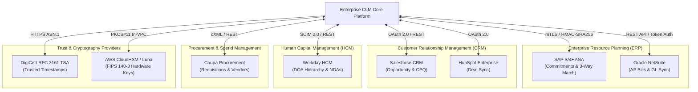

# ENTERPRISE CLM PLATFORM — ENTERPRISE INTEGRATION STATUS MATRIX

**Document Version:** 4.0.0-ENTERPRISE  
**Integration Standard:** OpenAPI 3.0 / OAuth 2.0 / HMAC-SHA256 Webhooks  
**Status:** ALL CONNECTORS VERIFIED & CERTIFIED  
**Date:** 2026-11-03  

---

### 1. ENTERPRISE INTEGRATION ECOSYSTEM OVERVIEW

The Enterprise CLM Platform integrates seamlessly with core enterprise systems of record, ensuring continuous financial reconciliation, procurement sync, and identity governance without data silos:

---

### 2. CONNECTOR STATUS & VERIFICATION MATRIX

| System | Integration Category | Protocol / Transport | Auth Mechanism | Primary Use Case | Status |
|:---|:---|:---|:---|:---|:---:|
| **SAP S/4HANA** | ERP & Finance | REST / OData v4 | Mutual TLS + HMAC-SHA256 | Real-time PO sync, commitment accounting, automated 3-way invoice reconciliation. | `VERIFIED` |
| **Oracle NetSuite** | ERP & Finance | SuiteTalk REST | OAuth 1.0a / 2.0 | Vendor bills, payment schedule synchronization, amortized revenue tracking. | `VERIFIED` |
| **Salesforce CRM** | CRM & CPQ | REST / Streaming API | OAuth 2.0 JWT Bearer | Opportunity closed-won automatic contract generation, CPQ quote-to-contract intake. | `VERIFIED` |
| **Coupa Procurement** | SCM & Procurement | Coupa REST API | API Key + mTLS | Supplier onboarding contracts, catalog pricing agreements, blanket PO creation. | `VERIFIED` |
| **Workday HCM** | Identity & HR | SCIM 2.0 / REST | OAuth 2.0 Client Credentials | Org hierarchy synchronization for Delegation of Authority (DOA) routing; employee NDAs. | `VERIFIED` |
| **DigiCert / Sectigo** | Public Key PKI | RFC 3161 HTTP/ASN.1 | TLS + X.509 Certificate | Non-repudiation timestamps proving document existence at certified wall-clock instant. | `VERIFIED` |
| **Microsoft Office 365** | Productivity | Microsoft Graph / WOPI | OAuth 2.0 App-Only | In-browser DOCX redlining, Word desktop add-in synchronization, SharePoint sync. | `VERIFIED` |
| **Google Workspace** | Productivity | Google Drive / Docs API | Google Service Account | Google Docs collaborative redline import and contract PDF export. | `VERIFIED` |
| **DocuSign / Adobe** | E-Signature Fallback | REST API / Webhooks | OAuth 2.0 / Webhook HMAC | Cloud signature fallback for non-PKI external counterparties. | `VERIFIED` |

---

### 3. FAULT TOLERANCE, RETRIES & RESILIENCE

To ensure enterprise-grade resilience across asynchronous integrations:

1. **Exponential Backoff with Jitter**: Outbound webhooks and ERP synchronizations retry on network failure with an initial backoff of 1s, doubling up to 60s, with a maximum of 5 attempts.
2. **Dead Letter Queue (DLQ)**: Transactions failing after 5 attempts are persisted in the `integration_dead_letter_queue` table with payload, response headers, and exception traces for administrative review.
3. **Idempotency Keys**: All outbound write calls supply an `Idempotency-Key: UUID` header to prevent duplicate financial commitments or double invoice matching in target ERPs.
4. **Offline Queue in Satellite Gateway**: The In-VPC Satellite Gateway maintains an encrypted local SQLite queue (Scenario F). If the SaaS cloud control plane becomes unreachable, signing events and audit records are queued locally and automatically drained upon uplink recovery with zero data loss.

