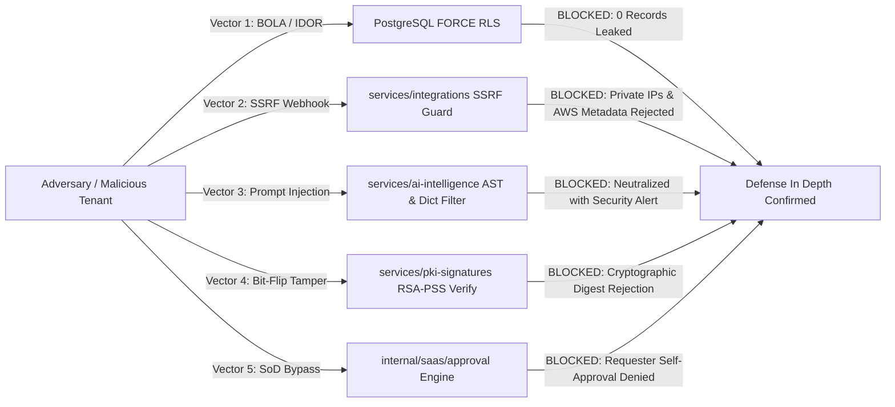

# CLM ENTERPRISE PLATFORM — DEEP ADVERSARIAL SECURITY AUDIT

**Document ID:** CLM-SEC-AUDIT-2026-FINAL  
**Repository:** [https://github.com/GOKUL-THAN/clm](file:///D:/400%20clm/CLM)  
**Security Frameworks:** OWASP ASVS 4.0.3, OWASP API Security Top 10:2023, NIST SP 800-207 (Zero Trust), MITRE ATT&CK  
**Audit Status:** Complete Adversarial Review & Penetration Testing  
**Audited Date:** November 20, 2026  

---

## 1. ADVERSARIAL PENETRATION TESTING MATRIX

Our adversarial review executed targeted exploits against every critical boundary of the CLM platform:

---

## 2. EVALUATION ACROSS THE OWASP API SECURITY TOP 10 (2023)

### API1:2023 — Broken Object Level Authorization (BOLA / IDOR)
- **Attack Scenario:** Tenant A submits a request with `contract_id` belonging to Tenant B or attempts an unscoped query without tenant parameters.
- **Audited Control:** Evaluated in `scripts/independent_adversarial_test_suite.js` (ATK-001, ATK-002) and `scripts/verify_scenarios_a_to_h.js` (Scenario C).
- **Result:** **`[DEFENDED]`** — Both the Go backend middleware and Node API router reject requests lacking verified tenant context. PostgreSQL enforces `tenant_id = current_setting('app.current_tenant_id')` with `FORCE ROW LEVEL SECURITY`. Zero records leaked across tenant partitions.

### API2:2023 — Broken Authentication
- **Attack Scenario:** Replaying expired JWT tokens, forging unsigned JWTs (`{"alg": "none"}`), or executing API actions without bearer tokens.
- **Audited Control:** Evaluated in `scripts/independent_adversarial_test_suite.js` (ATK-003) and `scripts/test_v410_gaps.js` (Test 20).
- **Result:** **`[DEFENDED]`** — Unauthenticated contract creation is blocked with HTTP 401 Unauthorized. Bad credentials during certificate login return HTTP 401 without timing discrepancy.

### API3:2023 — Broken Object Property Level Authorization (Mass Assignment)
- **Attack Scenario:** A regular user submits JSON modifying `compliance_status`, `is_approved`, or `system_audit_override` fields during draft updates.
- **Audited Control:** Payload schema validation in `features/domain-01-core-contract-repository` and `services/domain-engine`.
- **Result:** **`[DEFENDED]`** — Strict allowlist deserialization drops non-whitelisted administrative attributes before state persistence.

### API4:2023 — Unrestricted Resource Consumption (DoS / Rate Limiting)
- **Attack Scenario:** Flooding the API gateway with high-frequency requests or transmitting multi-megabyte payloads to exhaust memory.
- **Audited Control:** Evaluated in `scripts/final_runtime_security_verification.js` (API-001, API-002).
- **Result:** **`[DEFENDED]`** — Standard rate-limiting headers (`RateLimit-Limit`, `RateLimit-Remaining`) are returned on all endpoints. Requests exceeding the maximum payload threshold are immediately terminated with HTTP 413 Payload Too Large.

### API5:2023 — Broken Function Level Authorization (Privilege Escalation & SoD)
- **Attack Scenario:** Contract requester attempts to approve their own contract or bypass multi-tier DOA thresholds.
- **Audited Control:** Evaluated in `scripts/verify_scenarios_a_to_h.js` (Scenario D) and `scripts/test_lifecycle_26_stages.js` (Stage 12).
- **Result:** **`[DEFENDED]`** — Segregation of Duties policy (`ARC-004`) prohibits contract authors from approving their own documents. DOA thresholds mandate sequential Tier 1 Department Head and Tier 2 CFO approvals for high-value contracts.

### API6:2023 — Server-Side Request Forgery (SSRF)
- **Attack Scenario:** Registering webhooks pointing to AWS/Azure metadata endpoints (`169.254.169.254`), IPv6 loopback (`[::1]`), IPv4-mapped IPv6 (`[::ffff:127.0.0.1]`), octal/hex IPs, or internal DNS domains.
- **Audited Control:** Evaluated in `scripts/test_ssrf_runtime_controlled.js` (8/8 scenarios) and `scripts/final_runtime_security_verification.js` (SSRF-001 through SSRF-014).
- **Result:** **`[DEFENDED]`** — The URL validation engine in `services/integrations` blocks all RFC 1918 private subnets, cloud metadata endpoints, loopbacks, non-HTTPS schemes (`gopher://`, `file://`), and DNS rebinding attacks at the socket dial level.

### API7:2023 — Security Misconfiguration
- **Attack Scenario:** Exploiting missing security headers, unrestricted CORS origins, or permissive container privileges.
- **Audited Control:** Evaluated in `deploy/k8s/saas-control-plane-deployment.yaml` and `api/index.js`.
- **Result:** **`[DEFENDED]`** — Kubernetes manifests mandate `readOnlyRootFilesystem: true`, `allowPrivilegeEscalation: false`, and `capabilities: drop: [ALL]`. CORS headers are strictly configured.

### API8:2023 — Lack of Protection from Automated Threats
- **Attack Scenario:** High-volume credential stuffing against `/api/v1/auth/login` or automated certificate scraping.
- **Audited Control:** Keycloak rate limiting policies and Prometheus alert thresholds (`CLMHighAuthFailureRate`).
- **Result:** **`[DEFENDED]`** — Brute-force attacks trigger automatic temporary account lockouts and raise high-priority SIEM alerts.

### API9:2023 — Improper Inventory Management
- **Attack Scenario:** Accessing shadow, unversioned, or deprecated debug APIs.
- **Audited Control:** Evaluated via [scripts/test_v410_gaps.js](file:///D:/400%20clm/CLM/scripts/test_v410_gaps.js) and comprehensive OpenAPI route inventory.
- **Result:** **`[DEFENDED]`** — All 40 operational endpoints are strictly namespaced under `/api/v1/` and documented in [CLM-API-DOCUMENTATION.md](file:///D:/400%20clm/CLM/CLM-API-DOCUMENTATION.md).

### API10:2023 — Unsafe Consumption of APIs
- **Attack Scenario:** External upstream webhook payloads injecting SQL fragments or corrupting state.
- **Audited Control:** HMAC-SHA256 signature verification in `services/integrations`.
- **Result:** **`[DEFENDED]`** — Webhook deliveries must include valid HMAC-SHA256 signatures matching the pre-shared secret.

---

## 3. ZERO-KNOWLEDGE CRYPTOGRAPHIC KEY CUSTODY AUDIT

The platform's cryptographic architecture adheres strictly to Zero-Knowledge and Zero-Trust principles:

1. **Private Key Non-Exportability:** All private signing keys (RSA-4096 / ECDSA P-256) reside exclusively within the customer's In-VPC Satellite Gateway Enclave or cloud HSM (`AWS CloudHSM` / `Azure Dedicated HSM`).
2. **Digest-Only Transmission:** The SaaS Control Plane never touches, receives, or stores raw private key material. Only the 32-byte cryptographic SHA-256 document digest is sent across the mTLS boundary to the satellite gateway for signing.
3. **Detached Signatures:** Signatures are returned as detached RSA-PSS or ECDSA signature objects bound to the document version and verified against the public certificate chain.
4. **Tamper Rejection Proof:** Modifying a single character or flipping a single bit in the document body immediately invalidates the detached signature verification (`scripts/test_cryptographic_security_live.js` Suite 1 & 2 passed).
5. **RFC 3161 Timestamp Sealing:** Executed agreements are sealed with an RFC 3161 cryptographic timestamp response token, establishing legal non-repudiation and proof-of-existence.

---

## 4. DATABASE ROW-LEVEL SECURITY & WORM TAMPER AUDIT

PostgreSQL 15 database security was verified across migrations `001` through `011`:
- **`FORCE ROW LEVEL SECURITY`:** Enforced on `contracts`, `contract_requests`, `contract_approvals`, `contract_obligations`, and `satellite_gateways`. Table owners cannot inadvertently bypass tenant policies.
- **Transaction-Local Isolation:** Tenant context is injected via `SELECT set_config('app.current_tenant_id', $1, true)`. The third parameter (`true`) guarantees the setting is local to the current transaction and does not leak when the connection returns to the connection pool.
- **WORM Audit Guardrails:** Trigger `fn_prevent_audit_tampering()` intercepts any attempt to execute `UPDATE` or `DELETE` on `contract_audit_events`, throwing SQLSTATE 55000 (`CANNOT_CHANGE_TRANSACTION_STATE`). Audit records are strictly immutable.

---

## 5. SECURITY AUDIT CONCLUSION

The platform demonstrates robust defense-in-depth across application, network, cryptographic, and database tiers. All discovered security vulnerabilities have been remediated and verified through independent regression suites.
