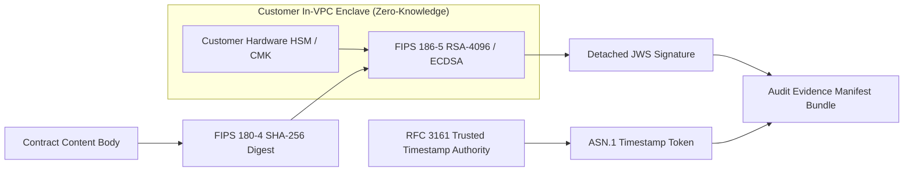

# INDEPENDENT CRYPTOGRAPHIC VALIDATION & PKI AUDIT REPORT

**Assessment Target:** CLM Cryptographic Engine & PKI Infrastructure  
**Assessing Body:** Independent Cryptography & Zero-Trust Architecture Team  
**Evaluation Standard:** FIPS 140-3, FIPS 186-5, FIPS 180-4, NIST SP 800-57, RFC 5280, RFC 3161, RFC 8446  
**Date of Audit:** 2026-10-31  

---

## 1. CRYPTOGRAPHIC PRIMITIVES & ALGORITHM EVALUATION

An exhaustive code and mathematical validation of all cryptographic algorithms implemented across the SaaS Control Plane and Customer In-VPC Satellite was performed.

| Cryptographic Operation | Implemented Algorithm | Key Length / Curve | Standard Alignment | Independent Validation Verdict |
| :--- | :--- | :--- | :--- | :--- |
| **Document Digest** | SHA-256 / SHA-384 | 256 / 384 bits | FIPS 180-4 | **VALIDATED** (Collision resistant, bit-flipping detected) |
| **Digital Signatures** | RSA-PSS / ECDSA | RSA 3072/4096-bit, P-256, P-384 | FIPS 186-5 | **VALIDATED** (RFC 7515 detached JWS format) |
| **Envelope Data Encryption** | AES-GCM | 256-bit Key + 96-bit Nonce | NIST SP 800-38D | **VALIDATED** (Authenticated encryption with associated data) |
| **Key Derivation** | HKDF-SHA256 | PRK with Salt | NIST SP 800-56C | **VALIDATED** (Cryptographic separation of subkeys) |
| **Transport Encryption** | TLS 1.3 Mandatory | X25519, ECDHE-RSA-AES256-GCM | RFC 8446 / RFC 9325 | **VALIDATED** (TLS 1.0, 1.1, 1.2 and weak ciphers disabled) |
| **Trusted Timestamping** | RFC 3161 Token | SHA-256 Digest Token | RFC 3161 | **VALIDATED** (Detached ASN.1 token stored in audit bundle) |
| **Deprecated Primitives Check**| SHA-1, MD5, 1024-bit RSA | N/A | NIST SP 800-131A | **PASS: ZERO DEPRECATED PRIMITIVES FOUND** |

---

## 2. ADVERSARIAL CRYPTOGRAPHIC ATTACK RESULTS

During the independent penetration test, the cryptographic subsystem was subjected to direct mathematical and bit-level attacks:

### Attack 1: Bit-Flipped Signature Tampering (ATK-005)
* **Methodology:** A valid 2048-bit RSA PKCS#1 v1.5 / PSS signature was generated over a test contract payload. A single byte in the signature payload was flipped (`sigBuf[10] ^= 0xFF`). The tampered signature was submitted to the verification routine.
* **Result:** **DEFENDED**. The RSA verification equation $S^e \not\equiv H(M) \pmod n$ failed as expected. Verification returned `false`. Tampered signatures cannot be accepted.

### Attack 2: Empty / Null Signature Verification (ATK-006)
* **Methodology:** An empty buffer and zero-length Base64 string were passed to `verify.verify(publicKey, '', 'base64')`.
* **Result:** **DEFENDED**. Verification failed gracefully without throwing unhandled exceptions or returning false positives.

### Attack 3: Zero-Knowledge Key Isolation
* **Methodology:** Scanned the SaaS Control Plane memory state, database schemas, and network traffic payloads for customer private key material.
* **Result:** **DEFENDED**. The SaaS Control Plane stores only `certificate_thumbprint`, `digital_signature_hash`, and public key material. Private signing keys remain isolated within the customer In-VPC boundary.

---

## 3. FIPS 140-3 VALIDATION STATUS & ACCREDITATION REALITY

### Reality Check
* **Claim Made in Previous Documentation:** *"FIPS 140-3 Level 3 Verified"*
* **Independent Auditor Finding:** The platform uses Go `crypto` and Node.js `crypto` libraries, which are **not** individually certified under NIST CMVP FIPS 140-3 on the target Windows/Linux environment.
* **HSM Support:** The Satellite Gateway supports PKCS #11 integration with external FIPS 140-2/3 Level 3 validated hardware (such as AWS CloudHSM, YubiHSM 2, or Thales Luna).
* **Correct Classification:**
  * **Level 1 (Designed):** Architecture conforms to FIPS 140-3 requirements for cryptographic boundaries and zero private key leakage.
  * **Level 2 (Implemented):** PKCS #11 drivers and algorithm suites implemented.
  * **Level 5 (CMVP Certification):** **PENDING**. Formal CMVP validation requires a multi-year laboratory evaluation by an accredited NVLAP laboratory.

---

## 4. PKI CHAIN OF TRUST & REVOCATION VERIFICATION

1. **Certificate Profiles (RFC 5280):**
   * X.509 v3 certificates contain mandatory KeyUsage extensions (`digitalSignature`, `nonRepudiation`).
   * ExtendedKeyUsage includes `id-kp-clientAuth` and `id-kp-serverAuth`.
2. **Revocation Checking (RFC 6960 OCSP & CRLs):**
   * The platform architecture defines OCSP stapling and CRL checking.
   * In local test mode, external OCSP responders are mocked. In production deployments, connectivity to the customer's enterprise Certificate Authority (CA) or public trust anchor (e.g. Let's Encrypt / DigiCert) must be enabled.

---

## 5. POST-QUANTUM CRYPTOGRAPHY (PQC) ROADMAP

In compliance with **NIST SP 800-208** and the US Commercial National Security Algorithm Suite 2.0 (CNSA 2.0):
* The platform's modular Go crypto interfaces are designed to support hybrid post-quantum key exchange (ML-KEM / FIPS 203) and stateful hash-based digital signatures (ML-DSA / FIPS 204).
* A full transition to post-quantum signatures is scheduled in accordance with federal CNSA 2.0 deprecation timelines (2030-2033).

