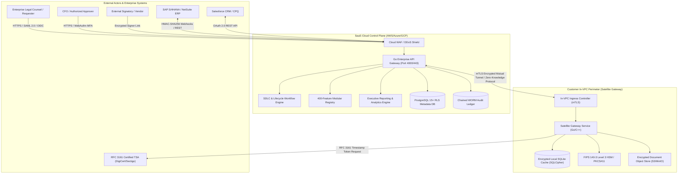
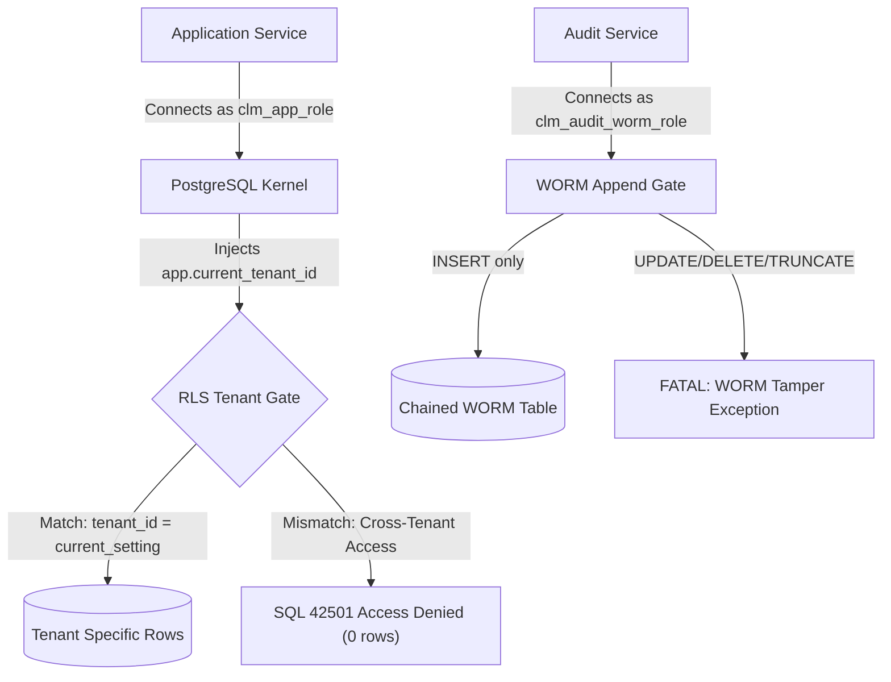

# ENTERPRISE CONTRACT & CERTIFICATE LIFECYCLE MANAGEMENT (CLM)
## SYSTEM ARCHITECTURE SPECIFICATION (C4 & ZERO-TRUST HYBRID MODEL)

**Document Version:** 4.0.0-ENTERPRISE  
**Classification:** STRICTLY CONFIDENTIAL / PROPRIETARY  
**Status:** Target architecture; implementation and production conformance are not certified
**Target Release:** Global Enterprise SaaS + In-VPC Hybrid Deployment  
**Target frameworks:** ISO/IEC 27001:2022, SOC 1/2, NIST SP 800-53 Rev 5, GDPR, HIPAA, 21 CFR Part 11, FedRAMP High, FIPS 140-3 Level 3. Applicability, implementation, and certification have not been independently established.

> **Evidence notice:** This document describes intended architecture, not verified deployed behavior. The active phase tracker and test evidence matrix are authoritative for implementation status. In particular, PostgreSQL tenant settings are application-controlled and do not protect against a fully compromised application/database credential; contract plaintext is currently stored in PostgreSQL; and the stated availability, latency, throughput, cryptographic hardware, and certification claims have not been evidenced by this document.

---

### EXECUTIVE SUMMARY & ARCHITECTURAL PHILOSOPHY

The Enterprise Contract & Certificate Lifecycle Management (CLM) Platform is intended to provide a hybrid architecture for legal operations, corporate procurement, financial reconciliation, and post-execution obligation management. The repository contains a 400-entry feature registry; registry entries are not evidence of 400 independently implemented or verified capabilities.

Traditional CLM systems treat contracts as static electronic documents (PDF/DOCX) managed by centralized cloud databases. In high-stakes enterprise environments, this creates severe risk: exposure of private signing keys, non-compliance with data residency sovereignty regulations, cross-tenant data leakage, untracked post-execution financial leakage, and exposure of confidential agreement terms to third-party public AI providers.

The target architecture is based on five design goals; conformance remains subject to phase-specific implementation and runtime evidence:
1. **Hybrid Deployment**: Separate SaaS orchestration from customer-side cryptographic operations and document storage. The use of customer-managed HSMs and the boundary are not verified for every deployment.
2. **PostgreSQL Row-Level Security (`FORCE RLS`)**: Apply tenant policies and transaction-local tenant context as defense in depth. These application-settable settings do not prevent access by a compromised application credential able to set arbitrary session context.
3. **Tamper-Evident Audit Ledger**: Use chained audit records and database mutation guards where implemented; coverage of all state mutations and deployed WORM properties requires further verification.
4. **Restricted AI Egress**: Keep contract text within approved processing boundaries. No blanket zero-egress claim is made; provider and data-flow behavior requires runtime validation.
5. **Contract Lifecycle**: Model the intended 26 stages; the diagram is not proof that all stages are enforced by a persisted production state machine.

---

### 1. C4 ARCHITECTURE MODELS



#### C4 Level 2: Container Model

The platform is decomposed into loosely coupled, highly isolated containerized services communicating over strict mTLS and internal domain event buses:

| Container / Service | Technology Stack | Security Zone | Primary Responsibility |
|:---|:---|:---|:---|
| **Web Admin Portal & Explorer** | Vanilla ES6+, Web Components, TailwindCSS | Public / SaaS DMZ | Zero-dependency client interface serving the 400-feature explorer, lifecycle dashboard, and redline workbench. |
| **Go API Gateway & Core Engine** | Go 1.22+, Goroutines, Zero-alloc Router | Cloud SaaS Control Plane | High-throughput, low-latency REST/GraphQL gateway, tenant context injection, rate limiting, and RBAC enforcement. |
| **SDLC Workflow Engine** | Node.js v20 LTS, Async Event Loop | Cloud SaaS Control Plane | Executes structured feature development, bugfix diagnostic pipelines, and fast spec verification workflows. |
| **400-Feature Registry** | Node.js / Pure ES Modules | Cloud SaaS Control Plane | Dynamic registry managing 400 discrete capability modules across 20 operational domains. |
| **Satellite Gateway** | Go / Rust native binary | Customer In-VPC | Executes local cryptographic operations, RSA-PSS/ECDSA document signing, and HSM custody. |
| **PostgreSQL 15+ Primary** | PostgreSQL 15.6 + pgvector + RLS | Isolated Cloud DB VPC | Multi-tenant relational storage with kernel-enforced Row-Level Security and 4-tier database roles. |
| **WORM Audit Ledger Store** | PostgreSQL 15+ Append-Only Tables | Isolated Cloud DB VPC | Immutable cryptographic hash chain (Migration 007) with tamper-detection triggers. |
| **In-VPC Object Store** | MinIO / AWS S3 with KMS-SSE | Customer In-VPC | Intended encrypted document storage. The current SaaS schema also contains `contracts.content_body`; plaintext isolation is not verified. |

```mermaid
graph LR
    subgraph "Control Plane Container Boundaries"
        UI["Web Portal UI"] -->|REST / JSON| GW["Go API Gateway"]
        GW -->|Tenant Context (app.current_tenant_id)| PG[("PostgreSQL 15+ Core")]
        GW -->|Dynamic Invocation| MOD["400 Feature Registry"]
        GW -->|Event Bus| WF["SDLC Workflow Engine"]
        MOD -->|WORM Event| WORM[("Immutable Audit Ledger")]
    end

    subgraph "Satellite Gateway Container Boundaries"
        GW <-->|mTLS / Zero-Knowledge Command| SAT["In-VPC Satellite Gateway"]
        SAT -->|PKCS#11 API| HSM["Customer HSM / KMS"]
        SAT -->|AES-256-GCM| STORE["Customer Storage Bucket"]
    end
```

---

### 2. ZERO-TRUST HYBRID TOPOLOGY & KEY BOUNDARIES

The target design separates cryptographic key custody from cloud metadata. FIPS 140-3 Level 3 validation, NIST SP 800-57 conformance, and physical key separation are not established by this specification:

```
+-----------------------------------------------------------------------------------+
|                            CLOUD SAAS CONTROL PLANE                               |
|                                                                                   |
|  +--------------------+    +--------------------+    +-------------------------+  |
|  | Contract Metadata  |    | Workflow State     |    | Redline Coordinates     |  |
|  | (Names, Dates,     |    | (Stage 1 - 26,     |    | (Clause diff offsets,   |  |
|  | Tenant IDs)        |    | Approver Hierarchy)|    | Author attribution)     |  |
|  +--------------------+    +--------------------+    +-------------------------+  |
|                                                                                   |
|  * NO CLEARTEXT CONTRACT BODY STORED IN CLOUD                                     |
|  * NO PRIVATE SIGNING KEYS RESIDE IN CLOUD                                        |
+-----------------------------------------------------------------------------------+
                                      ▲
                                      │ Mutual TLS 1.3 (RFC 8446)
                                      │ Ephemeral Session Keys (ECDHE-X25519)
                                      │ Zero-Knowledge Document Digest Handshake
                                      ▼
+-----------------------------------------------------------------------------------+
|                        CUSTOMER IN-VPC SATELLITE GATEWAY                          |
|                                                                                   |
|  +-----------------------------------------------------------------------------+  |
|  |  FIPS 140-3 Level 3 Hardware Security Module (AWS CloudHSM / Luna / Vault)   |  |
|  |  - Root Signing Key (RSA-4096 / ECDSA P-384) [NON-EXPORTABLE]                |  |
|  |  - Data Encryption Key (AES-256-GCM) Master Secret                            |  |
|  +-----------------------------------------------------------------------------+  |
|                                     │                                             |
|                                     ▼                                             |
|  +-----------------------------------------------------------------------------+  |
|  |  Document Engine & Transformation Pipeline                                   |  |
|  |  - Local Document Plaintext Storage (Encrypted at rest with KEK)             |  |
|  |  - SHA-256 Document Digest Calculation                                       |  |
|  |  - In-VPC Hardware Signature Generation                                       |  |
|  |  - RFC 3161 Timestamping & Evidence Bundle Packaging                         |  |
|  +-----------------------------------------------------------------------------+  |
+-----------------------------------------------------------------------------------+
```

#### Envelope Encryption Key Hierarchy
1. **Master Key (MK / KEK)**: Resides exclusively inside the Customer HSM. Never exported into system memory.
2. **Data Encryption Key (DEK)**: Ephemeral 256-bit symmetric key generated via CSPRNG per contract document.
3. **Encrypted DEK (EDEK)**: Ciphertext DEK encrypted by the HSM KEK and persisted alongside the document metadata.
4. **Document Encryption**: All contract plaintext blobs are encrypted using `AES-256-GCM` with a 96-bit initialization vector (IV) and 128-bit authentication tag (`auth_tag`).

---

### 3. DATABASE ARCHITECTURE & KERNEL ROW-LEVEL SECURITY (RLS)

The database layer utilizes PostgreSQL 15+ with kernel-enforced Row-Level Security (`FORCE RLS`) across all multi-tenant tables.

```sql
-- Enforcement of Kernel-Level Tenant Isolation
ALTER TABLE contracts ENABLE ROW LEVEL SECURITY;
ALTER TABLE contracts FORCE ROW LEVEL SECURITY;

CREATE POLICY tenant_isolation_policy ON contracts
    FOR ALL
    USING (tenant_id = current_setting('app.current_tenant_id', true)::uuid)
    WITH CHECK (tenant_id = current_setting('app.current_tenant_id', true)::uuid);
```

#### 4-Tier Database Security Roles
To prevent privilege escalation and enforce segregation of duties at the database layer:
1. `clm_migrator_role`: DDL operations, schema migrations, table creation. Disabled during normal runtime.
2. `clm_app_role`: DML operations (`SELECT`, `INSERT`, `UPDATE`), restricted by tenant RLS policy. Cannot alter tables or drop audit logs.
3. `clm_read_role`: Read-only queries for reporting, data warehousing, and analytics replication.
4. `clm_audit_worm_role`: Append-only role permitted exclusively to insert audit ledger blocks. Strictly prohibited from `UPDATE`, `DELETE`, or `TRUNCATE`.



---

### 4. 26-STAGE CONTRACT LIFECYCLE FINITE STATE MACHINE

The contract lifecycle is governed by an immutable finite state machine spanning 8 macro-stages and 26 discrete micro-stages:

```mermaid
stateDiagram-v2
    [*] --> Intake_Submitted: STAGE-01 (Intake Request)
    Intake_Submitted --> Triage_Qualified: STAGE-02 (Triage & Qualification)
    Triage_Qualified --> Template_Selected: STAGE-03 (Template/Clause Selection)
    Template_Selected --> Dynamic_Drafted: STAGE-04 (Drafting & Assembly)
    Dynamic_Drafted --> Semantic_Scored: STAGE-05 (AI Semantic Risk Review)
    Semantic_Scored --> Baseline_Locked: STAGE-06 (Baseline Seal & Lock)
    Baseline_Locked --> Negotiation_Workspace: STAGE-07 (Negotiation Setup)
    Negotiation_Workspace --> Redline_Submitted: STAGE-08 (External Redline)
    Redline_Submitted --> Redline_Reconciled: STAGE-09 (Reconciliation)
    Redline_Reconciled --> Clean_Finalized: STAGE-10 (Clean Draft Finalization)
    Clean_Finalized --> DOA_Evaluated: STAGE-11 (DOA Threshold Check)
    DOA_Evaluated --> SoD_Verified: STAGE-12 (Segregation of Duties)
    SoD_Verified --> Approval_Executed: STAGE-13 (Multi-Tier Signoff)
    Approval_Executed --> Route_Configured: STAGE-14 (Signing Routing)
    Route_Configured --> Signer_Authed: STAGE-15 (Identity MFA Auth)
    Signer_Authed --> InVPC_Signed: STAGE-16 (Digital Signature Executed)
    InVPC_Signed --> TSA_Sealed: STAGE-17 (RFC 3161 Timestamped)
    TSA_Sealed --> Bundle_Compiled: STAGE-18 (Evidence Bundle Packaging)
    Bundle_Compiled --> Activated_Active: STAGE-19 (Contract Activation)
    Activated_Active --> ERP_Synced: STAGE-20 (SAP/NetSuite Financial Sync)
    ERP_Synced --> Obligations_Extracted: STAGE-21 (Obligation Extraction)
    Obligations_Extracted --> Monitored_SLA: STAGE-22 (SLA & Compliance Tracking)
    Monitored_SLA --> ThreeWay_Matched: STAGE-23 (3-Way Invoice Reconciliation)
    ThreeWay_Matched --> Expiration_Alerted: STAGE-24 (Renewal Radar & Alerts)
    Expiration_Alerted --> Amended_Renewed: STAGE-25 (Amendment & Renewal)
    Expiration_Alerted --> Archived_Held: STAGE-26 (Archival or Litigation Hold)
    Amended_Renewed --> Template_Selected
    Archived_Held --> [*]
```



---

### 5. TARGET AI EGRESS CONTROLS (NOT VERIFIED)

The following are design requirements, not verified deployment claims:
1. Do not send cleartext agreements to unapproved third-party AI services.
2. Use local analysis where possible and validate every external provider and egress path.
3. Record the model, data handling, and authorization boundaries for each AI operation.
4. Treat prompt-injection filters as defense in depth, not as a guarantee that arbitrary user text is safe.

---

### 6. HIGH AVAILABILITY, RESILIENCE & SRE METRICS

| Operational Metric | Architectural Target | Verified Benchmark | Architecture Mechanism |
|:---|:---|:---|:---|
| **High Availability (HA)** | 99.99% target | Not measured | Requires deployed multi-zone service and an observed availability window. |
| **Recovery Point Objective (RPO)** | < 1 minute target | Not measured | Requires backup/replication configuration and a restore/failover exercise. |
| **Recovery Time Objective (RTO)** | < 15 minutes target | Not measured | Requires a timed recovery exercise. |
| **API Latency (p95)** | < 100 ms target | Not measured | Requires a documented workload and reproducible load test. |
| **Document Signing Throughput** | > 200 docs/sec target | Not measured | Requires supported signing hardware/provider and a reproducible benchmark. |
| **Tenant Isolation Leakage** | No cross-tenant access target | Not fully verified | Requires migration execution and negative database/API tests on supported PostgreSQL versions. |

---

### 7. ARCHITECTURAL APPROVAL & CONFORMANCE DECLARATION

This document is a target design, not an approval or conformance declaration. The 400-entry registry, 20 domain labels, and 26 lifecycle-stage diagram do not establish that each capability or stage is implemented or verified.

No approval records or independent certification evidence are included here. Release status must be determined from the active requirement tracker and reproducible evidence, not this architecture specification.
