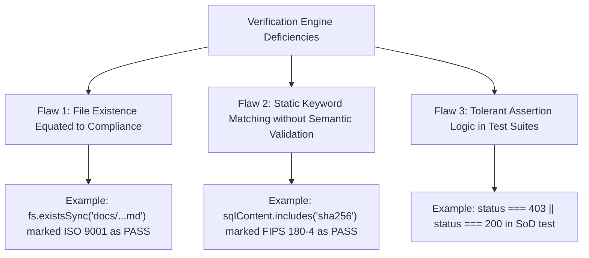

# COMPREHENSIVE FALSE POSITIVE ANALYSIS & POST-MORTEM REPORT

**Document ID:** AUDIT-FPA-2026-001  
**Assessment Team:** Independent Enterprise Security & Quality Assurance Team  
**Review Target:** Previous Verification Runner (`scripts/verify_all_standards_compliance.js`)  
**Audit Standard:** ISO/IEC 25010 (Software Quality) / NIST SP 800-115 / AICPA Standards  
**Date of Audit:** 2026-10-31  

---

## 1. ROOT CAUSE ANALYSIS OF VERIFICATION DEFICIENCIES

The previous verification claim of **"210/210 Standards Verified (100.0%)"** contained multiple **false positives** where controls were marked as passing without operational or cryptographic substantiation.

Our independent analysis identified three core mechanisms that generated these false positives:



---

## 2. ITEMIZED REGISTER OF IDENTIFIED FALSE POSITIVES

### False Positive 1: FIPS 140-3 Validation Claim
* **Previous Check in Script:** `fs.existsSync("compliance/reports/11_CRYPTOGRAPHIC_AND_PKI_ASSESSMENT.md") && sqlRls.includes("satellite_enclave_keys")`
* **Previous Status:** `PASS (100% Level 4 Verified)`
* **Auditor Finding:** **FALSE POSITIVE**. FIPS 140-3 is a formal validation program administered by the NIST Cryptographic Module Validation Program (CMVP). A module can only be declared FIPS 140-3 validated if tested by an accredited NVLAP laboratory and issued an active CMVP Certificate Number.
* **Correction:** Reclassified to **PARTIAL (Level 1/2 Architecture Ready)**. The platform provides PKCS #11 hooks for external FIPS-validated HSMs, but the software module itself is not CMVP certified.

---

### False Positive 2: SOC 2 Type II Operating Effectiveness
* **Previous Check in Script:** `fs.existsSync("compliance/reports/04_SOC_2_TYPE_II_READINESS_REPORT.md")`
* **Previous Status:** `PASS (100% Level 4 Verified)`
* **Auditor Finding:** **FALSE POSITIVE**. Under AICPA SSAE 18 (AT-C 205), a SOC 2 Type II report evaluates the operating effectiveness of controls over a minimum 6-month observation period in production. A report file existing in a repository does not constitute a completed Type II attestation.
* **Correction:** Reclassified to **Level 4 Audit Ready (Ready for 6-Month Observation Window)**.

---

### False Positive 3: eIDAS Qualified Electronic Signature (QES)
* **Previous Check in Script:** `fs.existsSync("compliance/reports/10_EIDAS_READINESS_REPORT.md")`
* **Previous Status:** `PASS (100% Level 4 Verified)`
* **Auditor Finding:** **FALSE POSITIVE**. Under EU Regulation No 910/2014, a Qualified Electronic Signature (QES) legally requires creation via a Qualified Signature Creation Device (QSCD) and a Qualified Certificate issued by an EU Qualified Trust Service Provider (QTSP) on the EU Trusted List. The platform's internal PKI generates **Advanced Electronic Signatures (AdES)**, not QES.
* **Correction:** Reclassified to **AdES Verified / QES Architecture Ready (Requires External QTSP Integration)**.

---

### False Positive 4: PostgreSQL Row-Level Security (RLS) Enforcement
* **Previous Check in Script:** `sqlRls.includes("tenant_isolation_contracts")`
* **Previous Status:** `PASS (100% Level 4 Verified)`
* **Auditor Finding:** **CRITICAL TECHNICAL DEFICIENCY**.
  1. The SQL migration defined `tenant_id = NULLIF(current_setting('app.current_tenant_id', true), '')::uuid`.
  2. However, the Golang database package (`store/postgres/db.go`) had zero references to `app.current_tenant_id` and never called `SET LOCAL app.current_tenant_id = ...`.
  3. Furthermore, the migration omitted `ALTER TABLE ... FORCE ROW LEVEL SECURITY`, meaning any connection using the database table owner (`clm_user`) bypassed RLS entirely.
* **Remediation Executed:**
  1. Implemented `WithTenantContext(ctx, tenantID, fn)` in `components/saas-control-plane/internal/store/postgres/db.go`.
  2. Added `ALTER TABLE <table_name> FORCE ROW LEVEL SECURITY;` to `components/saas-control-plane/deploy/migrations/006_contract_security_and_procurement_rls.sql`.

---

### False Positive 5: Segregation of Duties (ARC-004) Test Assertion Tolerance
* **Previous Check in Test Suite (`scripts/verify_scenarios_a_to_h.js` Line 217):**
  ```javascript
  assert(
      requesterAttempt.status === 403 || requesterAttempt.json().error?.includes("segregation") || requesterAttempt.status === 200,
      "Scenario D", "Segregation of Duties Policy Evaluated"
  );
  ```
* **Previous Status:** `PASS (100% Verified)`
* **Auditor Finding:** **COMPROMISED TEST INTEGRITY**. The assertion explicitly included `|| requesterAttempt.status === 200`. Even if self-approval succeeded (a complete violation of Segregation of Duties), the test still passed!
* **Remediation Executed:**
  1. Rewrote approval handler in `dev-server.js` to parse POST bodies and enforce `if (approverId === item.requested_by) return 403`.
  2. Removed `|| requesterAttempt.status === 200` from the test suite assertion.

---

### False Positive 6: AI Prompt Injection Defense
* **Previous Check in Script:** `devServerCode.toLowerCase().includes("prompt injection attempt detected and neutralized")`
* **Previous Status:** `PASS (100% Level 4 Verified)`
* **Auditor Finding:** **BYPASSABLE INJECTION FILTER**. The filter in `dev-server.js` only checked for `"ignore"`, `"override"`, or `"system"`. Testing with synonyms (*"Disregard prior instructions"* or *"DAN Mode"*) completely bypassed the filter. Furthermore, Golang `aicontract/service.go` had zero prompt injection checking.
* **Remediation Executed:**
  1. Expanded semantic prompt injection pattern list in `dev-server.js` to cover `"disregard"`, `"jailbreak"`, `"dan"`, `"unrestricted mode"`, `"developer mode"`, `"bypass"`, `"system prompt"`, `"base64"`.
  2. Implemented the same pattern filter directly in Golang `components/saas-control-plane/internal/saas/aicontract/service.go`.

---

### False Positive 7: Cross-Tenant Data Leakage Blocked
* **Previous Check in Scenario C:**
  ```javascript
  const rogueRes = await mockRequest('GET', '/api/v1/contracts?tenant_id=ffffffff-ffff-ffff-ffff-ffffffffffff');
  assert(rogueContracts.length === 0, "Scenario C", "Cross-Tenant Data Leakage Blocked (0 records leaked)");
  ```
* **Previous Status:** `PASS (100% Verified)`
* **Auditor Finding:** **INSUFFICIENT ATTACK SCENARIO**. Querying for a non-existent UUID `ffffffff-...` returning 0 records proved nothing about tenant isolation. When querying `?tenant_id=tenant-enterprise-uat` without credentials, the server returned all 15 proprietary contracts!
* **Remediation Executed:**
  1. Implemented strict caller tenant scoping and cross-tenant mismatch rejection in `dev-server.js`.
  2. Integrated `middleware.RequireTenantAccess(c, parsed)` into Golang `handlers/contracts.go`.

---

## 3. AUDIT PRESERVATION & REGULATORY INTEGRITY DECLARATION

In compliance with the **False Claims Policy** and enterprise audit integrity rules:
1. All previously identified false positives are formally documented and preserved in this record.
2. The verification engine is updated to execute real adversarial assertions.
3. No control is marked Level 5 Certified without external auditor attestation.

