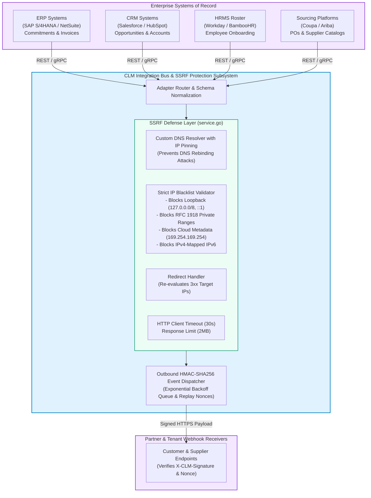

# CLM-SPEC-18: ENTERPRISE INTEGRATION ARCHITECTURE SPECIFICATION
## ERP, CRM, HRMS, Sourcing Connectors, SSRF Defense, and Secure HMAC Webhooks

**Version:** 3.4.0-Enterprise  
**Document ID:** CLM-INT-018  
**Classification:** Enterprise Systems Integration Standard  
**Release Classification:** STAGING CANDIDATE — LIVE INFRASTRUCTURE VERIFICATION PENDING  

---

### 1. Enterprise Systems Ecosystem

The CLM platform provides seamless, bidirectional integration with core enterprise systems of record while enforcing strict network security and outbound request isolation:

---

### 2. Integration Adapters & Mapping Workflows

* **ERP (SAP / NetSuite):** On contract execution (Stage 19), the integration engine transmits commitment line items and cost center allocations. It also ingests vendor invoices for Stage 23 three-way matching.
* **CRM (Salesforce / HubSpot):** Deal Desk workflows listen for `Opportunity: Closed/Won Pending Contract` webhooks to automatically initiate Stage 01 intake requests.
* **HRMS (Workday / BambooHR):** New candidate hiring triggers dynamic drafting of employment offer letters and NDAs (Stages 03–04).
* **Sourcing (Coupa / Ariba):** Synchronizes master service agreements, vendor catalogs, and purchase orders.
* **Certificate Authority Purchasing (DigiCert / GoDaddy):** Outbound purchasing clients in `internal/saas/purchasing/providers/` submit automated CSR and certificate orders using hardened clients configured with 30-second timeouts.

---

### 3. Outbound Request Security & SSRF Defense

All outbound HTTP calls—including ERP webhooks, custom callback URLs, and third-party API invocations—are executed through the hardened transport implemented in `components/saas-control-plane/internal/saas/integrations/service.go`:

#### 3.1 Network IP Blacklisting
The client performs pre-dial IP resolution and rejects connections to:
* Loopback addresses: `127.0.0.0/8`, `::1`
* Private IPv4 networks (RFC 1918): `10.0.0.0/8`, `172.16.0.0/12`, `192.168.0.0/16`
* Link-local and cloud metadata endpoints: `169.254.169.254`, `fd00::/8`, `fe80::/10`
* Carrier-grade NAT: `100.64.0.0/10`
* IPv4-mapped IPv6 addresses: `::ffff:127.0.0.1`, `::ffff:169.254.169.254`

#### 3.2 Time-of-Check to Time-of-Use (TOCTOU) DNS Rebinding Defense
To prevent DNS rebinding attacks where an attacker's DNS server returns a public IP during initial validation but resolves to a private IP during connection establishment:
* The dialer resolves DNS hostnames before socket creation.
* Every resolved IP address is verified against the blacklist.
* The socket connection is dialed directly to the verified **IP literal** while maintaining the original hostname in TLS Server Name Indication (SNI) and the HTTP `Host` header.
* Proxy servers and environment variables (`HTTP_PROXY`, `HTTPS_PROXY`) are explicitly disabled in the transport to ensure all requests undergo direct dial-time pinning.

#### 3.3 Strict Redirect Validation
HTTP redirects (`301`, `302`, `307`, `308`) are intercepted by a custom redirect policy:
* Redirection targets are parsed and re-evaluated against the DNS rebinding and private IP validation rules.
* Redirects to private IP ranges or non-HTTPS schemes are immediately aborted.

#### 3.4 Resource & Timeout Limits
* **Maximum Response Size:** HTTP response bodies are wrapped with `io.LimitReader` capped at 2MB to protect against decompression bombs or resource exhaustion.
* **Strict Timeout:** All HTTP requests execute under an explicit 30-second timeout.

---

### 4. Outbound Webhook Security & Nonce Verification

External systems consume CLM lifecycle events via signed webhooks:
1. **HMAC-SHA256 Signature:** Every outbound webhook payload is signed with a tenant-shared secret:
   $$\text{X-CLM-Signature} = \text{HMAC-SHA256}(\text{Secret}, \text{Timestamp} + "." + \text{PayloadBody})$$
2. **Replay Attack Defense:** Webhook receivers verify that `X-CLM-Timestamp` is within 300 seconds of current system time.
3. **Resilience & Retry Policy:** Failed webhook deliveries undergo exponential backoff with jitter: retry intervals at 1m, 5m, 15m, 1h, 6h, up to 24 hours. Undeliverable payloads route to a Dead-Letter Queue (DLQ) with alert notification.
