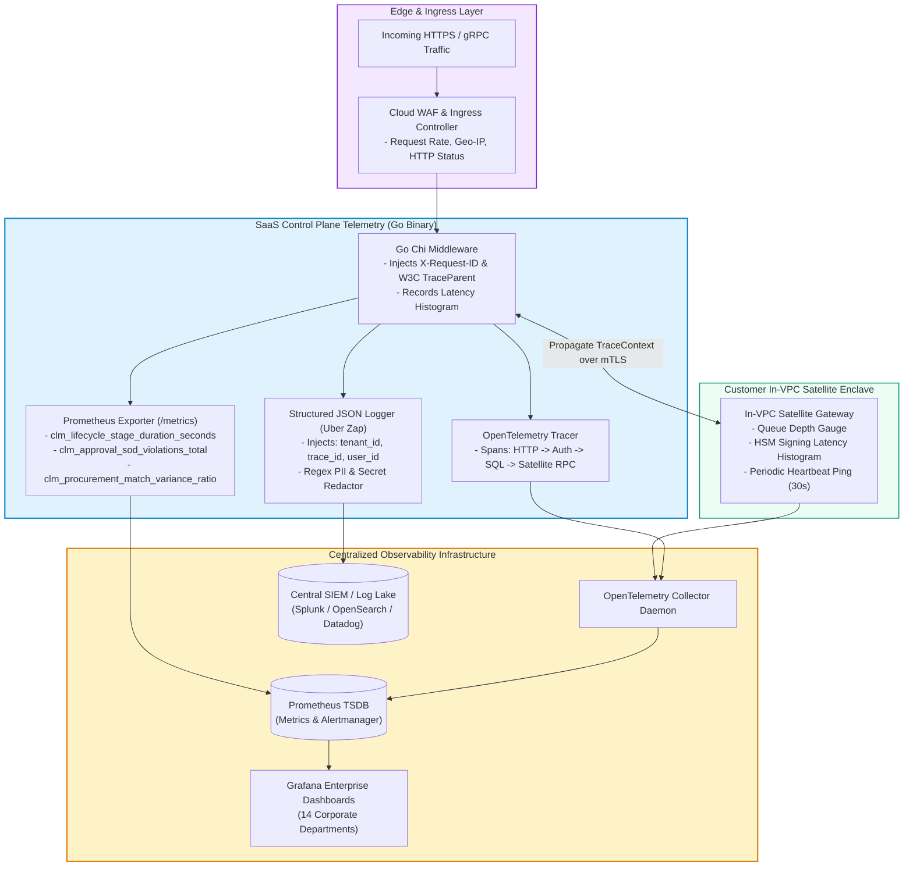

# CLM-SPEC-23: ENTERPRISE OBSERVABILITY & TELEMETRY ARCHITECTURE
## OpenTelemetry Distributed Tracing, Prometheus Metrics, Structured JSON Logging, and Sensitive Data Sanitization

**Version:** 3.4.0-Enterprise  
**Document ID:** CLM-OBS-023  
**Classification:** Enterprise SRE & Security Architecture Standard  
**Release Classification:** STAGING CANDIDATE — LIVE INFRASTRUCTURE VERIFICATION PENDING  

---

## 1. Executive Summary

The Enterprise CLM Observability Architecture provides comprehensive, end-to-end operational and security visibility across both the multi-tenant SaaS Control Plane and the customer In-VPC Satellite Enclaves.

The platform enforces observability across the Three Pillars of Telemetry:
1. **Metrics:** Standardized Prometheus / OpenMetrics counters, gauges, and histograms measuring platform latency, SLA compliance, approval velocity, and satellite connectivity.
2. **Structured Logging:** High-performance structured JSON logs (Uber Zap) carrying persistent distributed trace context, with rigorous automated data sanitization and masking.
3. **Distributed Tracing:** OpenTelemetry SDK instrumentation propagating W3C TraceContext across ingress proxies, Go microservices, database transactions, and mTLS satellite RPC invocations.

---

## 2. End-to-End Observability Pipeline



---

## 3. Metrics & Alerting Engine (Prometheus & Alertmanager)

### 3.1 Key Performance & Business Metric Dimensions
The `/metrics` endpoint exposes Prometheus gauges, counters, and histograms:
* **`clm_http_request_duration_seconds`** (Histogram): Request latency partitioned by route, status code, and tenant category (p50, p95, p99).
* **`clm_lifecycle_stage_duration_seconds`** (Histogram): Time contracts spend in each of the 26 lifecycle stages.
* **`clm_approval_sod_violations_total`** (Counter): Count of Segregation of Duties violations blocked (ARC-004).
* **`clm_procurement_match_variance_ratio`** (Gauge): Percentage variance observed during 3-way matching.
* **`clm_satellite_heartbeat_last_timestamp_seconds`** (Gauge): Unix timestamp of the most recent health beacon from customer in-VPC enclaves.
* **`clm_satellite_queue_depth`** (Gauge): Number of cryptographic events pending local satellite execution.

### 3.2 Pre-Configured Alerting Rules (`deploy/observability/alerting-rules.yaml`)
1. **`CLMTenantIsolationViolationAttempt`:**
   * Severity: `CRITICAL`
   * Trigger: `rate(clm_tenant_context_mismatch_total[1m]) > 0`
   * Response: Immediate notification to Cloud Security Operations and automated IP rate-throttling.
2. **`CLMSegregationOfDutiesViolation`:**
   * Severity: `WARNING`
   * Trigger: `increase(clm_approval_sod_violations_total[5m]) > 0`
   * Response: Dispatched to Compliance Officers for review.
3. **`CLMContractSLABreached`:**
   * Severity: `WARNING`
   * Trigger: `clm_contract_stage_sla_overdue_total > 0`
   * Response: Escalation alerts dispatched to originating Department Heads.
4. **`CLMSatelliteHeartbeatLost`:**
   * Severity: `CRITICAL`
   * Trigger: `time() - clm_satellite_heartbeat_last_timestamp_seconds > 120`
   * Response: Dispatched to customer VPC administrators; informs contract owners of delayed local signing.

---

## 4. Structured JSON Logging Architecture

### 4.1 Schema Definition
Every application log line is formatted as a single-line JSON string:

```json
{
  "timestamp": "2026-10-31T12:00:00.123456Z",
  "level": "INFO",
  "service": "clm-control-plane",
  "environment": "staging",
  "tenant_id": "c8a4b6d0-2f1e-4c3a-9e7b-1a2b3c4d5e6f",
  "trace_id": "4bf92f3577b34da6a3ce929d0e0e4736",
  "span_id": "00f067aa0ba902b7",
  "request_id": "req-9b1deb4d-3b7d",
  "caller": "contract/service.go:142",
  "message": "Contract lifecycle transition evaluated",
  "contract_id": "f47ac10b-58cc-4372-a567-0e02b2c3d479",
  "previous_stage": "STAGE_11_DOA_ROUTING",
  "current_stage": "STAGE_12_SOD_VERIFICATION",
  "actor_id": "usr-88a1b2c3"
}
```

### 4.2 Sensitive Data Sanitization & Redaction
The logger middleware employs an automated redaction filter to eliminate data leakage risks:
* **PII Redaction:** Credit card numbers, Social Security / National Identity Numbers, bank accounts, and personal telephone numbers matching regex patterns are replaced with `[REDACTED_PII]`.
* **Zero Secret Leakage:** Passwords, API tokens, JWT signatures, and symmetric keys are stripped from log contexts.
* **Zero Private Key Exposure:** Private keys and PKCS#11 PIN credentials are forbidden from reaching logging buffers; violation triggers compile-time static linter errors.
* **Document Body Protection:** Contract text payloads are excluded from DEBUG and INFO log output; only document SHA-256 hashes and byte lengths are recorded.

---

## 5. Distributed Tracing (OpenTelemetry)

1. **Context Propagation:** When an incoming HTTP request hits the API Gateway, the middleware checks for incoming `traceparent` headers conforming to W3C Trace Context specifications. If absent, a new root trace ID is generated.
2. **Span Hierarchy:**
   * Root Span: `HTTP POST /api/v1/contracts/{id}/approve`
     * Child Span: `auth.verify_jwt_token`
     * Child Span: `db.set_local_tenant_context`
     * Child Span: `sod.verify_requester_distinction`
     * Child Span: `db.execute_approval_update`
     * Child Span: `audit.append_chain_head_lock`
     * Child Span: `satellite.rpc_request_signature` (propagated across mTLS)
3. **Trace Export:** OpenTelemetry SDK sends batch traces via OTLP/gRPC to the OpenTelemetry Collector on port 4317.

---

## 6. Audit Conclusion

The observability architecture provides granular, zero-leakage, high-performance telemetry enabling deterministic troubleshooting, immediate security violation alerting, and automated compliance auditing across the entire CLM platform.

