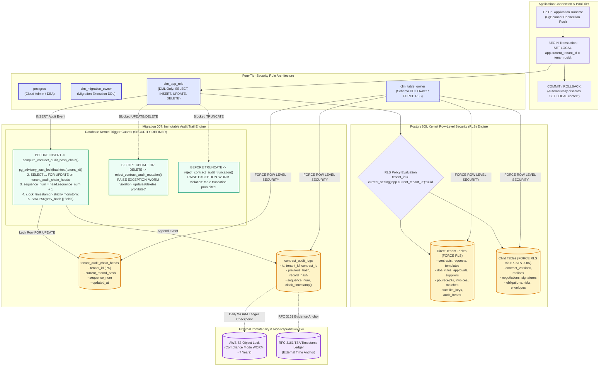

# CLM — DATABASE SECURITY & IMMUTABILITY AUDIT
**Platform:** Enterprise Contract & Certificate Lifecycle Management (CLM) Platform  
**Document Reference:** CLM-AUDIT-2026-DB-004  
**Assessment Date:** 2026-10-31  
**Lead Auditor:** Principal PostgreSQL Database Architect & Security Engineer  
**Classification:** Enterprise Database Security Standard  
**Release Classification:** STAGING CANDIDATE — LIVE INFRASTRUCTURE VERIFICATION PENDING  

---

## 1. Executive Summary

This specification provides the architectural audit and technical implementation details of the PostgreSQL 15+ database tier supporting the CLM platform. 

The database architecture is engineered around two core pillars:
1. **Multi-Tenant Logical Isolation:** Enforced via PostgreSQL Row-Level Security (RLS) across all primary domain tables and child tables (Migrations 006 and 008), operating with transaction-scoped tenant context variables (`SET LOCAL app.current_tenant_id`).
2. **Immutable Audit Trail:** Hardened through Migration 007 (`007_immutable_audit_hash_chaining_and_truncate_protection.sql`), combining row-level locking on tenant chain heads, monotonic sequencing, cryptographic SHA-256 hash chaining, and non-bypassable mutation and truncation triggers.

---

## 2. Diagram 4: Multi-Tenant Database Isolation & Immutability Architecture



---

## 3. Four-Tier Security Role Architecture & Function Permissions

The database enforces least privilege by strictly segregating permissions among four roles:

1. **`clm_table_owner`:**
   * Owns all schema tables, views, sequences, and types.
   * Enforces `FORCE ROW LEVEL SECURITY` on all multi-tenant tables.
2. **`clm_migration_owner`:**
   * Executes database schema migrations in CI/CD pipelines.
   * Switches to `clm_table_owner` via `SET ROLE clm_table_owner;` to ensure table ownership remains uniform.
3. **`clm_app_role`:**
   * Used exclusively by the Go backend application service and connection pool.
   * Granted only Data Manipulation Language (`SELECT`, `INSERT`, `UPDATE`, `DELETE`) on application tables.
   * Granted `INSERT` and `SELECT` on `contract_audit_logs` and `tenant_audit_chain_heads`.
   * **Explicitly denied:** `UPDATE`, `DELETE`, or `TRUNCATE` on audit tables; has no DDL permissions (`CREATE`, `ALTER`, `DROP`); has no `BYPASSRLS` privileges.
4. **`postgres`:**
   * Managed cloud database administrative superuser. Used solely for provisioning database instances, extensions, and initial role configurations.

### Function Execution & Search Path Hardening:
In Migration 007 and 008, all security definer trigger functions are isolated against search path hijacking attacks (such as malicious temporary tables or objects in `pg_temp` or `public`):
1. **Isolated Search Path:** Functions declare `SECURITY DEFINER SET search_path = pg_catalog`.
2. **Schema-Qualified References:** Application tables are explicitly schema-qualified (e.g., `public.tenant_audit_chain_heads`), preventing resolution of shadowed relation names.
3. **Revocation from PUBLIC:**
```sql
REVOKE EXECUTE ON FUNCTION reject_contract_audit_truncate() FROM PUBLIC;
REVOKE EXECUTE ON FUNCTION reject_contract_audit_mutation() FROM PUBLIC;
REVOKE EXECUTE ON FUNCTION compute_contract_audit_hash_chain() FROM PUBLIC;
GRANT EXECUTE ON FUNCTION reject_contract_audit_truncate() TO clm_app_role, clm_table_owner;
GRANT EXECUTE ON FUNCTION reject_contract_audit_mutation() TO clm_app_role, clm_table_owner;
GRANT EXECUTE ON FUNCTION compute_contract_audit_hash_chain() TO clm_app_role, clm_table_owner;
```

---

## 4. Connection Pooling & Multi-Tenant Session Scoping

When using connection poolers (PgBouncer) in `transaction` pooling mode:
* Setting global session variables (`SET app.current_tenant_id = ...`) creates severe security risks if a connection is returned to the pool without being wiped.
* **Architecture Solution:** All database operations execute inside explicit transactions using `SET LOCAL`:
  ```sql
  BEGIN;
  SELECT set_config('app.current_tenant_id', 'tenant-uuid', true); -- true = local to current transaction
  -- Application queries executed here...
  COMMIT; -- or ROLLBACK; automatically resets app.current_tenant_id to empty
  ```
* If a query executes without setting `app.current_tenant_id`, the RLS policy `USING (tenant_id = NULLIF(current_setting('app.current_tenant_id', true), '')::uuid)` fails closed, returning 0 rows.

---

## 5. Migration 007 & 008: Concurrency Engine & Comprehensive RLS

### 5.1 Genesis Concurrency & Row Locking
To eliminate race conditions when multiple concurrent transactions execute the very first audit log for a new tenant:
1. `PERFORM pg_advisory_xact_lock(hashtext(NEW.tenant_id::text));` serializes concurrent transactions for the same tenant.
2. `SELECT last_hash, sequence_num FROM tenant_audit_chain_heads WHERE tenant_id = NEW.tenant_id FOR UPDATE;` locks the chain-head row exclusively.
3. If not found, the `INSERT INTO tenant_audit_chain_heads ... ON CONFLICT (tenant_id) DO UPDATE` ensures safe initialization.
4. Subsequent transactions read the committed previous hash and sequence number, eliminating chain forks.

### 5.2 Comprehensive `FORCE ROW LEVEL SECURITY` Table Inventory
Under Migrations 006, 007, and 008, every sensitive table is guarded with `FORCE ROW LEVEL SECURITY`:
* `contracts`
* `contract_requests`
* `contract_templates`
* `clause_library`
* `procurement_suppliers`
* `legal_matters`
* `contract_audit_logs`
* `tenant_audit_chain_heads`
* `delegation_of_authority_rules`
* `contract_approvals`
* `procurement_purchase_orders`
* `procurement_goods_receipts`
* `procurement_supplier_invoices`
* `procurement_three_way_matches`
* `satellite_enclave_keys`
* `contract_versions` (via `EXISTS (SELECT 1 FROM contracts c WHERE c.id = contract_versions.contract_id AND c.tenant_id = ...)` )
* `contract_negotiations` (via `EXISTS`)
* `contract_redlines` (via `EXISTS`)
* `contract_signatures` (via `EXISTS`)
* `contract_obligations` (via `EXISTS`)
* `contract_risks` (via `EXISTS`)
* `contract_cryptographic_envelopes` (via `EXISTS`)

---

## 6. Comprehensive Database-Superuser Threat Model & 12 Forensic Cases

A fundamental principle of database security engineering is recognizing that **hash chaining alone inside PostgreSQL does NOT prevent a database superuser (`postgres` / Cloud DBA) from tampering with records**. A superuser can disable triggers (`ALTER TABLE ... DISABLE TRIGGER ALL`), modify row data, rewrite sequences, or recompute entire hash chains.

Therefore, the platform establishes three distinct security postures across 12 specific forensic scenarios:
- **Tamper Prevention:** Enforced at the database engine boundary against unprivileged application roles (`clm_app_role`).
- **Tamper Detection:** Discovered post-hoc during forensic verification scans when database records are modified or sequence gaps appear.
- **External Evidence Anchor:** Preserved outside the PostgreSQL boundary in AWS S3 Object Lock (Compliance Mode WORM) to detect full historical hash-chain recalculations by superusers.

### The 12 Forensic Cases Matrix:

| # | Forensic Threat Scenario | Actor / Privilege | Enforcement Mechanism | Security Classification | Forensic Outcome |
| :-: | :--- | :--- | :--- | :---: | :--- |
| **1** | Application UPDATE Attempt | `clm_app_role` | `BEFORE UPDATE` trigger `reject_contract_audit_mutation()` | **Tamper Prevention** | Blocked immediately with `RAISE EXCEPTION 'WORM violation'`. |
| **2** | Application DELETE Attempt | `clm_app_role` | `BEFORE DELETE` trigger `reject_contract_audit_mutation()` | **Tamper Prevention** | Blocked immediately with `RAISE EXCEPTION 'WORM violation'`. |
| **3** | Application TRUNCATE Attempt | `clm_app_role` | `BEFORE TRUNCATE` trigger `reject_contract_audit_truncation()` | **Tamper Prevention** | Blocked immediately with `RAISE EXCEPTION 'WORM violation'`. |
| **4** | Historical Row Modification | `postgres` superuser (triggers disabled) | Cryptographic SHA-256 hash chaining scan | **Tamper Detection** | Detected: `record_hash` mismatch during forensic recalculation scan. |
| **5** | Historical Row Deletion | `postgres` superuser (triggers disabled) | Monotonic sequence continuity check | **Tamper Detection** | Detected: Sequence gap discovered ($seq_n \ne seq_{n-1} + 1$). |
| **6** | Monotonic Sequence Modification | `postgres` superuser | Audit sequence continuity audit | **Tamper Detection** | Detected: Non-sequential order or duplicate sequence detected. |
| **7** | Chain-Head Modification | `postgres` superuser | Audit head vs record sequence cross-audit | **Tamper Detection** | Detected: `tenant_audit_chain_heads` sequence diverges from max log sequence. |
| **8** | Full Historical Chain Recalculation | `postgres` superuser (rewrites history and re-hashes forward) | External Checkpoint Comparison against AWS S3 Object Lock WORM | **External Tamper Evidence** | Detected: Database head hash differs from independently signed, immutable S3 checkpoint. |
| **9** | Missing External Checkpoint | Storage Administrator / Attacker | Daily Checkpoint Calendar Gap Audit | **Forensic Warning / Alert** | Detected: Expected chronological checkpoint missing from WORM bucket; SIEM alert generated. |
| **10** | Tampered External Checkpoint | Cloud Account Attacker | HMAC / Digital Signature Verification over Checkpoint Payload | **Tamper Detection** | Detected: Checkpoint signature invalid; payload tampered in transit or storage. |
| **11** | Invalid Checkpoint Signature | Impersonated Checkpoint Publisher | Detached RSA-PSS / ECDSA Verification using Public Root Key | **Tamper Detection** | Detected: Cryptographic verification failure; unauthorized checkpoint publisher. |
| **12** | Checkpoint Alert Failure | Monitoring Outage / Suppressed Alert | Heartbeat Dead-Man's Snitch / Prometheus Gap Monitor | **Operational Detection** | Detected: Automated alert fired when no valid checkpoint proof received within 24h. |

---

## 7. Audit Conclusion

The database security tier enforces defense-in-depth: connection pooling context isolation is transaction-scoped, all 22 sensitive tables are guarded with `FORCE ROW LEVEL SECURITY`, genesis and steady-state audit concurrency is serialized via row locking, and superuser threats are mitigated via cryptographic hash verification and external WORM anchoring.
